# TerraView

[简体中文](README.md) | English

[](https://www.npmjs.com/package/terra-viewer)
[](https://github.com/Yoy0o/TerraView/actions/workflows/ci.yml)
[](https://yoy0o.github.io/TerraView/)
[](LICENSE)
[](docs/en/sponsor.md)

A **WebGPU-first** 3D globe SDK built on three.js. From a global view down to street level, and then seamlessly into buildings, floors and rooms: the WGS84 ellipsoid, quadtree imagery and global terrain, physically based atmosphere and volumetric clouds, OGC 3D Tiles, Gaussian splats (3DGS), GeoJSON vectors and labels, HTML markers and point layers, and indoor / BIM level browsing are all provided by a single `GeoViewer`.

It embeds into applications as the npm package `terra-viewer`: the host app provides a container element and gets the globe, layer, point layer, indoor and interaction APIs. In this repository, `demo/` is a demo app built on the same public API (panels, status bar, URL parameters), and `examples/` holds runnable examples split by feature; neither is shipped in the package.

**Docs site**: [User manual](https://yoy0o.github.io/TerraView/guide/) (Chinese) · [English entry](https://yoy0o.github.io/TerraView/en/) · [Examples](https://yoy0o.github.io/TerraView/examples/) · [Live demo](https://yoy0o.github.io/TerraView/demo/) · [API reference](https://yoy0o.github.io/TerraView/api) (Chinese)

> **Status**: 0.2.0, the first public release (release notes: [docs/en/releases/v0.2.0.md](docs/en/releases/v0.2.0.md)). Published on npm (`terra-viewer`); the GitHub Release carries the same tgz. During 0.x, minor versions may contain breaking changes, recorded in the [CHANGELOG](CHANGELOG.md) (Chinese). Licensed under Apache-2.0 ([LICENSE](LICENSE)).
>
> To contribute, start with the [contributing guide](CONTRIBUTING.en.md); development conventions and lessons learned (for humans and AI agents) are in [AGENTS.md](AGENTS.md) (Chinese). If you find it useful, [sponsorship](#sponsorship) is welcome.

| Global view (WebGPU) | Atmosphere from low Earth orbit | Day-night terminator |
| --- | --- | --- |
| 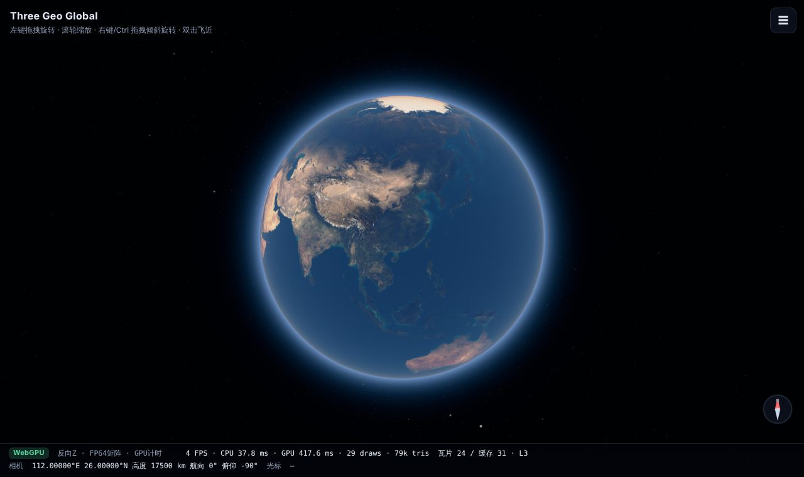 | 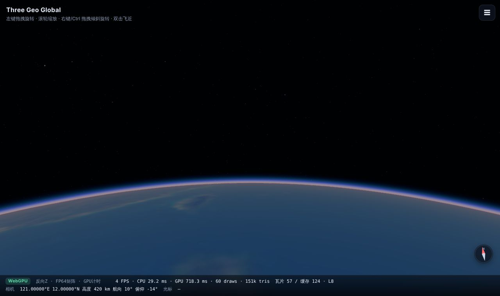 | 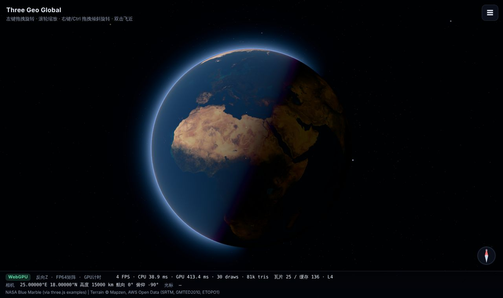 |

| Sunset over Beijing's Western Hills (terrain + atmosphere) | Terrain + quadtree LOD (debug grid) | 3D Tiles fitted to terrain |
| --- | --- | --- |
| 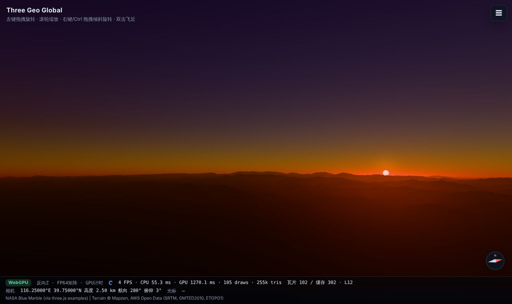 | 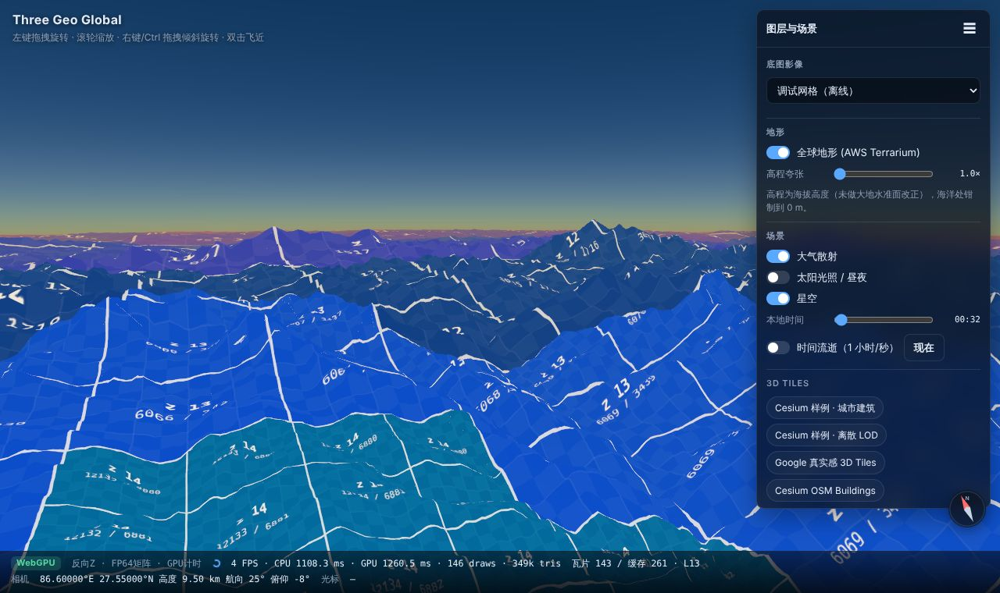 | 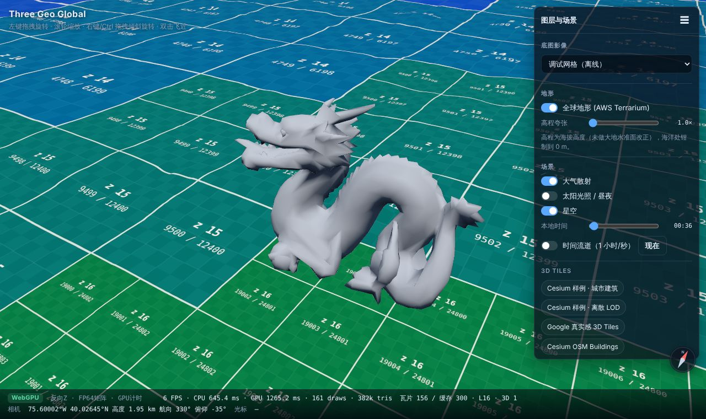 |

| GeoJSON: color-coded country borders + city points + Chinese label decluttering | Clicking a feature: property panel + highlight |
| --- | --- |
| 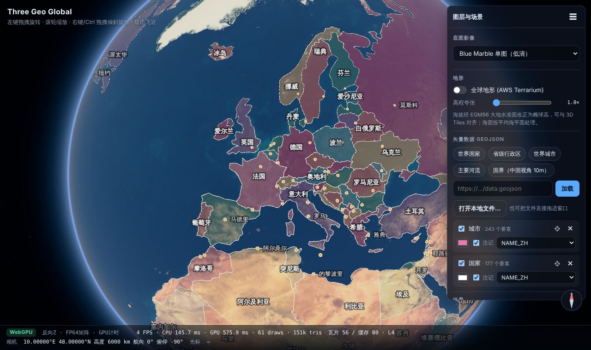 | 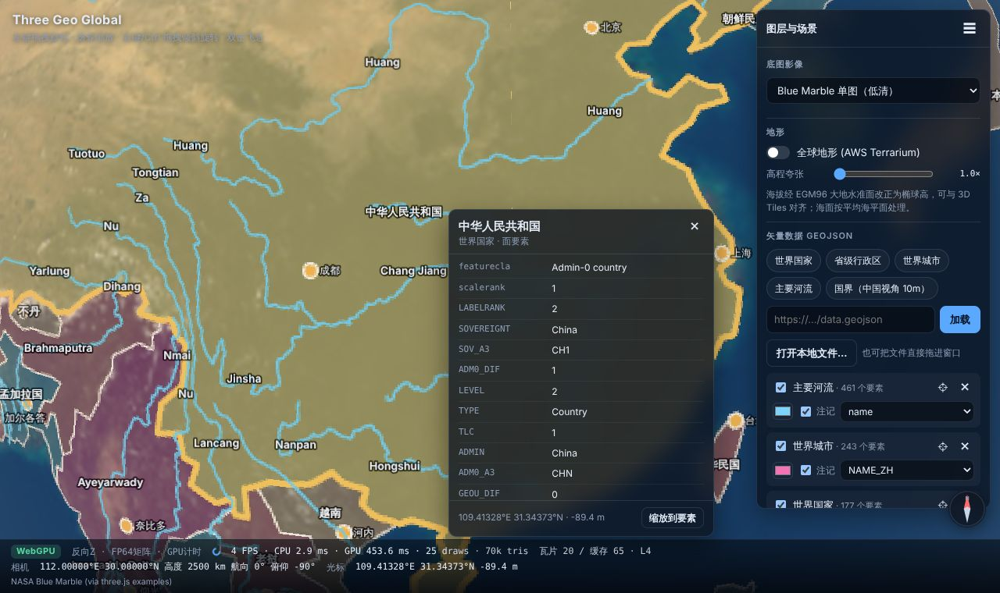 |

| Indoor floor: room / rack / temperature-humidity markers (decluttered) + level bar | Entering a room: highlight + property panel + alarm card |
| --- | --- |
| 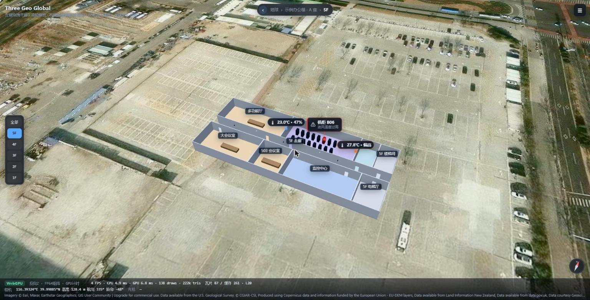 | 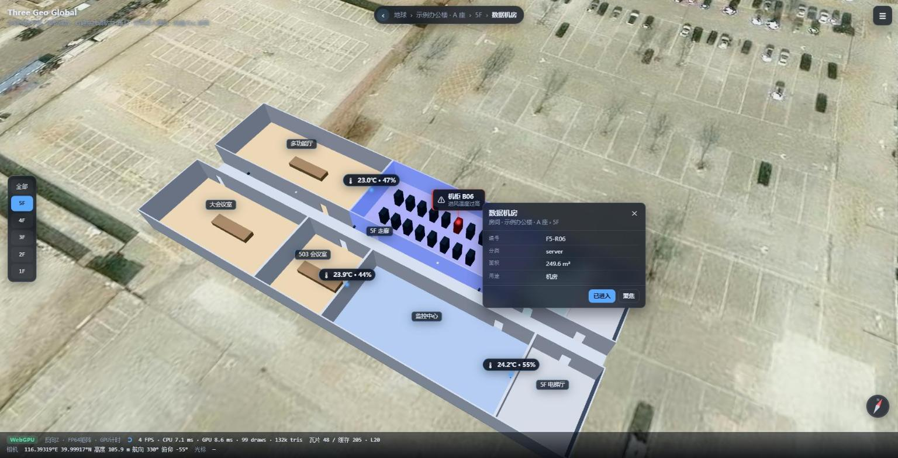 |

> The first two rows of screenshots were produced in headless Chromium (SwiftShader software GPU) with a single Blue Marble image and debug-grid imagery; the indoor screenshots use Chrome WebGPU + ArcGIS imagery + Cesium World Terrain. The screenshots predate the post-processing pipeline, shadows and volumetric clouds, so the current rendering looks different.

## Contents

- [Features](#features)
- [Quick start](#quick-start)
- [Integration examples](#integration-examples)
- [Integration notes](#integration-notes)
- [Compatibility](#compatibility)
- [Documentation](#documentation)
- [Demo app](#demo-app)
- [Architecture](#architecture)
- [Comparison with established products](#comparison-with-established-products)
- [Known limitations](#known-limitations)
- [Roadmap](#roadmap)
- [Developing this repository](#developing-this-repository)
- [Contributing](#contributing)
- [Sponsorship](#sponsorship)
- [License and acknowledgments](#license-and-acknowledgments)

## Features

The parentheses after each item give the entry API; usage is in [docs/api.md](docs/api.md) (Chinese), design details in [docs/agents/](docs/agents/) (Chinese).

### Rendering and precision

- **WebGPU first**: `WebGPURenderer`, falling back to WebGL 2 automatically when WebGPU is unavailable (`forceWebGL` forces it). All shaders are written in TSL, so the same code compiles to WGSL / GLSL; materials of the same kind share a node graph, and all globe tiles compile to a single pipeline.
- **Planet-scale precision**: world coordinates are ECEF (meters), model-view matrices are computed on the CPU in float64, every tile and building carries its own origin (RTC), and labels use high/low splitting (RTE); reversed-Z depth with dynamic near / far planes. No jitter and no Z-fighting from space down to street level.
- **Post-processing pipeline**: every frame goes through `viewer.postProcessing`: the scene is drawn into an HDR target, then the enabled effects run in two stages, linear and display; with no effects the cost is the same as rendering directly. You can register your own `PostEffect`.
- **Idle supersampling and render stop**: once the view has been quiet for 1 second, 16 / 32 sub-pixel jittered samples are averaged into an anti-aliased image, after which no more frames are drawn (when idle, CPU drops to about 1/6 and the GPU is essentially idle); interaction, loading and `requestRender()` resume real-time rendering immediately; nothing is drawn while the container is outside the viewport (`viewer.supersampling`, `idleFrameRate`).
- **Color grading**: exposure, contrast, saturation (`viewer.colorGrading`, preset `COLOR_GRADING_PRESETS.vivid`).
- **GPU memory tiers**: `low` / `medium` / `high` / `ultra` detected from the adapter (override with `gpuTier`), which determine pixel ratio, MSAA, the various caches and budgets, and which effects are on by default; `viewer.memory` estimates the GPU memory it has allocated, and `viewer.snapshot()` outputs a diagnostic snapshot you can attach to issue reports ([gpu-memory.md](docs/agents/gpu-memory.md) (Chinese)).

### Globe, imagery and terrain

- **WGS84 ellipsoid**: Newton-iteration projection, ENU frames, ray intersection, all in float64; geodesy utilities such as `Ellipsoid` and `geodeticToEcef` are exported from the package entry.
- **Quadtree globe**: level selection by screen-space error (how many CSS pixels an imagery texel covers), frustum culling + ellipsoid horizon culling, skirts to hide cracks, polar caps.
- **Loading without flicker or holes** (borrowed from CesiumJS): selection results are remembered; when zooming out, child tiles are kept until the parent's imagery and terrain are ready; child tiles newly entering the view are filled from the parent's quadrant; imagery reveals are merged and siblings cross-fade as a group; terrain mesh swaps go through geometric morphing.
- **Load scheduling**: three independent channels for geometry / imagery / overlay, each with priority buckets and a concurrency limit, with the center of the view first; per-frame upload budget and backpressure; requests leaving the view are cancelled immediately and their connections released; HTTP/1.1 sources are throttled per host; exponential-backoff retries and leaf-first LRU eviction ([tile-loading.md](docs/agents/tile-loading.md) (Chinese)).
- **Imagery sources**: XYZ templates (presets `IMAGERY_PRESETS` such as ArcGIS, OSM, Carto and Tianditu, or a custom `XYZImageryProvider`), a single equirectangular global image, an offline debug grid.
- **Overlay layers**: semi-transparent layers such as Tianditu labels, Esri boundaries and transportation, Carto labels and OpenRailwayMap, with adjustable opacity, order and visibility; together with vectors they are composited into one overlay texture per tile, costing the shader just one extra sample (`OVERLAY_PRESETS`).
- **Terrain sources**: AWS Terrain Tiles (Terrarium, no key needed), Mapbox Terrain-RGB, MapTiler, Cesium World Terrain (ion) and any quantized-mesh service; decoding and meshing happen in a Worker. Terrain data is fetched 3 levels below the mesh (one 256 px heightmap serves 8×8 tiles), and child tiles are shown immediately with a provisional mesh interpolated from an exact ancestor; camera terrain collision only trusts sufficiently detailed terrain.
- **Height datum**: data referenced to mean sea level is corrected to ellipsoidal height with the EGM96 geoid, aligning it with 3D Tiles and GNSS data; one clamp-to-ground query, `viewer.surfaceHeight` (switching to vertical rays against 3D Tiles when the globe is hidden).

### Atmosphere, lighting and weather

- **Physically based atmosphere**: single scattering for Rayleigh + Mie + ozone, sky per pixel and ground aerial perspective per vertex; a map mode (original imagery colors) and a realistic lighting mode (sun position from date and time, day and night, twilight, sunset colors). A starfield that rotates with sidereal time.
- **Lighting follows the atmosphere**: under realistic lighting, the sunlight color and sky light (spherical-harmonics probe) for buildings and 3D Tiles are computed by a CPU version of the same atmosphere model; buildings, equipment, 3D Tiles and globe tiles share the same aerial perspective (`viewer.lighting`, `viewer.date`).
- **Sun shadows**: buildings and equipment cast time-dependent shadows onto themselves, the ground and 3D Tiles; the shadow map is fitted to "buildings ∩ view" and texel-snapped, so edges do not shimmer as the camera moves, and it is redrawn only when something changes (`viewer.shadows`).
- **Clouds**: from afar, a cloud shell covering the whole globe (procedural noise or a custom cloud map, drifting eastward); below about 300 km the camera transitions into **volumetric clouds**: you can look up at them from the ground, fly into them, look down on them from above; clouds are occluded by mountains and buildings, and with lighting on they cast wind-driven cloud shadows on the ground, buildings and 3D Tiles. Low-resolution interleaved tracing plus temporal reprojection; the weather map is redrawn only when it moves (`viewer.clouds`, [volumetric-clouds.md](docs/agents/volumetric-clouds.md) (Chinese)).

### 3D Tiles

- Scheduling based on NASA-AMMOS 3DTilesRendererJS (b3dm / i3dm / pnts / cmpt / glTF, implicit tiling), Draco / KTX2 / Meshopt decoding, Cesium ion and Google Photorealistic 3D Tiles authentication (`viewer.addTileset`).
- **LOD fade under WebGPU**: tile materials are converted to node materials at parse time, and the fade uses a TSL dither mask instead (the official fade plugin relies on `onBeforeCompile`, which does not work under WebGPU).
- **GPU memory budget**: a GPU memory target and decode cache sized by tier, with hidden tiles kept while within budget; distant tiles get a relaxed error at oblique views, and when the cache is full precision is lowered globally rather than loading stopping in patches; automatically suppressed when entering a building.
- **Feature picking and highlighting**: `EXT_mesh_features` / `EXT_structural_metadata` and b3dm / i3dm batch tables; `event.tileFeature()` returns the ID and properties of the feature under the pointer, and `viewer.highlightTileFeature()` highlights it (without changing tile materials).
- Layer management: visibility, fly to layer, height offset, one-click clamp to ground, and binding to a building level (see "Level bindings" below).

### Gaussian splats (3DGS)

- `viewer.addSplats` places `.ply` (INRIA training output), `.splat` and `.spz` (versions 1–4) scenes on the globe: downloaded and decoded in a Worker, keeping the most important splats according to the GPU memory tier (0.5–6 million), and drawn with three.js's built-in `GaussianSplat` (sorting in a WebGPU compute shader, with a WebGL fallback).
- **Geo-anchoring**: longitude/latitude, clamped to ground or ellipsoidal height, heading / pitch / roll, scale, the file's axis convention, pivot, all changeable at any time; outliers do not affect framing or sorting precision.
- **Interaction**: click / hover events (`e.kind === 'splats'`); wheel zoom to cursor and right-button orbit land on the splat surface (BVH picking, under 0.1 ms per ray); box / sphere cropping; fly to scene ([splats.md](docs/agents/splats.md) (Chinese)).

### GeoJSON vectors and labels

- All geometry types are supported, from a URL, a file or an object; parsing, projection, antimeridian unwrapping and spatial indexing all run in a Worker, so large files do not block the main thread (`viewer.addGeoJson`).
- Lines, polygons and points are rasterized per globe tile into the overlay texture, **draped on terrain** with no Z-fighting, and only affected tiles are redrawn.
- Styling: layer-level fill / stroke / point styles, categorical coloring by property, compatible with simplestyle-spec.
- Labels: name fields detected automatically (Chinese preferred), polygons placed at the pole of inaccessibility and lines at their midpoint, shown by rank, with screen-space decluttering and fade in/out, and occlusion by the horizon and terrain.
- Click queries: point-in-polygon / point-to-line distance tests in the Worker, returning properties and highlighting the feature.

### Markers and point layers

- **HTML markers**: anchored at world coordinates and projected in float64 every frame; horizon, distance and viewport culling, priority-based decluttering; display modes (always / after entering a level / on hover / on click); hidden or faded when occluded by buildings or terrain (`MarkerManager`).
- **Point layers**: GeoJSON points, record arrays or point documents; 8 styles (card, teardrop pin, tag, POI, pulse, beacon, badge, text), property-based style rules and text templates, automatic clamping to ground; hierarchical cluster tree (click to zoom in), grid-based decluttering, and an automatic lean mode for large volumes (`viewer.addPoints`, [markers.md](docs/agents/markers.md) (Chinese)).

### Indoor / BIM

- **Building documents** `*.building.json`: building → floor → room / component / equipment, with the hierarchy aligned to the IFC spatial structure; a geographic anchor (clamped to ground when height is omitted); property sets, classifications, tags, viewpoints; validation errors with JSON paths ([building data manual](docs/building-data-manual.md) (Chinese)).
- **Geometry**: procedurally generated (floor slabs, rooms colored by category, walls with door openings, equipment primitives, glass curtain-wall shell) or glTF (mapped to entities by node name / `extras.id`). Floor and equipment models are loaded only when the floor is first shown, and unloaded when hidden floors exceed the GPU memory budget.
- **Level navigation**: double-click to enter, right-click / Esc / breadcrumbs to go back; transitions step along the level path one level at a time (cancellable, can skip levels), each level emitting `beforeEnterLevel` / `enterLevel` / `leaveLevel`; viewpoints are cached when drilling down and flown back to on return; during a transition the previous frame is reprojected by depth onto the moving camera and dissolved (`viewer.indoor.enter`).
- **Level control policies**: visibility, sibling translucency, picking mapping and framing at each level can all be replaced by selector + priority (`indoor.registerLevelControl`).
- **Entity API**: selector expressions (`.room && [温度>26]`, `tags:or(alarm, camera)`, `!` and parentheses, cached once compiled), chained queries and batch styling (`indoor.query` → `EntitySet`), visibility, style, bounding volumes, properties.
- **Level bindings**: Gaussian splat and 3D Tiles layers can be attached to a building, floor, room or piece of equipment, loaded and shown only when the corresponding level is entered, and move with the entity; the entity's own model can stay, fade or give way, and after giving way it can still be clicked, outlined and carry markers (the `level` option, `indoor.bindings`, [indoor-bim.md](docs/agents/indoor-bim.md) (Chinese) §6.5).
- **Visuals**: selection, hover and alarms are shown with outlines (see-through, blinking) and selective bloom, without changing materials (`entity.effects`, `viewer.effects`); floor ambient occlusion is baked once when a floor is first shown, adding no per-frame cost; transparent building surfaces can optionally use order-independent transparency (`viewer.transparency`, WebGPU); a showcase backdrop appears when there is no ground surface.
- **Scale**: equipment is batched by floor × geometry × material (10,000 devices in about 40 draw calls, about 9 ms/frame); optional contribution culling skips equipment that is too small on screen (`indoor.culling`, off by default).

### Local scene (sandbox)

- Shows only one region of the globe (circle, rectangle or polygon, at most 100 km across); nothing outside the region is drawn or loaded, there is a soil side wall around the edge and a showcase or space backdrop, and the camera is kept within the area around the region; globe tiles, 3D Tiles, picking and clamping to ground are all clipped to the region (`viewer.localScene.enter({ region })`, [local-scene.md](docs/agents/local-scene.md) (Chinese)).

### Interaction and camera

- **Unified events**: `viewer.interaction.on('click' | 'dblclick' | 'rightclick' | 'mousemove' | 'mouseenter' | 'mouseleave', fn, { selector, tag, priority, once })`; selector bubbling, batch unregistration by tag, priorities, `stopPropagation()`, `preventDefault()` to block default behavior, `pause()` for temporary blocking; clicks on markers are proxied into events on the entity.
- **Picking**: under WebGPU, a GPU pick buffer (object, instance, depth, normal; hover queries independent of scene size), automatically falling back to raycasting when the buffer is stale or under WebGL; the globe, 3D Tiles, buildings and splats all yield one kind of pick result (`viewer.pick` / `pickAt`).
- **Camera controller**: zero roll, a heading algorithm that does not flip when looking straight down, zoom at cursor preserving heading and pitch, right button for heading / pitch, pitch limits, gesture toggles, inertia, touch, keyboard (only when the viewer has focus), terrain collision based on reliable terrain ([camera-controller.md](docs/agents/camera-controller.md) (Chinese)).
- **Camera motion**: `flyTo`, `flyToTarget`, `flyToSphere`, `flyToEntity`, `flyToBBox` (great-circle arc flights, look-at flights between levels), orbit tours, an intro spin animation (`viewer.playIntro`), scripted animations that gestures can interrupt (`controller.playAnimation`).
- **Navigation commands**: zoom in, zoom out, rotate, tilt / top-down toggle, north up, return to the initial view, auto-rotate, fullscreen, screenshot; no UI included, the host app builds its own buttons (`viewer.navigation`, [intro-and-navigation.md](docs/agents/intro-and-navigation.md) (Chinese)).

### Embedding

- **Container**: any element with a size, following size changes automatically; multiple viewers can share a page (WebGPU and WebGL can be mixed), and after `dispose()` GPU resources, Workers and listeners all go back to zero.
- **Styles and theming**: every element the SDK creates uses the `tv-` class prefix, and theming is done with `--tv-*` variables, with no dependence on the host page's global styles.
- **Language and errors**: UI strings built in for `zh-CN` (default) and `en`, each overridable (`locale`, `messages`); errors are `TerraViewError` (English message + stable `code` + `details`).
- **Load state**: `viewer.loadState` aggregates the globe, 3D Tiles and every layer, with `load-progress` / `idle` / `error` events, so the host app does not have to poll each subsystem.
- **API tiers**: exports come in three tiers, stable / advanced (`@advanced`, touching three objects directly) / internal, and the published type declarations contain only the first two ([docs/api.md](docs/api.md) (Chinese) §2).

## Quick start

```bash
npm install terra-viewer three@0.187.0 3d-tiles-renderer@0.5.4
npm install -D @types/three@0.187.0        # when using TypeScript
```

You can also download `terra-viewer-0.2.0.tgz` from the GitHub Release, or pack it yourself from this repository:

```bash
# In this repository
npm install && npm run build && npm pack    # produces terra-viewer-0.2.0.tgz

# In the host project
npm install /path/to/terra-viewer-0.2.0.tgz three@0.187.0 3d-tiles-renderer@0.5.4
```

`three` and `3d-tiles-renderer` are peer dependencies and are not bundled into the package: when the host app also uses three, the page has only one copy. three does not follow semver, so the version range is pinned to 0.187.x.

Minimal setup:

```ts
import 'terra-viewer/style.css';
import { AWS_TERRARIUM, GeoViewer, IMAGERY_PRESETS } from 'terra-viewer';

const viewer = await GeoViewer.create({
  container: document.getElementById('map')!, // any element with a size; it need not fill the window
  imagery: IMAGERY_PRESETS[0].create(),       // base map, required
  terrain: AWS_TERRARIUM,                     // terrain, optional
  initialView: { longitude: 116.397, latitude: 39.916, height: 3000, heading: 0, pitch: -40 }, // degrees, meters
});
```

## Integration examples

### Layers and events

```ts
viewer.lighting = true; // compute the sun position from viewer.date; turns on realistic lighting and shadows

viewer.addTileset({ source: { type: 'url', url: 'https://example.com/tileset.json' } });

const countries = viewer.addGeoJson({
  url: 'https://example.com/countries.geojson',
  style: { colorBy: 'MAPCOLOR7', fillOpacity: 0.2, stroke: '#ffffff' },
  label: { field: 'NAME_ZH' },
});
countries.events.on('ready', (summary) => viewer.flyToBBox(summary.bbox!));

viewer.addPoints({
  data: [{ lon: 116.3972, lat: 39.9163, name: 'Forbidden City', status: 'alarm' }],
  style: { style: 'poi', title: '{name}' },
  rules: [{ when: { status: 'alarm' }, style: { style: 'pulse', color: '#ff4d4f', badge: 'Alarm' } }],
});

const splats = viewer.addSplats({
  url: 'https://example.com/scene.spz',
  position: { longitude: 116.39, latitude: 39.91 }, // no height: stands on the ground
  heading: 30,
});
splats.events.on('ready', () => splats.flyTo());

viewer.interaction.on('click', (e) => {
  if (e.kind === 'tiles') console.log(e.tileFeature()?.properties);
  if (e.kind === 'splats') console.log(e.splats?.name, e.cartographic);
}, { tag: 'app' });
```

### Load state and errors

```ts
import { isTerraViewError } from 'terra-viewer';

viewer.events.on('idle', () => console.log('Current view finished loading'));
viewer.events.on('error', ({ source, error, layer }) => {
  // source: 'imagery' | 'terrain' | 'tileset' | 'geojson' | 'points' | 'splats'
  const code = isTerraViewError(error) ? error.code : 'unknown';
  showToast(`${source} failed to load (${code})`, layer);
});
```

### Indoor / BIM

```ts
const building = viewer.indoor.add(await (await fetch('/office.building.json')).json());

viewer.indoor.events.on('enterLevel', ({ object }) => console.log('Entered', object?.name ?? 'globe'));
await viewer.indoor.enter(building); // you can also go straight to a floor or room: transitions step along the path

viewer.indoor.query('.room && [category=meeting]').setStyle({ color: '#ffd166' });
viewer.indoor.query('tags:or(alarm)').setEffects({ outline: 'alarm', glow: 0.6 });

viewer.interaction.on('click', (e) => openPanel(e.entity?.properties), { selector: '.thing', tag: 'app' });

// Block interaction while a dialog is open (including the camera's double-click fly-in), restore when it closes
const resume = viewer.interaction.pause({ blockDefault: true });
```

### Local scene, clouds and navigation

```ts
await viewer.localScene.enter({ region: { type: 'circle', center: [116.39, 39.91], radius: 3000 } }); // meters
viewer.clouds.set({ volumetric: { enabled: true, bottom: 1500, thickness: 1200 } });                 // meters
viewer.navigation.home();
await viewer.playIntro();
```

### Multiple viewers and disposal

```ts
const left = await GeoViewer.create({ container: leftEl, imagery: IMAGERY_PRESETS[0].create() });
const right = await GeoViewer.create({ container: rightEl, imagery: IMAGERY_PRESETS[0].create(), forceWebGL: true });

// When leaving the page or unmounting the component: stop the render loop, release GPU resources, Workers and listeners, remove the canvas, restore the container
left.dispose();
right.dispose();
```

Each viewer has its own camera, layers and events; the only things shared on a page are those shared on purpose, such as request queues and read-only node graphs ([docs/api.md](docs/api.md) (Chinese) §4).

## Integration notes

Details in [docs/api.md](docs/api.md) (Chinese) §1.

- **Styles**: `terra-viewer/style.css` covers only elements the SDK itself creates (canvas, markers), and all class names start with `tv-`; theme with `--tv-font` / `--tv-text` / `--tv-muted` / `--tv-card-bg` / `--tv-accent`. Panels, status bars and other UI are built by the host app (see `demo/ui/` for reference).
- **Container**: `GeoViewer` adds the `tv-viewer` class to the container; if the container is `position: static` it becomes `relative`, and if it has no `tabindex` it is set to `-1` (to receive keyboard input). Restored on `dispose()`.
- **Keyboard**: camera shortcuts (WASD / arrow keys / QERF) only work when the viewer has focus; `window` is not listened to. To use the keyboard right away, call `viewer.canvas.focus()`.
- **On-demand rendering**: once the view is still, the viewer stops drawing frames. Changes made through the SDK API wake it up automatically; **after changing three objects or materials in `viewer.scene` directly, bypassing the SDK, call `viewer.requestRender()`**.
- **Camera**: do not change the pose of `viewer.camera` directly; use `setView` / `flyTo` / `viewer.navigation` / `controller.playAnimation`, otherwise gestures cannot interrupt the motion and no redraw is triggered.
- **Coordinates and units**: longitude, latitude, heading and pitch in the public API are in degrees, heights are WGS84 ellipsoidal heights (meters), and parameters of type `Vector3` are ECEF (meters).
- **Workers**: the package's Workers are separate files referenced with `new URL(..., import.meta.url)`; Vite 8 and webpack 5 need no extra configuration.
- **Decoders**: Draco / KTX2 decoders default to the copies that ship with the three.js installed by the host app; pass `decoderPath` / `transcoderPath` to serve them from a CDN or static directory.
- **Credentials**: keys for Tianditu, Cesium ion, Google and Mapbox are passed in by the host app; the SDK neither stores nor bundles them.

## Compatibility

| Item | Requirement |
| --- | --- |
| Peer dependencies | `three` 0.187.x, `3d-tiles-renderer` 0.5.x; TypeScript host apps also install `@types/three@0.187.0` |
| Browsers | Chrome / Edge 113+ use WebGPU; other browsers with WebGL 2 fall back automatically. The GPU pick buffer and order-independent transparency are WebGPU only |
| Module format | ES modules only (no CommonJS / UMD) |
| Bundlers | Tested with Vite 8 (dev and build) and webpack 5, including Workers and Draco / KTX2 / Meshopt decoding |
| Building this repository | Node 20.19+ / 22.12+ |

## Documentation

The docs site [yoy0o.github.io/TerraView](https://yoy0o.github.io/TerraView/) is generated from `docs/` (VitePress, published by `.github/workflows/pages.yml` on pushes to main) and also hosts the examples and the demo app.

| Document | Contents |
| --- | --- |
| [docs/guide/](docs/guide/) (Chinese) | User manual (for developers integrating the SDK): quick start, basic concepts, chapters by feature, each with a runnable example ([examples/](examples/)), plus an FAQ |
| [docs/api.md](docs/api.md) (Chinese) | Public API: setup, container, styles, language and errors, load state, frame rate, post-processing, lighting, shadows, local scene, volumetric clouds, Gaussian splats; export list and tiers; multiple viewers |
| [docs/building-data-manual.md](docs/building-data-manual.md) (Chinese) | Building data manual (for data staff): coordinates, fields, categories, models, self-checks; sample [sample-office.building.json](docs/examples/sample-office.building.json) |
| [docs/en/releases/](docs/en/releases/) | Release notes for each version ([Chinese](docs/releases/)) |
| [CHANGELOG.md](CHANGELOG.md) (Chinese) | All changes, by version and topic |
| [docs/agents/](docs/agents/) (Chinese) | Subsystem specs: camera, tile loading, indoor BIM, markers, intro and navigation, GPU memory, local scene, volumetric clouds, Gaussian splats, roadmap, progress log |
| [AGENTS.md](AGENTS.md) (Chinese) | Development conventions and lessons learned (required reading for contributors) |
| [CONTRIBUTING.en.md](CONTRIBUTING.en.md) | Contributing guide: environment, branches and commits, verification, keeping docs in sync ([简体中文](CONTRIBUTING.md)) |
| [SECURITY.md](SECURITY.md) · [CODE_OF_CONDUCT.md](CODE_OF_CONDUCT.md) | How to report security issues, code of conduct (bilingual Chinese and English) |

This README is also available in [Simplified Chinese](README.md). The docs site has an [English entry](https://yoy0o.github.io/TerraView/en/) with the home page, quick start, release notes and sponsor page; the full user manual and API reference are currently Chinese only.

## Demo app

```bash
npm install
npm run dev          # http://localhost:5173 (demo/, uses src/ directly)
npm run examples:dev # http://localhost:5175 (examples/, examples split by feature)
npm run docs:dev     # docs site (embedded examples come from examples:dev)
```

Online: [demo app](https://yoy0o.github.io/TerraView/demo/), [examples](https://yoy0o.github.io/TerraView/examples/).

### URL parameters

| Parameter | Effect |
| --- | --- |
| `?webgl` | Force the WebGL 2 backend |
| `?imagery=osm` | Base map: `esri-imagery` `osm` `carto-voyager` `carto-dark` `esri-topo` `tianditu-img` `blue-marble` `debug` |
| `?noterrain` | Start with terrain off (switch terrain sources in the panel) |
| `?gpu=low\|medium\|high\|ultra` | Set the GPU memory tier |
| `?tileset=<url>` | Load a 3D Tiles tileset (tileset.json) |
| `?geojson=<url>` | Load GeoJSON (repeatable) |
| `?points=<url>` | Load a point layer: GeoJSON point features or a record array with lon / lat fields (repeatable) |
| `?splats=<url>` | Load Gaussian splats (`.ply` / `.splat` / `.spz`); `?splatsAt=lon,lat[,ellipsoidal height]`, `?splatsScale`, `?splatsHeading`, `?splatsUp=-y\|+y\|+z`, `?splatsMax` |
| `?demo` | Load and enter the procedurally generated sample office building (5 floors, rooms / equipment / sensors / server room alarm) |
| `?building=<url>` | Load a building document (format in the [building data manual](docs/building-data-manual.md) (Chinese)) |
| `?region=circle:lon,lat,radius km` / `rect:west,south,east,north` / `poly:lon,lat;…` | Enter a local scene; `?regionLook=sandbox\|float\|dim` |
| `?intro=0\|1` `?introDuration` `?introSpeed` `?introZoom` | Intro animation |
| `?clouds=0\|1` `?cloudCoverage` `?cloudOpacity` `?cloudSpeed` `?cloudHeight` `?cloudTexture=<url>` | Cloud shell |
| `?cloudVolumetric=0\|1` `?cloudBase` `?cloudThickness` `?cloudWind` `?cloudWindHeading` `?cloudDensity` `?cloudShadows=0\|1` | Volumetric clouds |
| `?shadows=0\|1` `?oit=0\|1` `?ao=0\|1` `?aoIntensity` | Sun shadows, order-independent transparency, floor ambient occlusion |
| `?ss=0\|1` `?ssSamples=4–64` `?idleFps=0\|10–60` `?grade=neutral\|vivid` | Idle supersampling, idle frame rate, color grading |
| `?tileCache=0\|1` | Persistent tile cache (IndexedDB; survives sessions and works offline; usage and clearing in the panel) |
| `?cull=1` `?cullThreshold` `?cullHysteresis` `?cullInterval` `?cullSelector` | Equipment contribution culling |
| `#lon,lat,height,heading,pitch` | Camera position (updated as you browse, so the link can be shared directly) |

In the browser console, `window.viewer` is the `GeoViewer` instance.

### Controls

- Left-drag: grab the ground and pan (the point under the cursor stays under it), with inertia on release
- Wheel / pinch: zoom toward the cursor, **keeping the current heading and pitch** (top-down stays top-down, no flipping)
- Right-, middle- or Ctrl/Shift + left-drag: **horizontal adjusts heading, vertical adjusts pitch** (around the screen center by default)
- Double-click: enter a building / floor / room, otherwise fly toward that point; **right-click or Esc: go back one level**
- Click a building, room, piece of equipment, 3D Tiles feature or vector feature: highlight it and open the property panel
- Button bar at the bottom right: zoom in, zoom out, north up, tilt / top-down, return to the initial view, auto-rotate, fullscreen, screenshot
- Drag a `.geojson` / `.json` / `.building.json` / `*.points.json` / `.ply` / `.splat` / `.spz` file into the window to load it
- Keyboard: WASD / arrow keys to pan, Q/E to turn, R/F to pitch

## Architecture

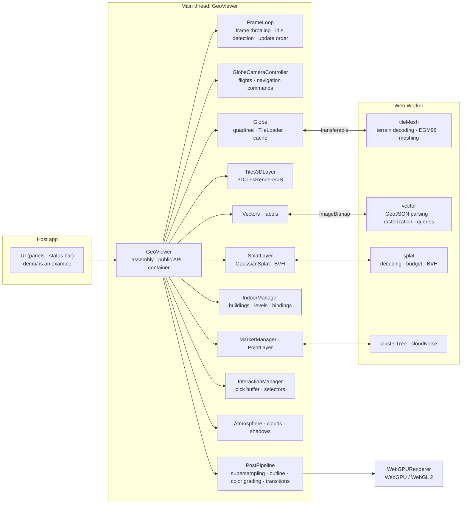

```
src/            SDK source, built into the npm package
├─ index.ts     Package entry: the public API is exported only from here
├─ style.css    SDK styles (terra-viewer/style.css, class prefix tv-)
├─ core/        Ellipsoid, geodesy, EGM96, sun position, events, language, errors, GPU memory tiers
├─ globe/       Quadtree globe, load scheduling, imagery sources, terrain sources (terrain/), tile materials, Worker meshing
├─ atmosphere/  Atmospheric scattering nodes and CPU version, lighting that follows the atmosphere, starfield
├─ clouds/      Cloud shell, volumetric clouds, noise Worker
├─ lighting/    Sun shadows, cloud shadows
├─ tiles3d/     3D Tiles layer, node materials and fade, LOD policy, feature picking
├─ splats/      Gaussian splats: format decoding (Worker), budget, BVH picking, geo-anchoring
├─ vector/      GeoJSON layer, vector Worker, labels
├─ indoor/      Building documents, entities and selectors, building construction, batching, level navigation and bindings, floor AO
├─ markers/     HTML markers, occlusion, style templates, point layers and clustering
├─ region/      Region math and shared clipping mask for local scenes
├─ local/       Local scene: side walls, dimming outside the region, orchestration
├─ post/        Post-processing pipeline, outline, glow, supersampling, color grading, level transitions, transparency blending
└─ viewer/      GeoViewer and its parts, camera controller and flights, navigation, interaction, pick buffer
demo/           Demo app, not in the package: main.ts, ui/, data/ (sample building, points, splat scene URLs)
tests/          vitest unit tests; tests/e2e/ is the Playwright browser smoke test
```

Dependencies between directories may only go bottom-up (core → … → viewer), checked by `npm run check:layers`; the rules are in [AGENTS.md](AGENTS.md) (Chinese) §2.1.

## Comparison with established products

| Capability | CesiumJS | Google Earth Web | Mapbox GL JS (globe) | ArcGIS JS SceneView | **TerraView 0.2** |
| --- | --- | --- | --- | --- | --- |
| Rendering backend | WebGL 2 | WebGL / Wasm | WebGL 2 | WebGL 2 | **WebGPU first**, WebGL 2 fallback |
| Shading language | GLSL | Internal | GLSL | GLSL | **TSL → WGSL / GLSL** |
| Ellipsoid + high precision | ✅ RTC / RTE | ✅ | Approximate sphere | ✅ | ✅ FP64 matrices + RTC |
| Imagery tiles | ✅ Multi-layer compositing | Built in | ✅ Mainly vector tiles | ✅ | ✅ Base map + overlay layers |
| Terrain | ✅ quantized-mesh | ✅ | ✅ raster-dem | ✅ | ✅ Terrarium / Terrain-RGB / quantized-mesh + EGM96 |
| 3D Tiles | ✅ Native | Proprietary format | Proprietary 3D format | ✅ I3S / 3D Tiles | ✅ 3DTilesRendererJS + feature picking |
| Gaussian splats | ✅ Embedded in 3D Tiles | — | — | — | ✅ Single file (`.ply` / `.splat` / `.spz`) |
| Atmosphere / day-night | ✅ | ✅ | Stylized | ✅ | ✅ Physical scattering + date-based sun |
| Clouds | Cloud billboards | Cloud layer | — | ✅ Weather | ✅ Global cloud shell + near-ground volumetric clouds and cloud shadows |
| Vectors / labels | ✅ | ✅ | ✅ Strength | ✅ | ✅ GeoJSON draped on terrain + label decluttering + point clustering |
| Indoor / BIM levels | Build your own | ❌ | ❌ | ✅ Floor filter | ✅ Building → floor → room, events, markers, level bindings |
| Shadows / post-processing | ✅ | ✅ | Partial | ✅ | ✅ Sun shadows, outline, bloom, idle supersampling (no SSAO / TAA yet) |
| Local scene (sandbox) | Clipping planes | — | — | ✅ Local scene | ✅ Region clipping + side walls |

The columns for other products reflect a rough impression from public documentation, not a version-by-version verification; "—" means not verified.

Positioning: a globe foundation in the three.js ecosystem that "understands geography like Cesium and extends as easily as three.js", written the WebGPU way from day one (TSL, shared node graphs, bind group / pipeline reuse).

## Known limitations

- Imagery (base map and overlays) only supports Web Mercator tiles; beyond ±85.05° the poles are covered with solid-color caps.
- Decoding and resampling for Cesium ion / quantized-mesh, Mapbox and MapTiler are unit tested but have seen little validation over real networks; ion access tokens expire after about 1 hour.
- Interpolation error at coarse levels is large in mountainous areas, so provisional (interpolated) terrain spans at most 3 levels; terrain normals at tile borders use central differences across the neighbor's data, except where a terrain source tile itself ends (about every 8th tile with raster terrain), so subtle seams may still be visible there with lighting on.
- 3D Tiles imagery overlays (ImageOverlayPlugin) rely on `onBeforeCompile` and are unavailable under WebGPU; point clouds (pnts) render as 1-pixel points under WebGPU; features cannot be picked in datasets that store feature IDs in textures.
- Gaussian splats: a single file is loaded as a whole, with no tiled streaming; splats do not write depth, so they do not occlude markers, and their ordering relative to translucent objects may be wrong; compressed PLY, `.ksplat`, SOG and splats embedded in glTF / 3D Tiles are not yet supported; frame rates on real GPUs have not been measured systematically ([splats.md](docs/agents/splats.md) (Chinese)).
- Indoor: reading IFC directly, section cuts and indoor navigation are not yet supported.
- When the globe is hidden (e.g. when loading Google 3D Tiles), clamping to ground switches to vertical rays against 3D Tiles; an anchor that lands exactly on a photogrammetry roof or tree canopy will snap onto it, so give the height explicitly in the data for such locations ([building data manual](docs/building-data-manual.md) (Chinese) §3.3).
- Vectors are rasterized per tile to drape on terrain: lines briefly look blurry during tile transitions; vector tiles (MVT), polygon extrusion and labels along lines are not yet supported; labels are not occluded by 3D Tiles buildings.
- Markers are DOM elements and are not suited to tens of thousands of items or values that refresh at high frequency.
- The sample country borders are Natural Earth's "de facto boundaries" and **not an officially approved map**; publishing in China requires map data with an official map approval number (China).
- The default base map / terrain services are for development and demos only; in production use your own services or obtain the appropriate authorization (OSM tile usage policy, Esri terms, Tianditu key, etc.).

## Roadmap

The detailed plan is in [docs/agents/roadmap.md](docs/agents/roadmap.md) (Chinese), and progress in [docs/agents/progress-log.md](docs/agents/progress-log.md) (Chinese). Next directions:

- **Data**: vector tiles (MVT), polygon extrusion (massing models), labels along lines; reading IFC directly (web-ifc) and per-floor streaming; tiled streaming and more formats for Gaussian splats.
- **Visuals**: precomputed atmosphere LUTs (Hillaire 2020), screen-space ambient occlusion, sun shadows for terrain and 3D Tiles.
- **Scale**: GPU-driven culling and indirect drawing, compute-shader-driven large dynamic layers (trajectories, particles, heatmaps), large numbers of value markers.
- **Productization**: measurement tools, viewpoint tour recording and playback, section planes / section boxes, 3D Tiles clipping and flattening, adaptation for Chinese data (GCJ-02, CGCS2000).

## Developing this repository

```bash
npm install
npm run dev            # demo app http://localhost:5173
npm test               # unit tests (vitest)
npm run build          # typecheck + library build (dist/: terraview.js, terraview.css, assets/*.worker.js, types/)
npm run build:demo     # production build of the demo app (dist-demo/)
npm run build:examples # production build of the examples (dist-examples/)
npm run verify         # typecheck + layer check + test + build + build:demo + build:examples; run before committing
npm run check:package  # pack and install into a temporary host project to check it (includes size budget; needs network; build first)
npm run smoke:build && npm run smoke   # Playwright browser smoke test (demo app and packed host, WebGL / WebGPU; all examples)
npm run site:build     # docs site: manual + examples + demo app (dist-site/)
```

- Development conventions and lessons learned: [AGENTS.md](AGENTS.md) (Chinese) (referenced by `CLAUDE.md`).
- Dependencies are pinned to exact versions (three r187, 3d-tiles-renderer 0.5.4, Vite 8); discuss before upgrading. `.npmrc` sets `legacy-peer-deps=true`: npm has a resolution bug in the optional peer dependency cycle of Vite 8 + Vitest 5.
- `scripts/generate-egm96.mjs`: regenerates `src/core/egm96Grid.ts` from NGA EGM96 (via the `egm96-universal` package).

### Continuous integration and releases

- **CI** (`.github/workflows/ci.yml`): every push to `main` and every PR runs typecheck, layer check, unit tests, library build, and demo and examples builds on Node 22 and 24; it then installs the packed package into a host project to check it (including the size budget) and runs the browser smoke test with Playwright.
- **Docs site** (`.github/workflows/pages.yml`): on pushes to `main`, builds the manual, examples and demo app and publishes them to GitHub Pages; PRs only build (checking for dead links).
- **Release** (`.github/workflows/release.yml`): pushing a tag matching the `package.json` version (e.g. `v0.2.0`) verifies, then creates a GitHub Release whose body is taken from `docs/releases/v<version>.md`, with the tgz attached. A tag push also publishes to npm (authenticating with the repository secret `NPM_TOKEN`, or npm trusted publishing when it is absent; this step is skipped when `package.json` has `"private": true`), then checks that the version actually reached the registry (it fails if the version only landed in npm's staging area; re-run after approving it). Running it manually from the Actions page is a dry run that neither creates a Release nor publishes. Release steps are in [AGENTS.md](AGENTS.md) (Chinese) §8.5.
- **Package name**: `terra-viewer`. The original name `terra-view`, with the hyphen removed, matches the existing npm package `terraview`, so npm would not allow publishing it; renamed on 2026-11-25.

## Contributing

Questions, feature requests and code contributions are all welcome:

- **Report a bug**: use the [bug template](https://github.com/Yoy0o/TerraView/issues/new?template=bug_report.yml) and include the browser, GPU, backend (WebGPU / WebGL) and the output of `viewer.snapshot()`.
- **Suggest a feature**: use the [feature request template](https://github.com/Yoy0o/TerraView/issues/new?template=feature_request.yml) and start with the scenario you want to solve.
- **Contribute code**: read the [contributing guide](CONTRIBUTING.en.md) ([简体中文](CONTRIBUTING.md)) and run `npm run verify` before committing.
- **Security issues**: do not open a public issue; report privately as described in [SECURITY.md](SECURITY.md).

By participating in this project you agree to abide by the [code of conduct](CODE_OF_CONDUCT.md).

## Sponsorship

TerraView is developed by an individual maintainer in their spare time and is free and open source. If it has saved you time, sponsorship is welcome and supports further feature development, testing on real GPUs and documentation upkeep.

| WeChat Pay | PayPal |
| :---: | :---: |
|  |  |

You can add your GitHub username as a note with the transfer so you can be listed among the acknowledgments. For corporate sponsorship, custom development or technical support, please open an issue describing what you need. If sponsoring isn't convenient, starring the repo, using it in your projects, and reporting problems and improvements are just as much appreciated. See the [sponsor page](docs/en/sponsor.md) for details.

## License and acknowledgments

Apache-2.0, see [LICENSE](LICENSE). Copyright notices for ported code and embedded data are in [THIRD_PARTY_NOTICES.md](THIRD_PARTY_NOTICES.md).

three.js · NASA-AMMOS 3DTilesRendererJS · CesiumJS (methods for tile selection, horizon culling, etc.) · Mapzen / AWS Terrain Tiles · NGA EGM96 · Esri / OpenStreetMap / CARTO / Tianditu (base maps) · CesiumGS 3d-tiles-samples (sample data) · Bruneton & Neyret, Hillaire, Schüler, Schneider (atmosphere and cloud rendering methods)
