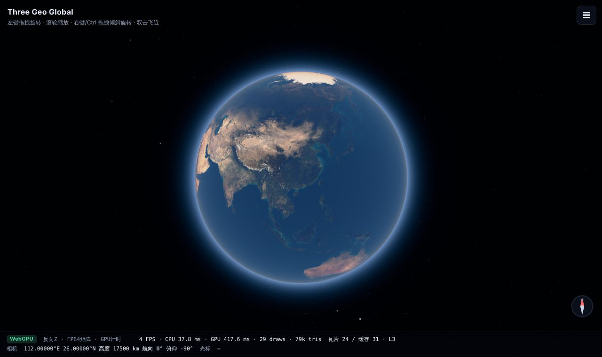
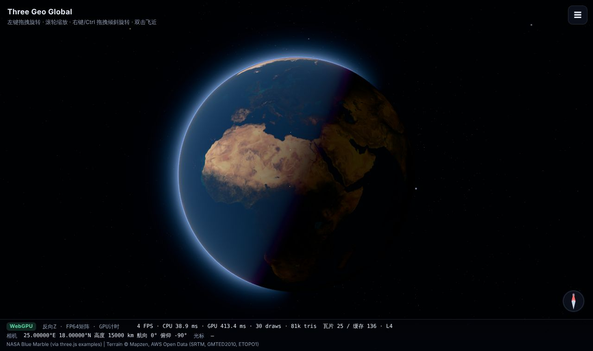
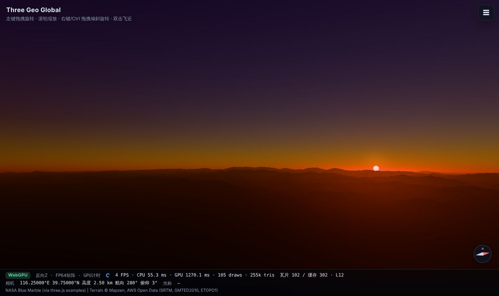
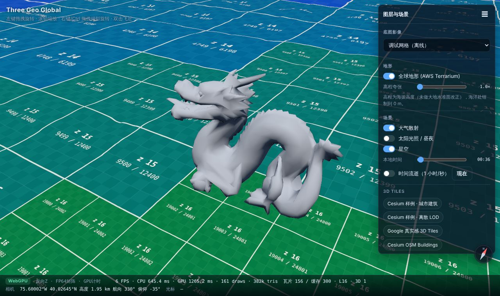
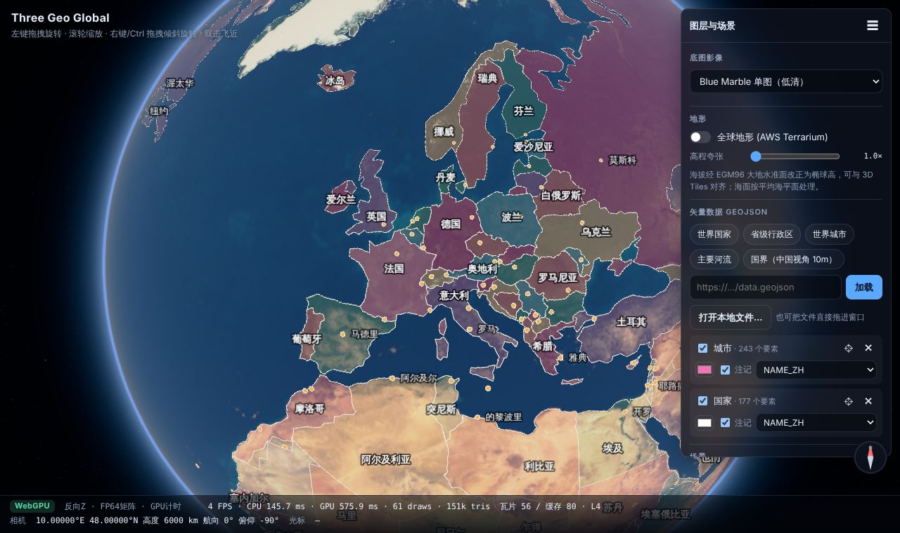
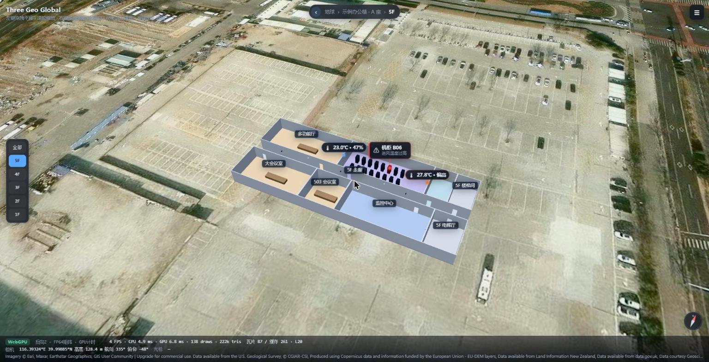
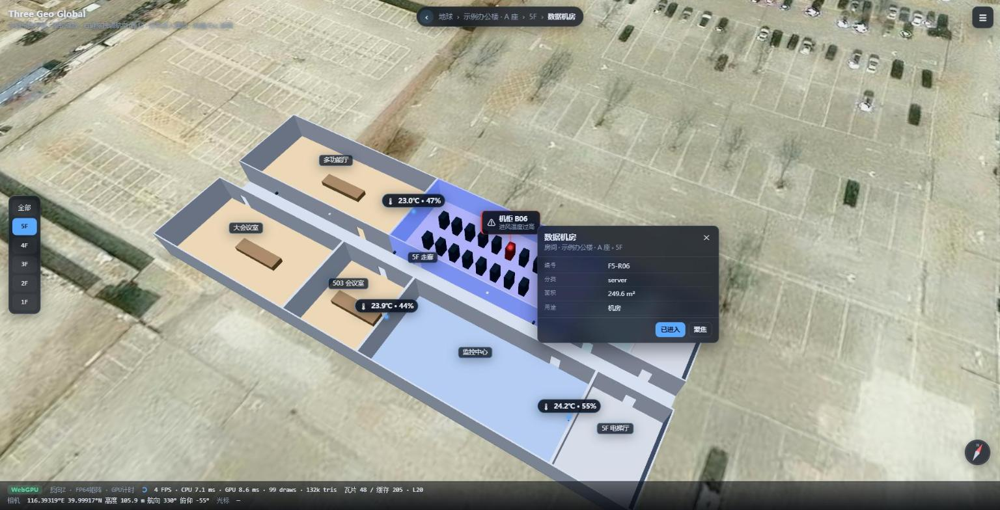
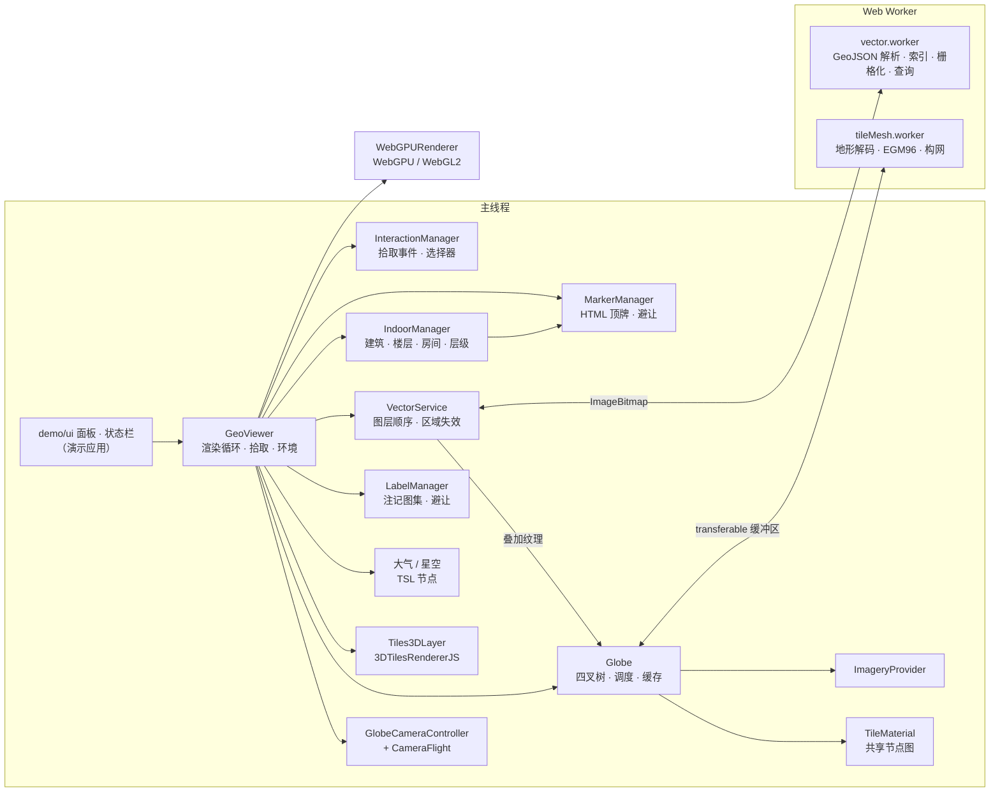

# TerraView

基于 three.js 的 **WebGPU 优先** 三维地球 SDK：WGS84 椭球、四叉树影像瓦片、全球地形、物理大气、OGC 3D Tiles、高斯泼溅（3DGS）、GeoJSON 矢量与注记、HTML 顶牌与点位，以及从地球无缝进入建筑 / 楼层 / 房间的**室内 BIM 浏览**（顶牌、事件、层级导航，参考 ThingJS）。
对标 CesiumJS / Google Earth 的核心浏览体验。

以 npm 包 `terra-view` 的形式嵌入应用：宿主提供一个容器元素，就能用上地球、图层、点位、室内和交互 API。仓库里的 `demo/` 是建在同一套公共 API 上的演示应用（面板、状态栏、URL 参数），不进包。

> 目前是私有包（`"private": true`），还没有发布到 npm。许可证 Apache-2.0（见 [LICENSE](LICENSE)）。包名 `terra-view` 在 npm 上没有注册（2026-11-11 查询），但首次发布有被相似名规则拒绝的风险，见下面的「持续集成与发布」。代码由 three-geo-global 迁移而来（2026-11-11，源提交 `be3bbbd`）。
>
> 参与开发（人或 AI 代理）请先读 [AGENTS.md](AGENTS.md)，子系统规范在 [docs/agents/](docs/agents/)，公共 API 说明在 [docs/api.md](docs/api.md)。

| 全球视角（WebGPU） | 近地轨道大气 | 昼夜晨昏线 |
| --- | --- | --- |
|  |  |  |

| 北京西山日落（地形 + 大气） | 地形 + 四叉树 LOD（调试网格） | 3D Tiles 贴合地形 |
| --- | --- | --- |
|  |  |  |

| GeoJSON：国界分色 + 城市点 + 中文注记避让 | 点击要素：属性面板 + 高亮 |
| --- | --- |
|  |  |

| 室内楼层：房间 / 机柜 / 温湿度顶牌（避让）+ 层级条 | 进入房间：高亮 + 属性面板 + 告警卡片 |
| --- | --- |
|  |  |

> 前两行截图在无头 Chromium（SwiftShader 软件 GPU）里生成，沙箱访问不了 ArcGIS/OSM，所以用的是 Blue Marble 单图和调试网格影像；室内截图为 Chrome WebGPU + ArcGIS 影像 + Cesium World Terrain。本地运行默认是 ArcGIS 卫星影像。

## 在应用里使用

发布到 npm 之前，用 `npm pack` 生成的 tgz 安装（或 `npm link`）：

```bash
# 在本仓库
npm install && npm run build && npm pack        # 得到 terra-view-0.1.0.tgz

# 在宿主工程
npm install /path/to/terra-view-0.1.0.tgz three@0.187.0 3d-tiles-renderer@0.5.4
npm install -D @types/three@0.187.0             # 用 TypeScript 时
```

`three` 和 `3d-tiles-renderer` 是 peer 依赖，不打进包里：宿主自己也用 three 时页面上只有一份。three 不按 semver 发布，版本范围锁在 0.187.x。

```ts
import 'terra-view/style.css';
import { AWS_TERRARIUM, GeoViewer, IMAGERY_PRESETS } from 'terra-view';

const viewer = await GeoViewer.create({
  container: document.getElementById('map')!, // 任意有尺寸的元素，不必铺满窗口
  imagery: IMAGERY_PRESETS[0].create(),
  terrain: AWS_TERRARIUM,
  initialView: { longitude: 116.397, latitude: 39.916, height: 3000, heading: 0, pitch: -40 },
});
viewer.lighting = true;
viewer.addTileset({ source: { type: 'url', url: 'https://example.com/tileset.json' } });

const countries = viewer.addGeoJson({
  url: 'https://raw.githubusercontent.com/nvkelso/natural-earth-vector/master/geojson/ne_110m_admin_0_countries.geojson',
  style: { colorBy: 'MAPCOLOR7', fillOpacity: 0.2, stroke: '#ffffff' },
  label: { field: 'NAME_ZH' },
});
countries.events.on('ready', (s) => viewer.flyToBBox(s.bbox!));

// 点位：属性规则决定样式
viewer.addPoints({
  data: [{ lon: 116.3972, lat: 39.9163, name: '故宫', status: 'alarm' }],
  style: { style: 'poi', title: '{name}' },
  rules: [{ when: { status: 'alarm' }, style: { style: 'pulse', color: '#ff4d4f', badge: '告警' } }],
});

// 室内：加载建筑文档，监听层级事件，查询房间并改样式
const building = viewer.indoor.add(await (await fetch('/office.building.json')).json());
viewer.indoor.events.on('enterLevel', ({ object }) => console.log('进入', object?.name ?? '地球'));
await viewer.indoor.enter(building);
viewer.indoor.query('[category=meeting]').forEach((room) => room.setStyle({ color: '#ffd166' }));
viewer.interaction.on('click', (e) => console.log(e.object?.properties), { selector: '.Thing', tag: 'app' });

viewer.dispose(); // 离开页面时释放 GPU 资源、Worker 和监听
```

接入时要知道的几件事（细节见 [docs/api.md](docs/api.md)）：

- **样式**：`terra-view/style.css` 只包含 SDK 自己创建的元素（canvas、顶牌），类名全部以 `tv-` 开头；主题用 `--tv-font` / `--tv-text` / `--tv-muted` / `--tv-card-bg` 调。面板、状态栏等界面由宿主自己做（可以参考 `demo/ui/`）。
- **容器**：`GeoViewer` 给容器加 `tv-viewer` 类；容器是 `position: static` 时改成 `relative`，没有 `tabindex` 时设为 `-1`（为了接收键盘）。`dispose()` 时恢复。
- **键盘**：相机快捷键（WASD / 方向键 / QERF）只在 viewer 有焦点时生效，不监听 `window`；同页多个 viewer 互不影响。要一打开就能用键盘，调用 `viewer.canvas.focus()`。
- **Worker**：包里的三个 Worker 是独立文件，用 `new URL(..., import.meta.url)` 引用。Vite 8 宿主（开发服务器和生产构建）已实测不需要额外配置；webpack 5 认同一种写法，但还没有实测。
- **解码器**：Draco / KTX2 解码器默认用宿主安装的 three.js 自带的那份（由宿主的打包工具处理）；要放到 CDN 或静态目录时传 `decoderPath` / `transcoderPath`。
- **凭证**：天地图、Cesium ion、Google、Mapbox 的密钥由宿主传入，SDK 不保存也不内置。

## 本仓库开发

```bash
npm install
npm run dev          # 演示应用 http://localhost:5173（demo/，直接引用 src/）
npm test             # 单元测试（vitest）
npm run build        # 类型检查 + 库构建到 dist/（terraview.js、terraview.css、assets/*.worker.js、types/）
npm run build:demo   # 演示应用的生产构建到 dist-demo/
npm run verify       # typecheck + test + build + build:demo，提交前跑
npm run check:package  # 打包并装进一个临时宿主工程检查（需要联网，先 build）
```

需要 Node 20.19+ / 22.12+。浏览器：Chrome / Edge 113+ 走 WebGPU，其他支持 WebGL 2 的浏览器会自动回退。

### 持续集成与发布

- **CI**（`.github/workflows/ci.yml`）：推送到 `main` 和每个 PR 都会在 Node 22、24 上跑 typecheck、单测、库构建、演示构建，再把打出的包装进一个宿主工程检查（含体积预算）；tgz 留作工作流产物。
- **发布**（`.github/workflows/release.yml`）：推送与 `package.json` 版本一致的标签（如 `v0.1.0`）时，验证后创建 GitHub Release 并附上 tgz。发布到 npm 的步骤只有在 `package.json` 去掉 `"private": true` 之后才执行，并且需要仓库密钥 `NPM_TOKEN`。在 Actions 页面手动运行是演练，不创建 Release 也不发布。
- 包名：`terra-view` 在 npm 上没有注册（2026-11-11 查询）。但 npm 上已有 `terraview`（npm 官方的安全占位包，2021 年起），而 npm 自 2017 年起不允许新建的无 scope 包名去掉 `.` `-` `_` 后与已有包相同，所以首次发布 `terra-view` 有可能被拒；这一点只有真正发布时才能确认。被拒时改用带 scope 的 `@<scope>/terra-view`（scope 不受这条规则限制）。

以下 URL 参数和操作说的是演示应用。

### URL 参数

| 参数 | 作用 |
| --- | --- |
| `?webgl` | 强制使用 WebGL 2 后端（对比调试用） |
| `?imagery=osm` | 指定底图：`esri-imagery` `osm` `carto-voyager` `carto-dark` `esri-topo` `tianditu-img` `blue-marble` `debug` |
| `?noterrain` | 启动时关闭地形（地形源在面板里切换，含 Mapbox / MapTiler / Cesium World Terrain / quantized-mesh） |
| `?tileset=<url>` | 启动后加载一个 3D Tiles（tileset.json） |
| `?splats=<url>` | 启动后加载一个高斯泼溅场景（`.ply` / `.splat` / `.spz`）；`?splatsAt=经度,纬度[,椭球高]` 指定位置（不给时放在示例场地），`?splatsScale=<每单位米数>`、`?splatsHeading=<度>`、`?splatsUp=-y\|+y\|+z`（文件里哪边朝上）、`?splatsMax=<泼溅数上限>` |
| `?geojson=<url>` | 启动后加载 GeoJSON（可重复多次） |
| `?points=<url>` | 启动后加载点位标注：GeoJSON 点要素或带 lon / lat 字段的记录数组（可重复多次） |
| `?demo` | 加载程序生成的示例办公楼（5 层，房间 / 设备 / 传感器 / 机房告警）并进入 |
| `?building=<url>` | 加载 `three-geo-building` 格式的建筑文档（格式见 [docs/agents/indoor-bim.md](docs/agents/indoor-bim.md)） |
| `#lon,lat,height,heading,pitch` | 相机位置（会随浏览自动更新，可直接分享链接） |

### 操作

- 左键拖拽：抓住地面平移（光标下的点始终跟手），松手有惯性
- 滚轮 / 双指捏合：向光标处缩放，**保持当前航向与俯仰**（俯视保持俯视，不会翻转）
- 右键、中键或 Ctrl/Shift + 左键拖拽：**横向调航向、纵向调俯仰**（默认绕屏幕中心点，面板“相机”里可改为光标处、限制最大倾斜）
- 双击：进入建筑 / 楼层 / 房间（室内），否则飞近该点；**右键单击或 Esc：返回上一级**
- 单击建筑、房间、设备或矢量要素：高亮并弹出属性面板；Esc 关闭
- 指北针：点击复位朝北；面板“相机 → 环绕浏览”：绕视野中心匀速旋转
- 把 `.geojson` / `.json` / `.building.json` 文件直接拖进窗口即可加载
- 键盘：WASD / 方向键平移，Q/E 转向，R/F 俯仰

## 已实现能力

**渲染（WebGPU 优先）**
- `WebGPURenderer`，WebGPU 不可用时自动回退 WebGL 2；所有着色器用 TSL 编写，同一份代码编译成 WGSL / GLSL
- 行星尺度精度：世界坐标即 ECEF（米），开启 `renderer.highPrecision`（模型视图矩阵在 CPU 上以 float64 计算）+ 每个瓦片自带原点（RTC），从太空到街道级都不抖动
- 反向 Z 浮点深度缓冲（WebGPU 原生；WebGL 走 `EXT_clip_control`），配合动态近/远裁剪面，无 Z-fighting
- GPU 计时（WebGPU timestamp query）显示在状态栏
- 静止超采样与停画：画面安静 1 秒后用 16–32 帧亚像素抖动平均出抗锯齿画面，然后停止重画（静止时 CPU 约降到每帧渲染时的 1/6 以下，GPU 基本空闲）；关掉超采样时降到每秒 10 帧（`idleFrameRate`）。交互、加载、`requestRender()` 立刻恢复实时画面；容器不在视口内时不画（[docs/api.md](docs/api.md) §1.8）
- 调色：曝光、对比度、饱和度（`viewer.colorGrading`，`COLOR_GRADING_PRESETS.vivid`）
- 所有地球瓦片共享同一套节点图 → 只编译 1 条 GPU 管线，逐瓦片纹理通过 `materialReference` 绑定

**地球与数据**
- WGS84 椭球数学（Newton 迭代投影、ENU 坐标系、射线求交），全部 float64
- Web Mercator 四叉树：屏幕空间误差（以“影像纹素占多少 CSS 像素”计）选择 LOD、视锥裁剪 + 椭球地平线裁剪（Cesium 的 horizon culling point）、裙边消除裂缝、极地补盖（颜色取自影像边缘）
- 加载调度（[规范](docs/agents/tile-loading.md)）：几何 / 影像 / 叠加三条独立通道与并发上限；五级优先级桶 + **视野中心优先**；跨级“锚点”影像（大跨度缩放一个往返就变清晰）；新影像**交叉淡入**；每帧上传预算 + 背压；离开视野自动取消（立即释放槽位并中止无人等待的下载）、指数退避重试、叶子优先的 LRU 淘汰；首屏根瓦片先以平面立即显示
- **缩放不闪烁**（借鉴 CesiumJS 的四叉树选择）：选择结果记忆；缩小时父瓦片的影像和地形就绪前保留子瓦片（不丢细节）；子瓦片刚进入视野时用父瓦片象限填充；视野外兄弟瓦片预建插值网格；地平线雾化 SSE
- 地形取数比网格低 3 级（一张 256 px 高程图服务 8×8 个网格瓦片，请求量降到 1/64 且不损失精度）；子瓦片先用**精确祖先**高度插值出临时网格（≤3 级）立即可渲染，真实地形随后替换；临时网格的子瓦片用保守包围体，杜绝空洞；相机防入地只采信足够精细的地形
- 影像源：XYZ 模板（ArcGIS、OSM、Carto、天地图等预设 + 自定义 URL）、单张等经纬度全球图、离线调试网格
- 叠加图层：天地图影像注记、Esri 边界地名 / 交通、Carto 注记、OpenRailwayMap 等半透明图层，可调不透明度、顺序、显隐；与矢量栅格一起**合成为每个瓦片的一张叠加纹理**，着色器始终只多一次纹理采样；压缩瓦片缓存，矢量变化时不重复下载
- 地形源（在 Web Worker 里解码并构网，含法线、包围体、地平线点，超出最大层级时从父级上采样；可调高程夸张）：
  - AWS Terrain Tiles（Terrarium，免 key）、Mapbox Terrain-RGB、MapTiler Terrain（RGB 编码）
  - Cesium World Terrain（ion）与任意 **quantized-mesh** 服务（layer.json）：按 EPSG:4326 地理瓦片取数，三角网栅格化后重采样到墨卡托网格，缺失瓦片自动回退父级
- 高程基准：海拔类数据经 **EGM96 大地水准面**（1° 网格，RMS 误差 0.41 m）改正为椭球高；quantized-mesh 本身是椭球高；两者都与 3D Tiles、GNSS 数据对齐

**大气与环境**
- 物理单次散射大气（Rayleigh + Mie + 臭氧），视线方向光线步进，太阳方向用 Chapman 函数解析近似，替代嵌套循环
- 天空作为 `scene.backgroundNode` 逐像素计算；地面空气透视逐顶点计算（便宜且平滑）
- 两种模式：地图模式（影像原色 + 均匀光晕）与真实光照模式（按日期时间计算太阳位置、昼夜、晨昏、日落色彩、太阳圆盘）
- 光照跟随大气：真实光照下，建筑和 3D Tiles 的太阳光颜色、天光（球谐光照探针）由同一个大气模型的 CPU 版算出，黄昏时与地面色调一致；建筑、设备、3D Tiles 与地球瓦片有相同的空气透视（[docs/api.md](docs/api.md) §1.10）
- 随恒星时旋转的星空

**3D Tiles**
- 基于 NASA-AMMOS 3DTilesRendererJS 的核心调度（b3dm / i3dm / pnts / cmpt / glTF、隐式分块）
- Draco / KTX2 / Meshopt 解码；Cesium ion、Google 真实感 3D Tiles 鉴权
- **WebGPU 下的 LOD 渐显**：瓦片材质在解析阶段转为节点材质，官方渐显插件的材质管理换成 TSL 抖动遮罩（官方版依赖 `onBeforeCompile`，在 WebGPU 下无效）
- 按显存档位（`low` / `medium` / `high` / `ultra`，按适配器自动识别或 `?gpu=` 指定）给预算：隐藏瓦片在显存目标内保留、回头看不再重新上传，斜视时远处放宽误差，缓存满时整体降精度而不是局部停止加载（[gpu-memory.md](docs/agents/gpu-memory.md)）；进入建筑时自动压制 3D Tiles
- **要素拾取与属性**：`EXT_mesh_features` / `EXT_structural_metadata`（要素编号属性、属性表）和 b3dm / i3dm 批量表，`event.tileFeature()` 取得指针下要素的编号和属性，`viewer.highlightTileFeature()` 高亮（不改瓦片材质）；要素编号纹理暂不支持
- 图层管理：显隐、飞到图层、高度偏移、一键贴地（针对以椭球面为基准的样例数据）

**高斯泼溅（3DGS）**
- `viewer.addSplats`：`.ply`（INRIA 训练输出）、`.splat`、`.spz`（1–4 版）在 Worker 里解码，按显存档位的预算保留最重要的泼溅；用 three.js 自带的 `GaussianSplat` 绘制（WebGPU 计算着色器排序，WebGL 回退）
- 地理锚定：经纬度、贴地或椭球高、heading / pitch / roll、缩放、轴向约定、枢轴，随时可改；远到只剩几个像素时不画
- 交互：点击 / 悬停事件（`e.kind === 'splats'`）、滚轮缩放到光标和右键环绕落在泼溅表面上（BVH 拾取，每条射线不到 0.1 ms）、盒 / 球裁剪、飞到场景
- 演示面板带三个开放场景（three.js 示例库，CC BY 4.0），也可以拖入自己的文件（[docs/agents/splats.md](docs/agents/splats.md)）

**GeoJSON 矢量与注记**
- 支持 Point / MultiPoint / LineString / MultiLineString / Polygon / MultiPolygon / GeometryCollection，来源可以是 URL、本地文件（拖拽）或对象
- 解析、投影、跨日界线展开、网格空间索引都在 **Web Worker** 里完成，大文件不卡主线程
- 线、面、点符号按地球瓦片实时栅格化成透明叠加纹理，**贴合地形**、无 Z-fighting；只重绘受影响区域的瓦片（按区域失效），加载期间用父瓦片叠加图放大兜底
- 样式：图层级填充 / 描边 / 点样式，按属性分类着色（如 Natural Earth `MAPCOLOR7`），兼容 simplestyle-spec 逐要素样式
- 注记：自动识别名称字段（优先中文 `name_zh` / `NAME_ZH`），面用“极点不可达点”（polylabel）、线用中点定位；按 `LABELRANK` / `scalerank` 排优先级，按 `min_label` / `min_zoom` 分级显示，屏幕空间碰撞避让 + 淡入淡出
- 注记位置用 GPU 端双精度模拟（RTE，高低位拆分），近距离也不抖；可见性由 CPU 判定（地平线 + 低空时沿视线采样地形遮挡）
- 点击查询：注记命中优先，其次在 Worker 里做点在面内 / 点到线距离判定，返回属性并高亮该要素
- 预设数据：Natural Earth 国界、省级区划、城市、河流（公有领域，示例用）

**室内 / BIM（[规范](docs/agents/indoor-bim.md)）**
- `three-geo-building` JSON 格式：建筑 → 楼层 → 房间 / 构件 / 设备，层级对齐 IFC 空间结构与 ThingJS；地理锚点（经纬高 + 朝向，省略高度自动贴地）；属性集、分类、IFC 类型；带 JSON 路径的校验错误
- 几何：程序生成（楼板、按类别着色的房间、内缩墙体与门洞、设备图元、玻璃幕墙外壳）或 glTF（按节点名 / `extras.id` 映射到实体，其余为静态几何）；楼层和设备的 glTF 在楼层第一次显示时才加载，隐藏楼层的模型超出显存预算时卸载
- 层级导航：双击进入、右键 / Esc / 面包屑返回、楼层切换条、楼层展开；沿层级路径逐级切换（可取消、可跳级），每一级都发 `beforeEnterLevel` / `enterLevel` / `leaveLevel`；往下钻时缓存视点，返回时飞回；相机取最近的对角视点（按视场归一化距离），文档可写 `viewpoint`
- 层级控制策略：每一级的显隐、同级半透明聚焦、拾取映射（`filterObject`）和取景都可以按选择器 + 优先级注册替换（`indoor.registerLevelControl`）
- 实体 API：选择器表达式（`.room && [温度>26]`、`tags:or(alarm, camera)`、`!` 与括号，编译后缓存）、链式查询与批量样式（`EntitySet`）、标签、样式（颜色 / 透明度）、包围体、属性面板
- 日照阴影：真实光照下，建筑和设备在自身、地面、3D Tiles 上投下随时间变化的阴影，一张按"建筑 ∩ 视野"适配的阴影图，只在变化时重画（`viewer.shadows`）；建筑的透明表面可选顺序无关混合（`viewer.transparency`，WebGPU）
- 楼层环境光遮蔽：楼层第一次显示时在 GPU 上烘焙一次，墙根、柜体和桌子周围的地面柔和变暗，不增加每帧开销（`viewer.indoor.ambientOcclusion`）
- 描边与发光：选中、悬停、告警用描边（可透视被遮挡部分、可闪烁）和选择性泛光表示，不改材质，合批设备可单独描边（`entity.effects`、`viewer.effects`）；所有帧经可扩展的后期管线（`viewer.postProcessing`）

**交互、顶牌与相机（参考 ThingJS）**
- 统一事件：`viewer.interaction.on('click' | 'dblclick' | 'rightclick' | 'mousemove' | 'mouseenter' | 'mouseleave', fn, { selector, tag, priority, once })`，选择器冒泡、标签批量注销、优先级、`stopPropagation()`、`preventDefault()` 屏蔽默认行为；顶牌上的单击 / 双击 / 右键经事件代理转成对实体的事件
- HTML 顶牌：float64 投影、地平线 / 距离 / 视口裁剪、优先级避让；数据驱动显示模式（常显 / 进入层级后 / 悬停 / 点击）；卡片 / 图钉 / 标签三种样式
- 点位标注（[规范](docs/agents/markers.md)）：`viewer.addPoints()` 加载 GeoJSON 点或记录数组；8 种样式（水滴图钉、呼吸点、徽章、光柱、文字等）；按属性的样式规则与文本模板；自动贴地；屏幕空间聚合（点击放大）；点击查看属性
- 自研相机控制器（[规范](docs/agents/camera-controller.md)）：零 roll、俯视不翻转的航向算法、保持姿态的光标缩放、右键航向 / 俯仰、俯仰范围、手势开关、环绕巡航、惯性、触屏、键盘、按可靠地形防入地
- 相机 API：`flyTo`、`flyToTarget({ target, heading, pitch, range })`、`flyToSphere`、`flyToEntity`、`startAutoOrbit`、`resetNorth`；大圆弧线飞行
- 图层面板、状态栏（帧率 / GPU 耗时 / 瓦片与待影像统计 / 相机与光标经纬高）、层级条、指北针、数据署名

## 架构



```
src/
├─ core/        椭球、测地学、EGM96、太阳位置、事件
├─ globe/       四叉树（Globe / GlobeTile）、分块方案、Worker、影像源、地形源、瓦片材质
├─ atmosphere/  散射节点（天空 / 空气透视）、星空
├─ tiles3d/     3D Tiles 图层封装、节点材质与 WebGPU 渐显
├─ splats/      高斯泼溅图层：文件解码（Worker）、预算、地理锚定、拾取
├─ vector/      GeoJSON 图层、矢量 Worker、注记管理、几何算法
├─ indoor/      BIM 文档格式、实体与选择器、建筑构建、层级导航
├─ markers/     HTML 顶牌管理、样式模板、点位图层（解析 / 规则 / 聚合）
├─ viewer/      GeoViewer、相机控制器、相机数学、飞行动画、交互事件
├─ index.ts     包入口：公共 API 都从这里导出
└─ style.css    SDK 样式（`terra-view/style.css`，类名前缀 `tv-`）
demo/           演示应用，不进包：main.ts、ui/（面板、状态栏、层级条、属性弹窗、URL 参数）、data/（示例建筑与点位）
tests/          vitest 单元测试
```

代码示例见上面的"在应用里使用"。

## 与成熟产品对标

| 能力 | CesiumJS | Google Earth Web | Mapbox GL JS（globe） | ArcGIS JS SceneView | **本项目 v0.1** |
| --- | --- | --- | --- | --- | --- |
| 渲染后端 | WebGL 2 | WebGL / Wasm | WebGL 2 | WebGL 2 | **WebGPU 优先**，WebGL 2 回退 |
| 着色语言 | GLSL | 内部 | GLSL | GLSL | **TSL → WGSL / GLSL** |
| 椭球 + 高精度 | ✅ RTC / RTE | ✅ | 近似球 | ✅ | ✅ FP64 矩阵 + RTC |
| 影像瓦片 | ✅ 多图层叠加 | 内置 | ✅ 矢量瓦片为主 | ✅ | ✅ 底图 + 叠加图层 |
| 地形 | ✅ quantized-mesh | ✅ | ✅ raster-dem | ✅ | ✅ Terrarium / Terrain-RGB / quantized-mesh + EGM96 |
| 3D Tiles | ✅ 原生 | 自有格式 | 自有 3D 格式 | ✅ I3S / 3D Tiles | ✅ 3DTilesRendererJS |
| 大气 | ✅ | ✅ | 风格化 | ✅ | ✅ 物理散射 + 光晕 |
| 昼夜 / 太阳 | ✅ | ✅ | 风格化光照 | ✅ | ✅ 按日期计算太阳位置 |
| 矢量 / 标注 | ✅ | ✅ | ✅ 强项 | ✅ | ✅ GeoJSON 贴地 + 注记避让 |
| 室内 / BIM 层级 | 需自建 | ❌ | ❌ | ✅ 楼层过滤 | ✅ 建筑 → 楼层 → 房间，顶牌 + 事件 |
| 阴影 / 后处理 | ✅ | ✅ | 部分 | ✅ | ⏳ 路线图 |

定位：在 three.js 生态里做一个“像 Cesium 一样懂地理、像 three.js 一样好扩展”的地球底座，并且从第一天起按 WebGPU 的方式写（TSL、计算着色器友好、绑定组 / 管线复用）。

## 已知限制

- 影像（底图与叠加）只支持 Web Mercator 瓦片，±85.05° 以外用纯色极盖
- Cesium ion / quantized-mesh、Mapbox、MapTiler 在开发沙箱里无法联网，只验证了解码与重采样（单元测试）和错误提示，需在真实网络下确认；ion 访问令牌约 1 小时过期，过期后需重新点“应用”
- 山区的粗层级插值误差较大，因此临时（插值）地形最多跨 3 级（换成精确网格时有几何渐变）
- 地形法线在瓦片边界用单侧差分，开启光照时可能看到细微接缝
- 3D Tiles 的影像叠加（ImageOverlayPlugin）依赖 `onBeforeCompile`，在 WebGPU 下不可用；点云（pnts）在 WebGPU 下为 1 像素点
- 高斯泼溅：单文件整体加载（按显存档位 50 万–600 万个泼溅，超出的舍去），没有分块流式；不写深度，所以不挡顶牌、与半透明物体的前后关系可能不对；压缩 PLY、`.ksplat`、SOG、glTF / 3D Tiles 内嵌泼溅还不支持；真实 GPU 上的帧率尚未实测（[splats.md](docs/agents/splats.md) §9–§11）
- 室内：尚不支持 IFC 直读、剖切与室内导航
- 隐藏地球（如加载 Google 3D Tiles）时，贴地和相机防入地改用 3D Tiles 竖直射线得到的高程（`viewer.surfaceHeight`）；锚点正好落在倾斜摄影的屋顶、树冠上时会贴到它上面，这种位置仍需在数据里写明高度（[ISSUE-1](docs/agents/roadmap.md)，见[建筑数据制作手册](docs/building-data-manual.md) §3.3）
- 矢量按瓦片栅格化贴地：线宽是屏幕像素级的，但瓦片切换的过渡期内线条会短暂变虚；暂不支持面拉伸（3D 建筑）、沿线排布的注记和图标符号
- 注记不会被 3D Tiles 建筑遮挡（只判断地平线和地形遮挡）
- 示例国界为 Natural Earth 的“事实边界”，**不是审定地图**；在国内发布须使用审图号地图数据（如天地图边界）
- 默认底图 / 地形服务仅用于开发演示，生产环境请使用自有服务或取得相应授权（OSM 瓦片使用政策、Esri 条款、天地图 key 等）

## 路线图

**近期（v0.2）——数据与可用性**
- 瓦片边界法线拼接（地形与 3D Tiles 统一高程查询已完成）
- 矢量进阶：MVT 矢量瓦片、面拉伸（建筑白模）、沿线注记（点位标注与聚合已完成）
- 已升级 three r187，瓦片材质改用 `NodeMaterialInstance`，并完成 GPU 拾取缓冲（M2.1）、顶牌遮挡查询（M2.2）、贡献剔除（M2.3）、设备合批（M3.6），见[路线图](docs/agents/roadmap.md)
- ~~3D Tiles 要素拾取与属性查询（EXT_mesh_features / batch table），高亮；接入统一事件~~（已完成；要素编号纹理、按属性批量着色待做）
- Worker 间共享高程缓存（临时到精确地形的几何形变过渡已完成）
- 室内：IFC 直读（web-ifc）与按楼层流式加载、剖切面 / 剖切盒、室内导航、~~实体描边~~（已完成）

**中期（v0.3）——深度用好 WebGPU**
- 计算着色器预计算大气 LUT（透射率 / 多次散射 / 天空视图，Hillaire 2020），提升质量并降低每像素开销
- GPU 驱动的瓦片剔除与间接绘制（indirect draw），HZB 遮挡剔除
- 计算着色器驱动的大规模动态图层（轨迹、粒子、热力）
- 后处理：TAA / SMAA、Bloom、SSAO，太阳级联阴影投射到 3D Tiles

**产品化**
- 测量工具（距离 / 面积 / 高度）、视点漫游录制与回放、截图分享
- glTF / KML 模型摆放、裁剪面与压平（3D Tiles）、时态数据
- 国内数据适配：GCJ-02 纠偏（高德 / 腾讯影像）、天地图注记、CGCS2000

## 开发说明

- 开发规范与踩坑记录：[AGENTS.md](AGENTS.md)（`CLAUDE.md` 引用它）；子系统规范：相机、瓦片加载、室内 BIM、ThingJS 对照与运行时源码分析（[docs/agents/](docs/agents/)）
- 路线图：[docs/agents/roadmap.md](docs/agents/roadmap.md)（可借鉴、可复用内容的分阶段落地计划）
- 改造记录与计划：[docs/agents/progress-log.md](docs/agents/progress-log.md)（已改造时间线、待办清单；迁移前的 agent-hub 任务对应留作历史）
- 建筑数据制作手册：[docs/building-data-manual.md](docs/building-data-manual.md)（`*.building.json` 的坐标、字段、类别、模型与自检；样例 [docs/examples/sample-office.building.json](docs/examples/sample-office.building.json)）
- `scripts/generate-egm96.mjs`：从 NGA EGM96（经 `egm96-universal` 包）重新生成 `src/core/egm96Grid.ts`
- 依赖版本锁定为精确版本（three r187、3d-tiles-renderer 0.5.4、Vite 8），原则上只用发布满两周以上的版本；r187（2026-10-30 发布）是按路线图 M0 提前升级的
- `.npmrc` 设置了 `legacy-peer-deps=true`：npm 在 Vite 8 + Vitest 5 的可选 peer 依赖环上有解析 bug

## 数据与致谢

three.js · NASA-AMMOS 3DTilesRendererJS · Mapzen / AWS Terrain Tiles · NGA EGM96 · Esri / OpenStreetMap / CARTO / 天地图（底图）· CesiumGS 3d-tiles-samples（示例数据）· Bruneton & Neyret、Hillaire、Schüler（大气散射方法）
