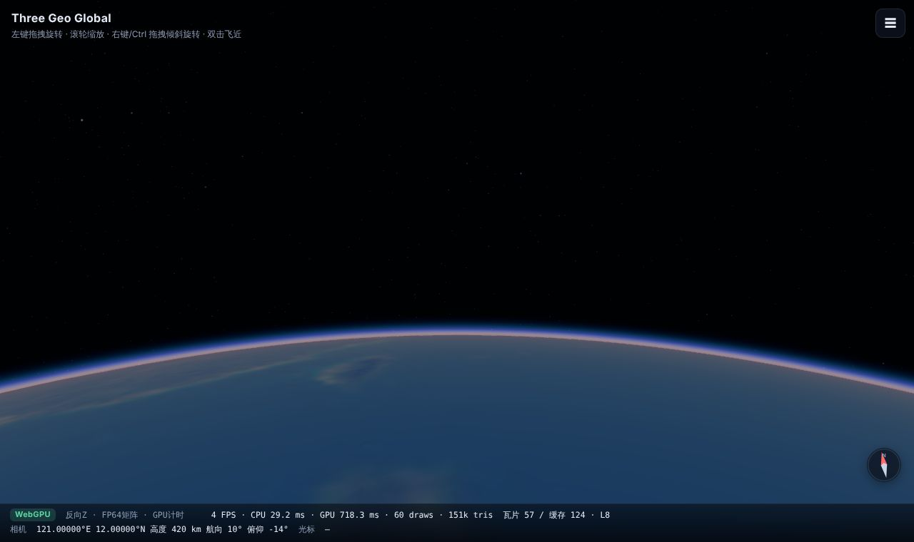
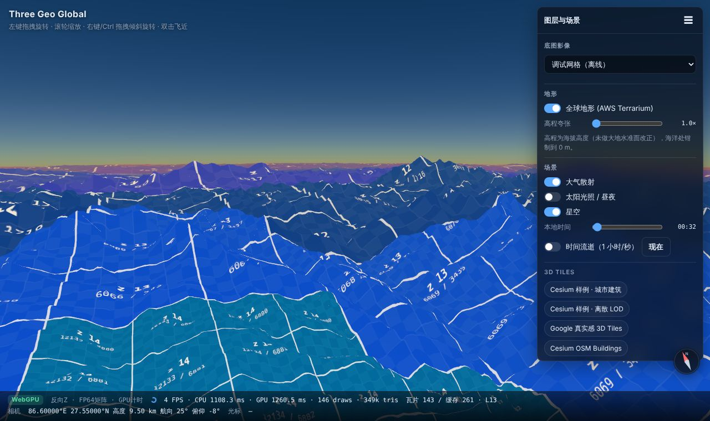
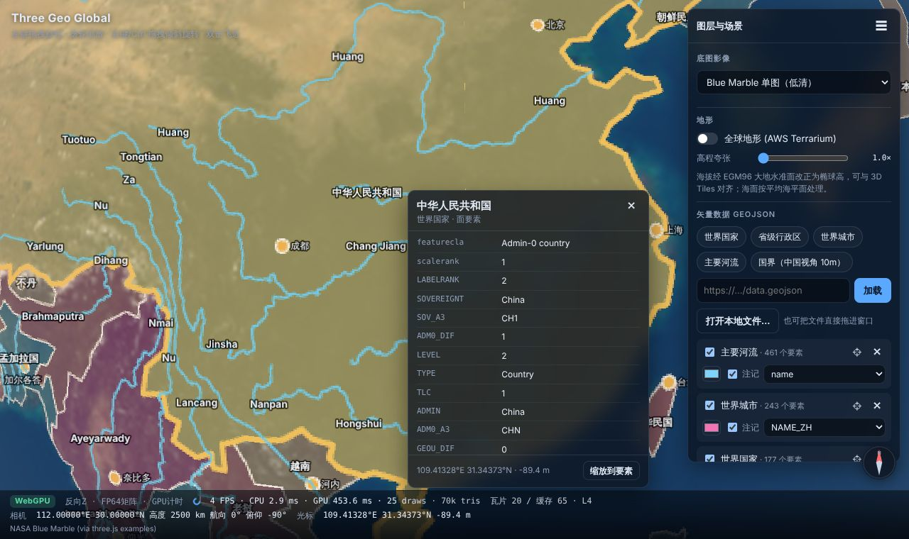
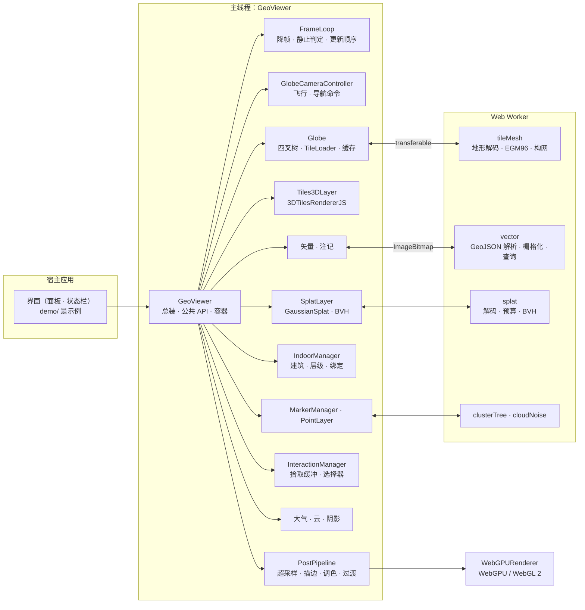

# TerraView

基于 three.js 的 **WebGPU 优先** 三维地球 SDK。从全球视角到街道，再无缝进入建筑、楼层、房间：WGS84 椭球、四叉树影像与全球地形、物理大气与体积云、OGC 3D Tiles、高斯泼溅（3DGS）、GeoJSON 矢量与注记、HTML 顶牌与点位、室内 / BIM 层级浏览，都由同一个 `GeoViewer` 提供。

以 npm 包 `terra-view` 的形式嵌入应用：宿主提供一个容器元素，就能用上地球、图层、点位、室内和交互 API。仓库里的 `demo/` 是建在同一套公共 API 上的演示应用（面板、状态栏、URL 参数），不进包。

> **状态**：0.2.0，首个对外版本（发布说明见 [docs/releases/v0.2.0.md](docs/releases/v0.2.0.md)）。`package.json` 仍是 `"private": true`，发布到 npm 之前用 GitHub Release 附带的 tgz 安装。0.x 阶段次版本号可以有破坏性变更，记在 [CHANGELOG](CHANGELOG.md)。许可证 Apache-2.0（[LICENSE](LICENSE)）。
>
> 参与开发（人或 AI 代理）请先读 [AGENTS.md](AGENTS.md)。

| 全球视角（WebGPU） | 近地轨道大气 | 昼夜晨昏线 |
| --- | --- | --- |
|  |  |  |

| 北京西山日落（地形 + 大气） | 地形 + 四叉树 LOD（调试网格） | 3D Tiles 贴合地形 |
| --- | --- | --- |
|  |  |  |

| GeoJSON：国界分色 + 城市点 + 中文注记避让 | 点击要素：属性面板 + 高亮 |
| --- | --- |
|  |  |

| 室内楼层：房间 / 机柜 / 温湿度顶牌（避让）+ 层级条 | 进入房间：高亮 + 属性面板 + 告警卡片 |
| --- | --- |
|  |  |

> 前两行截图在无头 Chromium（SwiftShader 软件 GPU）里生成，用的是 Blue Marble 单图和调试网格影像；室内截图为 Chrome WebGPU + ArcGIS 影像 + Cesium World Terrain。截图早于后期管线、阴影和体积云，现在的画面会有差别。

## 目录

- [功能概览](#功能概览)
- [快速开始](#快速开始)
- [接入示例](#接入示例)
- [接入要点](#接入要点)
- [兼容性](#兼容性)
- [文档](#文档)
- [演示应用](#演示应用)
- [架构](#架构)
- [与成熟产品对标](#与成熟产品对标)
- [已知限制](#已知限制)
- [路线图](#路线图)
- [本仓库开发](#本仓库开发)
- [许可与致谢](#许可与致谢)

## 功能概览

每一项后面的括号是入口 API；用法见 [docs/api.md](docs/api.md)，设计细节见 [docs/agents/](docs/agents/)。

### 渲染与精度

- **WebGPU 优先**：`WebGPURenderer`，WebGPU 不可用时自动回退 WebGL 2（`forceWebGL` 可强制）。所有着色器用 TSL 编写，同一份代码编译成 WGSL / GLSL；同类材质共享节点图，所有地球瓦片只编译一条管线。
- **行星尺度精度**：世界坐标即 ECEF（米），模型视图矩阵在 CPU 上以 float64 计算，每个瓦片、建筑自带原点（RTC），注记用高低位拆分（RTE）；反向 Z 深度配合动态近 / 远裁剪面。从太空到街道都不抖动、没有 Z-fighting。
- **后期管线**：每帧经 `viewer.postProcessing`，场景画进 HDR 目标，再按 linear / display 两段跑启用的效果；没有效果时开销与直接渲染一致。可以注册自己的 `PostEffect`。
- **静止超采样与停画**：画面安静 1 秒后用 16 / 32 个亚像素抖动样本平均出抗锯齿画面，画完就不再画帧（静止时 CPU 约降到原来的 1/6，GPU 基本空闲）；交互、加载、`requestRender()` 立刻恢复实时画面；容器不在视口内时不画（`viewer.supersampling`、`idleFrameRate`）。
- **调色**：曝光、对比度、饱和度（`viewer.colorGrading`，预设 `COLOR_GRADING_PRESETS.vivid`）。
- **显存档位**：按适配器识别 `low` / `medium` / `high` / `ultra`（可用 `gpuTier` 指定），决定像素比、MSAA、各类缓存与预算、默认开启的效果；`viewer.memory` 估算自己分配的显存，`viewer.snapshot()` 输出可附到问题报告里的诊断快照（[gpu-memory.md](docs/agents/gpu-memory.md)）。

### 地球、影像与地形

- **WGS84 椭球**：Newton 迭代投影、ENU 坐标系、射线求交，全部 float64；`Ellipsoid`、`geodeticToEcef` 等测地工具从包入口导出。
- **四叉树地球**：屏幕空间误差选级（按影像纹素占多少 CSS 像素），视锥裁剪 + 椭球地平线裁剪，裙边消除裂缝，两极补盖。
- **加载不闪烁、不出空洞**（借鉴 CesiumJS）：选择结果记忆；缩小时父瓦片的影像和地形就绪前保留子瓦片；新进入视野的子瓦片由父瓦片象限填充；影像合并揭示、兄弟成组交叉淡入；地形换网格走几何渐变。
- **加载调度**：几何 / 影像 / 叠加三条独立通道，各有优先级桶和并发上限，视野中心优先；每帧上传预算与背压；离开视野立即取消并释放连接；HTTP/1.1 源按域名限流；指数退避重试、叶子优先的 LRU 淘汰（[tile-loading.md](docs/agents/tile-loading.md)）。
- **影像源**：XYZ 模板（ArcGIS、OSM、Carto、天地图等预设 `IMAGERY_PRESETS`，或自定义 `XYZImageryProvider`）、单张等经纬度全球图、离线调试网格。
- **叠加图层**：天地图注记、Esri 边界与交通、Carto 注记、OpenRailwayMap 等半透明图层，可调不透明度、顺序、显隐；与矢量一起合成为每个瓦片的一张叠加纹理，着色器只多一次采样（`OVERLAY_PRESETS`）。
- **地形源**：AWS Terrain Tiles（Terrarium，免 key）、Mapbox Terrain-RGB、MapTiler、Cesium World Terrain（ion）与任意 quantized-mesh 服务；在 Worker 里解码构网。取数比网格低 3 级（一张 256 px 高程图服务 8×8 个瓦片），子瓦片先用精确祖先插值出临时网格立即显示；相机防入地只采信足够精细的地形。
- **高程基准**：海拔类数据经 EGM96 大地水准面改正为椭球高，与 3D Tiles、GNSS 数据对齐；统一的贴地查询 `viewer.surfaceHeight`（地球隐藏时改用 3D Tiles 竖直射线）。

### 大气、光照与天气

- **物理大气**：Rayleigh + Mie + 臭氧单次散射，天空逐像素、地面空气透视逐顶点；地图模式（影像原色）与真实光照模式（按日期时间计算太阳位置、昼夜、晨昏、日落色彩）。随恒星时旋转的星空。
- **光照跟随大气**：真实光照下，建筑和 3D Tiles 的太阳光颜色、天光（球谐探针）由同一个大气模型的 CPU 版算出；建筑、设备、3D Tiles 与地球瓦片有相同的空气透视（`viewer.lighting`、`viewer.date`）。
- **日照阴影**：建筑和设备在自身、地面、3D Tiles 上投下随时间变化的阴影；阴影图按"建筑 ∩ 视野"适配并按纹素对齐，相机移动时边缘不抖，只在变化时重画（`viewer.shadows`）。
- **云层**：远看是覆盖全球的云壳（程序噪声或自定义云图，向东漂移）；相机降到约 300 km 以下过渡为**体积云**：可以从地面仰望、飞进云里、从云上俯瞰，云被山体和建筑遮挡，开光照时在地面、建筑、3D Tiles 上投下随风移动的云影。低分辨率交错追踪加时域重投影，天气图只在移动时重画（`viewer.clouds`，[volumetric-clouds.md](docs/agents/volumetric-clouds.md)）。

### 3D Tiles

- 基于 NASA-AMMOS 3DTilesRendererJS 的调度（b3dm / i3dm / pnts / cmpt / glTF、隐式分块），Draco / KTX2 / Meshopt 解码，Cesium ion 与 Google 真实感 3D Tiles 鉴权（`viewer.addTileset`）。
- **WebGPU 下的 LOD 渐显**：瓦片材质在解析阶段转为节点材质，渐显改用 TSL 抖动遮罩（官方渐显插件依赖 `onBeforeCompile`，在 WebGPU 下无效）。
- **显存预算**：按档位给显存目标和解码缓存，隐藏瓦片在预算内保留；斜视时远处放宽误差，缓存满时整体降精度而不是局部停止加载；进入建筑时自动压制。
- **要素拾取与高亮**：`EXT_mesh_features` / `EXT_structural_metadata` 和 b3dm / i3dm 批量表；`event.tileFeature()` 取得指针下要素的编号和属性，`viewer.highlightTileFeature()` 高亮（不改瓦片材质）。
- 图层管理：显隐、飞到图层、高度偏移、一键贴地，可以绑定到建筑层级（见下文"层级绑定"）。

### 高斯泼溅（3DGS）

- `viewer.addSplats` 把 `.ply`（INRIA 训练输出）、`.splat`、`.spz`（1–4 版）场景放到地球上：在 Worker 里下载和解码，按显存档位保留最重要的泼溅（50 万–600 万），用 three.js 自带的 `GaussianSplat` 绘制（WebGPU 计算着色器排序，WebGL 回退）。
- **地理锚定**：经纬度、贴地或椭球高、heading / pitch / roll、缩放、文件轴向约定、枢轴，随时可改；离群点不影响取景和排序精度。
- **交互**：点击 / 悬停事件（`e.kind === 'splats'`），滚轮缩放到光标、右键环绕都落在泼溅表面上（BVH 拾取，每条射线不到 0.1 ms）；盒 / 球裁剪；飞到场景（[splats.md](docs/agents/splats.md)）。

### GeoJSON 矢量与注记

- 支持全部几何类型，来源可以是 URL、文件或对象；解析、投影、跨日界线展开、空间索引都在 Worker 里，大文件不卡主线程（`viewer.addGeoJson`）。
- 线、面、点按地球瓦片栅格化成叠加纹理，**贴合地形**、没有 Z-fighting，只重绘受影响的瓦片。
- 样式：图层级填充 / 描边 / 点样式，按属性分类着色，兼容 simplestyle-spec。
- 注记：自动识别名称字段（优先中文），面用极点不可达点、线用中点定位，按等级分级显示，屏幕空间避让与淡入淡出，地平线和地形遮挡。
- 点击查询：Worker 里做点在面内 / 点到线距离判定，返回属性并高亮要素。

### 顶牌与点位标注

- **HTML 顶牌**：锚定在世界坐标上，每帧 float64 投影；地平线、距离、视口裁剪，优先级避让；显示模式（常显 / 进入层级后 / 悬停 / 点击）；被建筑、地形挡住时隐藏或淡出（`MarkerManager`）。
- **点位图层**：GeoJSON 点、记录数组或点位文档；8 种样式（卡片、水滴图钉、标签、POI、呼吸点、光柱、徽章、文字），按属性的样式规则与文本模板，自动贴地；层级聚合树（点击放大），网格避让，大批量时自动进入精简模式（`viewer.addPoints`，[markers.md](docs/agents/markers.md)）。

### 室内 / BIM

- **建筑文档** `*.building.json`：建筑 → 楼层 → 房间 / 构件 / 设备，层级对齐 IFC 空间结构；地理锚点（省略高度自动贴地）；属性集、分类、标签、视点；带 JSON 路径的校验错误（[建筑数据制作手册](docs/building-data-manual.md)）。
- **几何**：程序生成（楼板、按类别着色的房间、墙体与门洞、设备图元、玻璃幕墙外壳）或 glTF（按节点名 / `extras.id` 映射到实体）。楼层和设备模型在楼层第一次显示时才加载，隐藏楼层超出显存预算时卸载。
- **层级导航**：双击进入、右键 / Esc / 面包屑返回；沿层级路径逐级切换（可取消、可跳级），每一级都发 `beforeEnterLevel` / `enterLevel` / `leaveLevel`；往下钻时缓存视点，返回时飞回；切换时上一帧按深度重投影到飞行中的相机并溶解（`viewer.indoor.enter`）。
- **层级控制策略**：每一级的显隐、同级半透明、拾取映射和取景都可以按选择器 + 优先级替换（`indoor.registerLevelControl`）。
- **实体 API**：选择器表达式（`.room && [温度>26]`、`tags:or(alarm, camera)`、`!` 与括号，编译后缓存），链式查询与批量样式（`indoor.query` → `EntitySet`），显隐、样式、包围体、属性。
- **层级绑定**：高斯泼溅、3D Tiles 图层可以挂到建筑、楼层、房间或设备上，进入对应层级时才加载和显示，跟着实体移动；实体自己的模型可以保留、淡化或让位，让位后仍可点选、描边、带顶牌（`level` 选项、`indoor.bindings`，[indoor-bim.md](docs/agents/indoor-bim.md) §6.5）。
- **画面**：选中、悬停、告警用描边（可透视、可闪烁）和选择性泛光表示，不改材质（`entity.effects`、`viewer.effects`）；楼层环境光遮蔽在楼层第一次显示时烘焙一次，不增加每帧开销；建筑的透明表面可选顺序无关混合（`viewer.transparency`，WebGPU）；没有地表时显示展台背景。
- **规模**：设备按楼层 × 几何 × 材质合批（1 万个设备约 40 次绘制、约 9 ms/帧）；可选的贡献剔除让屏幕上太小的设备不渲染（`indoor.culling`，默认关）。

### 局部场景（沙盘）

- 只显示地球上的一块区域（圆、矩形、多边形，直径不超过 100 km），区域外不画不加载，边缘一圈土层侧壁，展台或太空背景，相机被限制在区域周围活动；地球瓦片、3D Tiles、拾取、贴地都按区域裁剪（`viewer.localScene.enter({ region })`，[local-scene.md](docs/agents/local-scene.md)）。

### 交互与相机

- **统一事件**：`viewer.interaction.on('click' | 'dblclick' | 'rightclick' | 'mousemove' | 'mouseenter' | 'mouseleave', fn, { selector, tag, priority, once })`；选择器冒泡、标签批量注销、优先级、`stopPropagation()`、`preventDefault()` 屏蔽默认行为、`pause()` 临时屏蔽；顶牌上的点击经事件代理转成对实体的事件。
- **拾取**：WebGPU 下用 GPU 拾取缓冲（对象、实例、深度、法线，悬停查询与场景规模无关），缓冲过期或 WebGL 下自动退回射线；地球、3D Tiles、建筑、泼溅统一成一种拾取结果（`viewer.pick` / `pickAt`）。
- **相机控制器**：零 roll、俯视不翻转的航向算法、光标处缩放并保持航向和俯仰、右键调航向 / 俯仰、俯仰范围、手势开关、惯性、触屏、键盘（只在 viewer 有焦点时）、按可靠地形防入地（[camera-controller.md](docs/agents/camera-controller.md)）。
- **相机运动**：`flyTo`、`flyToTarget`、`flyToSphere`、`flyToEntity`、`flyToBBox`（大圆弧线飞行，层级之间用注视飞行），环绕巡航，开场自转动画（`viewer.playIntro`），可被手势打断的脚本动画（`controller.playAnimation`）。
- **导航命令**：放大、缩小、旋转、倾斜 / 俯视切换、指北、回到初始视角、自动旋转、全屏、截图，不带 UI，宿主自己做按钮（`viewer.navigation`，[intro-and-navigation.md](docs/agents/intro-and-navigation.md)）。

### 嵌入

- **容器**：任意有尺寸的元素，尺寸变化自动跟随；同页可以有多个 viewer（可以混用 WebGPU 和 WebGL），`dispose()` 后 GPU 资源、Worker、监听都归零。
- **样式与主题**：SDK 创建的元素类名一律 `tv-` 前缀，主题用 `--tv-*` 变量调，不依赖宿主页面的全局样式。
- **语言与错误**：界面文案内置 `zh-CN`（默认）和 `en`，可以逐项改写（`locale`、`messages`）；错误是 `TerraViewError`（英文消息 + 稳定的 `code` + `details`）。
- **加载状态**：`viewer.loadState` 汇总地球、3D Tiles 和各图层，事件 `load-progress` / `idle` / `error`，宿主不必轮询各子系统。
- **API 分级**：导出分为稳定 / 高级（`@advanced`，直接接触 three 对象）/ 内部三级，发布的类型声明里只有前两级（[docs/api.md](docs/api.md) §2）。

## 快速开始

```bash
npm install terra-view three@0.187.0 3d-tiles-renderer@0.5.4
npm install -D @types/three@0.187.0        # 用 TypeScript 时
```

发布到 npm 之前，从 GitHub Release 下载 `terra-view-0.2.0.tgz`，或在本仓库自己打包：

```bash
# 在本仓库
npm install && npm run build && npm pack    # 得到 terra-view-0.2.0.tgz

# 在宿主工程
npm install /path/to/terra-view-0.2.0.tgz three@0.187.0 3d-tiles-renderer@0.5.4
```

`three` 和 `3d-tiles-renderer` 是 peer 依赖，不打进包里：宿主自己也用 three 时页面上只有一份。three 不按 semver 发布，版本范围锁在 0.187.x。

最小接入：

```ts
import 'terra-view/style.css';
import { AWS_TERRARIUM, GeoViewer, IMAGERY_PRESETS } from 'terra-view';

const viewer = await GeoViewer.create({
  container: document.getElementById('map')!, // 任意有尺寸的元素，不必铺满窗口
  imagery: IMAGERY_PRESETS[0].create(),       // 底图，必填
  terrain: AWS_TERRARIUM,                     // 地形，可选
  initialView: { longitude: 116.397, latitude: 39.916, height: 3000, heading: 0, pitch: -40 }, // 度、米
});
```

## 接入示例

### 图层与事件

```ts
viewer.lighting = true; // 按 viewer.date 计算太阳位置，开启真实光照和阴影

viewer.addTileset({ source: { type: 'url', url: 'https://example.com/tileset.json' } });

const countries = viewer.addGeoJson({
  url: 'https://example.com/countries.geojson',
  style: { colorBy: 'MAPCOLOR7', fillOpacity: 0.2, stroke: '#ffffff' },
  label: { field: 'NAME_ZH' },
});
countries.events.on('ready', (summary) => viewer.flyToBBox(summary.bbox!));

viewer.addPoints({
  data: [{ lon: 116.3972, lat: 39.9163, name: '故宫', status: 'alarm' }],
  style: { style: 'poi', title: '{name}' },
  rules: [{ when: { status: 'alarm' }, style: { style: 'pulse', color: '#ff4d4f', badge: '告警' } }],
});

const splats = viewer.addSplats({
  url: 'https://example.com/scene.spz',
  position: { longitude: 116.39, latitude: 39.91 }, // 不给高度：站在地面上
  heading: 30,
});
splats.events.on('ready', () => splats.flyTo());

viewer.interaction.on('click', (e) => {
  if (e.kind === 'tiles') console.log(e.tileFeature()?.properties);
  if (e.kind === 'splats') console.log(e.splats?.name, e.cartographic);
}, { tag: 'app' });
```

### 加载状态与错误

```ts
import { isTerraViewError } from 'terra-view';

viewer.events.on('idle', () => console.log('当前视图已加载完'));
viewer.events.on('error', ({ source, error, layer }) => {
  // source：'imagery' | 'terrain' | 'tileset' | 'geojson' | 'points' | 'splats'
  const code = isTerraViewError(error) ? error.code : 'unknown';
  showToast(`${source} 加载失败（${code}）`, layer);
});
```

### 室内 / BIM

```ts
const building = viewer.indoor.add(await (await fetch('/office.building.json')).json());

viewer.indoor.events.on('enterLevel', ({ object }) => console.log('进入', object?.name ?? '地球'));
await viewer.indoor.enter(building); // 也可以直接进某个楼层、房间：沿路径逐级切换

viewer.indoor.query('.room && [category=meeting]').setStyle({ color: '#ffd166' });
viewer.indoor.query('tags:or(alarm)').setEffects({ outline: 'alarm', glow: 0.6 });

viewer.interaction.on('click', (e) => openPanel(e.entity?.properties), { selector: '.thing', tag: 'app' });

// 弹窗打开期间屏蔽交互（连同相机的双击飞近），关闭时恢复
const resume = viewer.interaction.pause({ blockDefault: true });
```

### 局部场景、云与导航

```ts
await viewer.localScene.enter({ region: { type: 'circle', center: [116.39, 39.91], radius: 3000 } }); // 米
viewer.clouds.set({ volumetric: { enabled: true, bottom: 1500, thickness: 1200 } });                 // 米
viewer.navigation.home();
await viewer.playIntro();
```

### 多个 viewer 与释放

```ts
const left = await GeoViewer.create({ container: leftEl, imagery: IMAGERY_PRESETS[0].create() });
const right = await GeoViewer.create({ container: rightEl, imagery: IMAGERY_PRESETS[0].create(), forceWebGL: true });

// 离开页面或卸载组件时：停止渲染循环，释放 GPU 资源、Worker、监听，移除 canvas，恢复容器
left.dispose();
right.dispose();
```

各 viewer 有自己的相机、图层和事件；同页共享的只有请求队列、只读节点图这类有意共享的东西（[docs/api.md](docs/api.md) §4）。

## 接入要点

细节见 [docs/api.md](docs/api.md) §1。

- **样式**：`terra-view/style.css` 只包含 SDK 自己创建的元素（canvas、顶牌），类名全部以 `tv-` 开头；主题用 `--tv-font` / `--tv-text` / `--tv-muted` / `--tv-card-bg` / `--tv-accent` 调。面板、状态栏等界面由宿主自己做（可以参考 `demo/ui/`）。
- **容器**：`GeoViewer` 给容器加 `tv-viewer` 类；容器是 `position: static` 时改成 `relative`，没有 `tabindex` 时设为 `-1`（为了接收键盘）。`dispose()` 时恢复。
- **键盘**：相机快捷键（WASD / 方向键 / QERF）只在 viewer 有焦点时生效，不监听 `window`；要一打开就能用键盘，调用 `viewer.canvas.focus()`。
- **按需绘制**：画面静止后 viewer 不再画帧。经 SDK API 做的改动会自动唤醒；**绕过 SDK 直接改 `viewer.scene` 里的 three 对象、材质后，调用 `viewer.requestRender()`**。
- **相机**：不要直接改 `viewer.camera` 的位姿，用 `setView` / `flyTo` / `viewer.navigation` / `controller.playAnimation`，否则手势打断不了，也不会触发重画。
- **坐标与单位**：公共 API 的经纬度、航向、俯仰用度，高度是 WGS84 椭球高（米），带 `Vector3` 的参数是 ECEF（米）。
- **Worker**：包里的 Worker 是独立文件，用 `new URL(..., import.meta.url)` 引用，Vite 8、webpack 5 不需要额外配置。
- **解码器**：Draco / KTX2 解码器默认用宿主安装的 three.js 自带的那份；要放到 CDN 或静态目录时传 `decoderPath` / `transcoderPath`。
- **凭证**：天地图、Cesium ion、Google、Mapbox 的密钥由宿主传入，SDK 不保存也不内置。

## 兼容性

| 项 | 要求 |
| --- | --- |
| peer 依赖 | `three` 0.187.x、`3d-tiles-renderer` 0.5.x；TypeScript 宿主另装 `@types/three@0.187.0` |
| 浏览器 | Chrome / Edge 113+ 走 WebGPU；其他支持 WebGL 2 的浏览器自动回退。GPU 拾取缓冲、透明顺序无关混合只在 WebGPU 下 |
| 模块格式 | 只有 ES 模块（没有 CommonJS / UMD） |
| 打包工具 | Vite 8（开发与构建）、webpack 5 已实测，含 Worker 和 Draco / KTX2 / Meshopt 解码 |
| 构建本仓库 | Node 20.19+ / 22.12+ |

## 文档

| 文档 | 内容 |
| --- | --- |
| [docs/api.md](docs/api.md) | 公共 API：接入、容器、样式、语言与错误、加载状态、帧率、后期、光照、阴影、局部场景、体积云、高斯泼溅；导出清单与级别；多 viewer |
| [docs/building-data-manual.md](docs/building-data-manual.md) | 建筑数据制作手册（面向数据人员）：坐标、字段、类别、模型、自检；样例 [sample-office.building.json](docs/examples/sample-office.building.json) |
| [docs/releases/](docs/releases/) | 各版本的发布说明 |
| [CHANGELOG.md](CHANGELOG.md) | 全部改动，按版本和专题 |
| [docs/agents/](docs/agents/) | 子系统规范：相机、瓦片加载、室内 BIM、顶牌、开场与导航、显存、局部场景、体积云、高斯泼溅、路线图、改造记录 |
| [AGENTS.md](AGENTS.md) | 开发规范与踩坑记录（贡献者必读） |

## 演示应用

```bash
npm install
npm run dev          # http://localhost:5173（demo/，直接引用 src/）
```

### URL 参数

| 参数 | 作用 |
| --- | --- |
| `?webgl` | 强制使用 WebGL 2 后端 |
| `?imagery=osm` | 底图：`esri-imagery` `osm` `carto-voyager` `carto-dark` `esri-topo` `tianditu-img` `blue-marble` `debug` |
| `?noterrain` | 启动时关闭地形（地形源在面板里切换） |
| `?gpu=low\|medium\|high\|ultra` | 指定显存档位 |
| `?tileset=<url>` | 加载一个 3D Tiles（tileset.json） |
| `?geojson=<url>` | 加载 GeoJSON（可重复） |
| `?points=<url>` | 加载点位：GeoJSON 点要素或带 lon / lat 字段的记录数组（可重复） |
| `?splats=<url>` | 加载高斯泼溅（`.ply` / `.splat` / `.spz`）；`?splatsAt=经度,纬度[,椭球高]`、`?splatsScale`、`?splatsHeading`、`?splatsUp=-y\|+y\|+z`、`?splatsMax` |
| `?demo` | 加载程序生成的示例办公楼（5 层，房间 / 设备 / 传感器 / 机房告警）并进入 |
| `?building=<url>` | 加载建筑文档（格式见[建筑数据制作手册](docs/building-data-manual.md)） |
| `?region=circle:经度,纬度,半径km` / `rect:西,南,东,北` / `poly:经度,纬度;…` | 进入局部场景；`?regionLook=sandbox\|float\|dim` |
| `?intro=0\|1` `?introDuration` `?introSpeed` `?introZoom` | 开场动画 |
| `?clouds=0\|1` `?cloudCoverage` `?cloudOpacity` `?cloudSpeed` `?cloudHeight` `?cloudTexture=<url>` | 云壳 |
| `?cloudVolumetric=0\|1` `?cloudBase` `?cloudThickness` `?cloudWind` `?cloudWindHeading` `?cloudDensity` `?cloudShadows=0\|1` | 体积云 |
| `?shadows=0\|1` `?oit=0\|1` `?ao=0\|1` `?aoIntensity` | 日照阴影、透明顺序无关混合、楼层环境光遮蔽 |
| `?ss=0\|1` `?ssSamples=4–64` `?idleFps=0\|10–60` `?grade=neutral\|vivid` | 静止超采样、静止帧率、调色 |
| `?cull=1` `?cullThreshold` `?cullHysteresis` `?cullInterval` `?cullSelector` | 设备贡献剔除 |
| `#lon,lat,height,heading,pitch` | 相机位置（随浏览自动更新，可直接分享链接） |

浏览器控制台里的 `window.viewer` 就是 `GeoViewer` 实例。

### 操作

- 左键拖拽：抓住地面平移（光标下的点始终跟手），松手有惯性
- 滚轮 / 双指捏合：向光标处缩放，**保持当前航向与俯仰**（俯视保持俯视，不会翻转）
- 右键、中键或 Ctrl/Shift + 左键拖拽：**横向调航向、纵向调俯仰**（默认绕屏幕中心点）
- 双击：进入建筑 / 楼层 / 房间，否则飞近该点；**右键单击或 Esc：返回上一级**
- 单击建筑、房间、设备、3D Tiles 要素或矢量要素：高亮并弹出属性面板
- 右下角按钮条：放大、缩小、指北、倾斜 / 俯视、回到初始视角、自动旋转、全屏、截图
- 把 `.geojson` / `.json` / `.building.json` / `*.points.json` / `.ply` / `.splat` / `.spz` 文件拖进窗口即可加载
- 键盘：WASD / 方向键平移，Q/E 转向，R/F 俯仰

## 架构



```
src/            SDK 源码，打成 npm 包
├─ index.ts     包入口：公共 API 只从这里导出
├─ style.css    SDK 样式（terra-view/style.css，类名前缀 tv-）
├─ core/        椭球、测地学、EGM96、太阳位置、事件、语言、错误、显存档位
├─ globe/       四叉树地球、加载调度、影像源、地形源（terrain/）、瓦片材质、Worker 构网
├─ atmosphere/  大气散射节点与 CPU 版、光照跟随大气、星空
├─ clouds/      云壳、体积云、噪声 Worker
├─ lighting/    日照阴影、云影
├─ tiles3d/     3D Tiles 图层、节点材质与渐显、LOD 策略、要素拾取
├─ splats/      高斯泼溅：格式解码（Worker）、预算、BVH 拾取、地理锚定
├─ vector/      GeoJSON 图层、矢量 Worker、注记
├─ indoor/      建筑文档、实体与选择器、建筑构建、合批、层级导航与绑定、楼层 AO
├─ markers/     HTML 顶牌、遮挡、样式模板、点位图层与聚合
├─ region/      局部场景的区域数学与共享裁剪遮罩
├─ local/       局部场景：侧壁、区域外压暗、调度
├─ post/        后期管线、描边、发光、超采样、调色、层级过渡、透明混合
└─ viewer/      GeoViewer 及其部件、相机控制器与飞行、导航、交互、拾取缓冲
demo/           演示应用，不进包：main.ts、ui/、data/（示例建筑、点位、泼溅场景地址）
tests/          vitest 单元测试；tests/e2e/ 是 Playwright 浏览器冒烟
```

目录之间的依赖只能自下而上（core → … → viewer），由 `npm run check:layers` 检查，规则见 [AGENTS.md](AGENTS.md) §2.1。

## 与成熟产品对标

| 能力 | CesiumJS | Google Earth Web | Mapbox GL JS（globe） | ArcGIS JS SceneView | **TerraView 0.2** |
| --- | --- | --- | --- | --- | --- |
| 渲染后端 | WebGL 2 | WebGL / Wasm | WebGL 2 | WebGL 2 | **WebGPU 优先**，WebGL 2 回退 |
| 着色语言 | GLSL | 内部 | GLSL | GLSL | **TSL → WGSL / GLSL** |
| 椭球 + 高精度 | ✅ RTC / RTE | ✅ | 近似球 | ✅ | ✅ FP64 矩阵 + RTC |
| 影像瓦片 | ✅ 多图层叠加 | 内置 | ✅ 矢量瓦片为主 | ✅ | ✅ 底图 + 叠加图层 |
| 地形 | ✅ quantized-mesh | ✅ | ✅ raster-dem | ✅ | ✅ Terrarium / Terrain-RGB / quantized-mesh + EGM96 |
| 3D Tiles | ✅ 原生 | 自有格式 | 自有 3D 格式 | ✅ I3S / 3D Tiles | ✅ 3DTilesRendererJS + 要素拾取 |
| 高斯泼溅 | ✅ 3D Tiles 内嵌 | — | — | — | ✅ 单文件（`.ply` / `.splat` / `.spz`） |
| 大气 / 昼夜 | ✅ | ✅ | 风格化 | ✅ | ✅ 物理散射 + 按日期的太阳 |
| 云 | 云朵广告牌 | 云图层 | — | ✅ 天气 | ✅ 全球云壳 + 近地体积云与云影 |
| 矢量 / 标注 | ✅ | ✅ | ✅ 强项 | ✅ | ✅ GeoJSON 贴地 + 注记避让 + 点位聚合 |
| 室内 / BIM 层级 | 需自建 | ❌ | ❌ | ✅ 楼层过滤 | ✅ 建筑 → 楼层 → 房间，事件、顶牌、层级绑定 |
| 阴影 / 后处理 | ✅ | ✅ | 部分 | ✅ | ✅ 日照阴影、描边、泛光、静止超采样（尚无 SSAO / TAA） |
| 局部场景（沙盘） | 裁剪面 | — | — | ✅ local scene | ✅ 区域裁剪 + 侧壁 |

其他产品的各列按公开文档的大致印象整理，不是逐版本核对的结论；"—" 表示没有核实。

定位：在 three.js 生态里做一个"像 Cesium 一样懂地理、像 three.js 一样好扩展"的地球底座，并且从第一天起按 WebGPU 的方式写（TSL、共享节点图、绑定组 / 管线复用）。

## 已知限制

- 影像（底图与叠加）只支持 Web Mercator 瓦片，±85.05° 以外用纯色极盖。
- Cesium ion / quantized-mesh、Mapbox、MapTiler 的解码与重采样有单元测试，但在真实网络下验证得不多；ion 访问令牌约 1 小时过期。
- 山区的粗层级插值误差较大，所以临时（插值）地形最多跨 3 级；地形法线在瓦片边界用单侧差分，开启光照时可能看到细微接缝。
- 3D Tiles 的影像叠加（ImageOverlayPlugin）依赖 `onBeforeCompile`，在 WebGPU 下不可用；点云（pnts）在 WebGPU 下为 1 像素点；用纹理存要素编号的数据集拾取不到要素。
- 高斯泼溅：单文件整体加载，没有分块流式；不写深度，所以不挡顶牌，与半透明物体的前后关系可能不对；压缩 PLY、`.ksplat`、SOG、glTF / 3D Tiles 内嵌泼溅还不支持；真实 GPU 上的帧率尚未系统测量（[splats.md](docs/agents/splats.md)）。
- 室内：尚不支持 IFC 直读、剖切与室内导航。
- 隐藏地球（如加载 Google 3D Tiles）时，贴地改用 3D Tiles 竖直射线；锚点正好落在倾斜摄影的屋顶、树冠上时会贴到它上面，这种位置要在数据里写明高度（[建筑数据制作手册](docs/building-data-manual.md) §3.3）。
- 矢量按瓦片栅格化贴地：瓦片切换的过渡期内线条会短暂变虚；暂不支持矢量瓦片（MVT）、面拉伸和沿线注记；注记不会被 3D Tiles 建筑遮挡。
- 顶牌是 DOM 元素，上万个或高频刷新的数值不适合用它。
- 示例国界为 Natural Earth 的"事实边界"，**不是审定地图**；在国内发布须使用有审图号的地图数据。
- 默认底图 / 地形服务只用于开发演示，生产环境请使用自有服务或取得相应授权（OSM 瓦片使用政策、Esri 条款、天地图 key 等）。

## 路线图

详细计划在 [docs/agents/roadmap.md](docs/agents/roadmap.md)，完成情况在 [docs/agents/progress-log.md](docs/agents/progress-log.md)。接下来的方向：

- **数据**：矢量瓦片（MVT）、面拉伸（白模）、沿线注记；IFC 直读（web-ifc）与按楼层流式加载；高斯泼溅的分块流式与更多格式。
- **画面**：预计算大气 LUT（Hillaire 2020）、屏幕空间环境光遮蔽、地形与 3D Tiles 的太阳阴影。
- **规模**：GPU 驱动的剔除与间接绘制，计算着色器驱动的大规模动态图层（轨迹、粒子、热力），大批量数值顶牌。
- **产品化**：测量工具、视点漫游录制与回放、剖切面 / 剖切盒、3D Tiles 裁剪与压平、国内数据适配（GCJ-02、CGCS2000）。

## 本仓库开发

```bash
npm install
npm run dev            # 演示应用 http://localhost:5173
npm test               # 单元测试（vitest）
npm run build          # 类型检查 + 库构建（dist/：terraview.js、terraview.css、assets/*.worker.js、types/）
npm run build:demo     # 演示应用的生产构建（dist-demo/）
npm run verify         # typecheck + 分层检查 + test + build + build:demo，提交前跑
npm run check:package  # 打包并装进一个临时宿主工程检查（含体积预算，需要联网，先 build）
npm run smoke:build && npm run smoke   # Playwright 浏览器冒烟（演示应用与打包宿主，WebGL / WebGPU）
```

- 开发规范与踩坑记录：[AGENTS.md](AGENTS.md)（`CLAUDE.md` 引用它）。
- 依赖版本锁定为精确版本（three r187、3d-tiles-renderer 0.5.4、Vite 8），升级要先讨论。`.npmrc` 设置了 `legacy-peer-deps=true`：npm 在 Vite 8 + Vitest 5 的可选 peer 依赖环上有解析 bug。
- `scripts/generate-egm96.mjs`：从 NGA EGM96（经 `egm96-universal` 包）重新生成 `src/core/egm96Grid.ts`。

### 持续集成与发布

- **CI**（`.github/workflows/ci.yml`）：推送到 `main` 和每个 PR 都在 Node 22、24 上跑 typecheck、分层检查、单测、库构建、演示构建；再把打出的包装进宿主工程检查（含体积预算），并用 Playwright 跑浏览器冒烟。
- **发布**（`.github/workflows/release.yml`）：推送与 `package.json` 版本一致的标签（如 `v0.2.0`）时，验证后创建 GitHub Release，正文取 `docs/releases/v<版本>.md`，附上 tgz。发布到 npm 的步骤只在 `package.json` 去掉 `"private": true` 之后才执行，并且需要仓库密钥 `NPM_TOKEN`。在 Actions 页面手动运行是演练，不创建 Release 也不发布。发版步骤见 [AGENTS.md](AGENTS.md) §8.5。
- **包名**：`terra-view` 在 npm 上没有注册（2026-11-12 查询），但 npm 不允许新建的无 scope 包名去掉 `.` `-` `_` 后与已有包（`terraview`）相同，首次发布有可能被拒；被拒时改用带 scope 的 `@<scope>/terra-view`。

## 许可与致谢

Apache-2.0，见 [LICENSE](LICENSE)。移植代码和内嵌数据的版权声明见 [THIRD_PARTY_NOTICES.md](THIRD_PARTY_NOTICES.md)。

three.js · NASA-AMMOS 3DTilesRendererJS · CesiumJS（瓦片选择、地平线剔除等方法）· Mapzen / AWS Terrain Tiles · NGA EGM96 · Esri / OpenStreetMap / CARTO / 天地图（底图）· CesiumGS 3d-tiles-samples（示例数据）· Bruneton & Neyret、Hillaire、Schüler、Schneider（大气与云的渲染方法）
