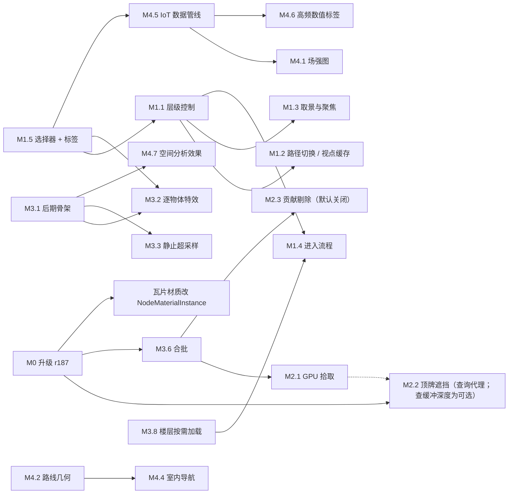

# 可借鉴与复用路线图

> 版本：2026-11-04，2026-11-05 按 three.js r187 复核（见 §8），2026-11-06 M0、M1 落地（各节"状态"），同日增补进度总览（§0.1）和 SDK 打包插入项（§10），2026-11-09 M3.6、M2.1、M2.2 落地，2026-11-10 M2.1、M2.2 合入 main 并在 Google 真实感 3D Tiles 下实测，同日 M2.3 落地（默认关闭、可配置）并合入 main，同日 GPU 显存盘点与硬件档位（插单 T261110-npf）合入 main，2026-11-11 迁移到 TerraView 并完成 SDK 第一期（§10），2026-11-12 逐项核对迁移完整性（§10.5）并按 SDK 定位重排后续阶段（**§0.2，当前执行以它为准**）。已改造的时间线、agent-hub 任务对应和待办清单见 [progress-log.md](progress-log.md)。本文是后续开发的总路线：把外部来源中可借鉴、可复用的内容，对照本仓库现状和 three.js 的内置能力，整理成分阶段的落地计划。外部代码只做了静态阅读和检索，没有安装或执行。
>
> 文中"参考平台"指一款商业数字孪生平台的浏览器运行时（闭源，只公开构建产物）；"t3d 生态"指开源的 t3d.js 渲染库及其配套扩展仓库。两类来源可以互相印证：参考平台里观察到的不少机制（拾取缓冲、静止超采样、后期缓冲依赖、遮挡查询、锚点矩阵），在 t3d 生态里都有公开实现。

## 0. 结论速览

1. **渲染底层不换，复用分三层**：
   - **直接用 three r186 内置**：描边、TRAA / SSAA、GTAO / SSR、OIT、成簇光照、级联阴影、高斯泼溅、遮挡查询、异步像素回读、`BatchedMesh`、宽线。这些在 t3d 里是自研扩展，three 已经现成，不再移植。
   - **移植算法（BSD-3 / MIT，保留版权声明）**：three 没有、或不适合我们场景的部分。包括拾取缓冲布局、静止超采样、遮挡代理管理、贡献剔除、八面体冒名顶替、IDW / 热力场生成、路线与带洞挤出构建器、阴影范围适配、动态字形图集。CPU 部分大多是纯函数，可以直接放进 Worker。
   - **只借鉴设计**：参考平台的层级控制、选择器、事件选项、取景策略、样式池、可见性驱动加载、IoT 数据管线。对方只有构建产物公开，按思路自研。
2. 按依赖关系排成 6 个里程碑：M0 升级 three r187（前置）→ M1 室内层级与交互框架 → M2 拾取、遮挡与顶牌 → M3 画质与性能 → M4 孪生数据与空间分析 → M5 工程与工具（持续）。
3. 最先做的 3 件事：**层级控制策略化（M1.1）**、**选择器表达式（M1.5）**、**GPU 拾取缓冲（M2.1）**。后两者是后面大多数功能的前置条件。M0 不阻塞 M1，但必须在 M2.2、M3.6 之前完成。
4. **2026-11-05 复核结论**（§8）：
   - 与 three 官方的进展没有方向冲突。
   - 有 4 处需要修正：
     - r186 的 `BatchedMesh` 在 WebGPU 上每个实例单独一次 draw，到 r187 才开始合并。
     - r186 的遮挡查询在多相机下会串结果，r187 修复。
     - r187 新增 `NodeMaterialInstance`，正是我们瓦片材质的写法，可直接替换。
     - 静止超采样、楼层 AO、阴影和帧快照，three 已有更完整的内置或 addon 方案，应先评估再决定是否自研。
   - 2026-11-06 修复：隐藏地球（Google 3D Tiles）且室内压制 3D Tiles 时，光标下落空导致平移飞出数千公里、右键不能环绕；室内无地表时改为展台背景。见 [camera-controller.md](camera-controller.md) §3.4、[indoor-bim.md](indoor-bim.md) §7.1。
   - 已完成：地球瓦片调度借鉴 CesiumJS 的改造（选择记忆、不丢细节守卫、象限填充、兄弟预建、雾化 SSE、取消即释放），见 [tile-loading.md](tile-loading.md)；点位标注（样式、规则、聚合），见 [markers.md](markers.md)；M0（升级 r187、瓦片材质实例）和 M1（层级控制、路径切换、取景、选择器、事件选项），见 [indoor-bim.md](indoor-bim.md) §5–§7。
5. **SDK 打包**（§10）：2026-11-06 作为插入项记录，2026-11-11 随迁移到 TerraView 完成 S1–S4，S5–S8 部分完成（状态见 §10.0）。仓库定位从此变成 SDK，后续排序改为"先首发就绪、再嵌入体验、再画质与孪生"，见 §0.2。

### 0.1 进度总览（2026-11-12 更新）

**已完成**

| 项 | 完成日期 | 要点 | 详见 |
| --- | --- | --- | --- |
| 地球瓦片调度（借鉴 CesiumJS） | 2026-11-05 | 选择记忆、不丢细节守卫、象限填充、兄弟预建、地形渐变、影像合并揭示、HTTP/1.1 限流、空闲预取 | [tile-loading.md](tile-loading.md) |
| 点位标注 | 2026-11-06 | 8 种顶牌样式、属性规则、层级聚合树、网格避让、`dense` 模式 | [markers.md](markers.md) |
| M0 升级 r187 与材质实例 | 2026-11-06 | three 0.187.0、3d-tiles-renderer 0.5.4；瓦片材质改 `NodeMaterialInstance` | §3 M0 |
| M1.1 层级控制策略化 | 2026-11-06 | `LevelControl` 注册表，内置 building / floor / placement | §3 M1.1 |
| M1.2 路径切换、取消、视点缓存 | 2026-11-06 | `levelPath`，`enter()` 可取消，返回飞回缓存视点 | §3 M1.2 |
| M1.3 取景与聚焦 | 2026-11-06 | 最近对角视点、同级半透明（`levelOpacity`） | §3 M1.3 |
| M1.4 进入流程与过渡 | 2026-11-06 | 等模型加载；DOM 版截帧淡出；注视飞行 | §3 M1.4 |
| M1.5 选择器与标签 | 2026-11-06 | 表达式编译 + 缓存，`tags:or/and/not` | §3 M1.5 |
| M1.6 事件选项与顶牌代理 | 2026-11-06 | 优先级、once、停止传播、顶牌事件代理 | §3 M1.6 |
| M1.6 收尾：事件暂停 | 2026-11-09 | `interaction.pause / resume`，按类型、tag、选择器范围，可选挡住默认行为 | §3 M1.6 |
| M2.1 GPU 拾取缓冲 | 2026-11-09 | 半分辨率 RGBA32Uint（对象 id、实例 id、视深、八面体法线）；按签名判断新鲜，不新鲜时退回射线；悬停查询 0.005 ms、与设备数无关；抽样与射线一致（差异只在对象边缘） | §3 M2.1 |
| M2.2 遮挡查询与顶牌遮挡 | 2026-11-09 | `MarkerOptions.occlusion: 'none' \| 'hide' \| 'fade'`；锚点代理 + three 遮挡查询，代理池固定容量、回收下标；重要顶牌只淡出；防抖 | §3 M2.2、[markers.md](markers.md) §5.2.1 |
| M2.3 贡献剔除 | 2026-11-10 | 默认关闭；设备与非结构构件按包围球精确屏幕占比剔除（移植 t3d），阈值 / 回差 / 间隔 / 选择器 / 按类别阈值可配；结构与楼板始终保留；剔除与 `visible` 分开 | §3 M2.3、[indoor-bim.md](indoor-bim.md) §5.3 |
| M3.6 合批与样式池 | 2026-11-09 | 设备按楼层 × 几何 × 基础材质 × 渲染状态合成 `InstancedMesh`；逐实例颜色 / 发光 / 不透明度走实例属性；材质池按唯一键共享 + 引用计数，`NodeMaterialInstance` 共享着色器；1 万设备 40 次绘制 | §3 M3.6、[indoor-bim.md](indoor-bim.md) §5.2 |
| ISSUE-1 统一高程查询 | 2026-11-09 | `viewer.surfaceHeight`：地形 / 3D Tiles 竖直射线 / 压制期间沿用缓存，带分辨率与可信度；建筑、点位、防入地、参考地面统一改用 | §9 ISSUE-1 |
| 插入项：无地表时的手势与背景 | 2026-11-06 | 参考地面兜底手势、展台背景 | [camera-controller.md](camera-controller.md) §3.4、[indoor-bim.md](indoor-bim.md) §7.1 |
| 插入项：开场动画、云层、基础导航控制 | 2026-11-09 | 开场自转（停在初始视角）、程序云 / 云图漂移、`viewer.navigation` 导航命令与按钮条；核心 API 与 UI 分离，为 §10 SDK 打包铺路 | [intro-and-navigation.md](intro-and-navigation.md) |
| 插入项：缩放抖动排查与自动旋转按视角 | 2026-11-09 | 云层噪声按像素限带，修复缩放时云边闪烁；自动旋转按视角选地球自转 / 环绕 / 先倾斜再环绕 | [intro-and-navigation.md](intro-and-navigation.md) |
| 插入项：GPU 显存盘点与硬件档位 | 2026-11-10 | `low / medium / high / ultra` 档位（按适配器猜测或 `?gpu=` 指定）；3D Tiles 远处放宽、缓存满时自适应降精度、纹理过滤策略；隐藏地球超时释放缓存；`viewer.gpu` / `viewer.memory`。Hub 任务 T261110-npf | [gpu-memory.md](gpu-memory.md) |
| 插入项：建筑数据制作手册 | 2026-11-06 | 中文手册 + 有单测校验的样例；门洞、构件校验 | [building-data-manual.md](../building-data-manual.md) |
| SDK 第一期：迁移到 TerraView | 2026-11-11 | 包入口与库构建、three 外置、`tv-` 样式、键盘改容器、解码器路径、聚合 Worker 关闭、CI / Release、打包自检、Apache-2.0；40 次创建销毁无泄漏、Webpack 5 宿主可构建运行 | §10.0、§10.5 |

**未完成**

| 项 | 状态 | 说明 |
| --- | --- | --- |
| 迁移收尾 | 完成（2026-11-12；源仓库收口由维护者自行处理） | §0.2 P0 |
| SDK S5–S8 余项与首次发布 | 未开始 | §0.2 P1 |
| M1.4 GPU 版截帧过渡 | 遗留 | 等 M3.1 后期骨架，再把 DOM 淡出换成缩放过渡、按深度混合 |
| M2.2 改查拾取缓冲深度 | 可选优化，暂缓 | 见 §3 M2.2 |
| M3.1–M3.5、M3.7–M3.9 画质与性能 | 未开始 | M3.3 的按需渲染、M3.8 楼层按需加载提前到 §0.2 P2，其余在 P3 |
| M4.1–M4.8 孪生数据与空间分析 | 未开始 | §0.2 P4，按需求排期 |
| M5.1–M5.3 工程与工具 | 未开始 | 持续项 |

### 0.2 TerraView 阶段计划（2026-11-12 调整）

迁移之后，仓库的产出从"一个演示应用"变成"给第三方嵌入的 npm 包"，排序原则相应调整：

1. **先把迁移收干净**，再谈新功能（P0）。
2. **首发前必须定下的东西优先**（P1）：公共 API 边界、写死在核心里的中文文案、打包工具兼容。0.x 阶段可以有破坏性变更，但每改一次都要宿主跟着改，越晚越贵。
3. **嵌入方最先感知的是功耗、显存、加载状态**（P2），排在画质特效（P3）之前。
4. **画质（M3）和孪生数据（M4）按业务需求排期**，单项方案仍按 §3，不重写。

编号说明：`P*.*` 是本节的执行单元；括号里是 §3 的里程碑项和 [progress-log.md](progress-log.md) §4 的待办编号，两边状态同步更新。

**P0 迁移收尾**（✅ 2026-11-12 全部标为完成）

| 编号 | 内容 | 做法 / 状态 | 验收 |
| --- | --- | --- | --- |
| P0.1 | 文档残留：旧类名（markers.md 的 `.tg-*`）、旧路径（`src/ui/`）、许可证"未定"、S5 / S6 实测结果没有同步过来 | ✅ 2026-11-12，核对过程见 §10.5 | 文档和注释里搜不到旧类名、旧路径（AGENTS.md §8 的对照表除外） |
| P0.2 | 第三方声明补全：`globe/tileSelection.ts` 和 `Globe.visitTile` 改写自 CesiumJS（Apache-2.0），`THIRD_PARTY_NOTICES.md` 只收录了 t3d.js；EGM96 网格的数据来源（NGA，公有领域；经 `egm96-universal`，MIT，生成）也没写 | ✅ 2026-11-12：补了 CesiumJS（Apache-2.0，`Copyright 2011-2026 CesiumJS Contributors`，列出 7 个改写位置）和 EGM96（NGA 数据，经 `egm96-universal` MIT）两节；quantized-mesh 解码是按格式规范自写，单独注明 | 声明与文件头一一对应 |
| P0.3 | `package-lock.json` 根包的 `license` 还是 `UNLICENSED`（`package.json` 已改为 Apache-2.0） | ✅ 2026-11-12（经同意）：只改根包的 `license` 字段，没有重新解析依赖 | 两处一致 |
| P0.4 | 远端 CI 首跑确认 | ✅ 2026-11-12 确认：`ci.yml` 第 1 次运行（推送 `441a82c` 触发）成功，Verify（Node 22）、Verify（Node 24）、Package check 三个 job 全绿，用时 1 分 16 秒，24 个测试文件、291 个测试通过，tgz 产物 1 个 | CI 绿 |
| P0.5 | 源仓库收口 | ✅ 2026-11-12 标为完成：由维护者自行在源仓库处理，步骤清单只保存在本地 `temp/source-repo-wrapup.md`（不入库）。实测记录已抄入本仓库 §10.5 | 源仓库 main 能看出"已迁移" |
| P0.6 | `cad-to-building` 技能和 CAD 数据的去留 | ✅ 2026-11-12 决定：**不迁移**。技能和 CAD 资料留在源仓库，本仓库不收录（AGENTS.md §8.3） | 有结论 |

**P1 首发就绪**（约 2 周，目标是首个对外版本，建议 `0.2.0`）

| 编号 | 内容 | 做法 | 验收 |
| --- | --- | --- | --- |
| P1.1 | 公共 API 收口（S7） | 2026-11-12：必填项检查已做（`create()` 先检查 `container` / `imagery`，缺了抛 `option-invalid`，不再拖到每帧报错）；分级见下方草案，待确认。`src/index.ts` 的导出逐项分成稳定 / 高级 / 内部；`renderer` `scene` `camera` `globe` `controller` 等内部对象标 `@internal`（声明里用 `stripInternal` 去掉）或收进 `viewer.advanced`；P2.1、P2.4 要新增的 API 名字在这一步一起定。另：`GeoViewerOptions.imagery` 是必填，但不写类型的 JS 宿主漏传时不报错，之后每帧在 `Globe.update` 报错、`dispose()` 也抛错（2026-11-12 冒烟时发现）：`create()` 里校验必填项，缺了就抛 `TerraViewError`（或给默认影像） | [api.md](../api.md) 的清单与 `dist/types` 一致；变化记入 CHANGELOG |
| P1.2 | 核心文案选项化（S7） | ✅ 2026-11-12。确认项：**默认 `zh-CN`**，**错误信息用英文**（带 `code`）。做法：`core/i18n.ts`（`GeoViewerOptions.locale` / `messages`，内置 `zh-CN`、`en`）管实体自动属性名、房间顶牌副标题、点位图层默认名；预设显示名改为 `label: LocalizedText`；`core/errors.ts` 的 `TerraViewError`（8 个 code，Worker 跨线程保留 code）；服务商署名和输入字段别名保留原文。演示应用用 `demo/ui/errors.ts` 把 code 译成中文。破坏性变更见 CHANGELOG | 除白名单（输入别名、署名、预设中文名）外 `src/` 无中文字面量，由 `tests/i18n.test.ts` 扫描守住；单测覆盖两种语言 |
| P1.3 | 打包工具兼容余项（S6） | ✅ 2026-11-12。**EGM96 评估 ✅ 2026-11-12**：瓦片 Worker 197 KiB（gzip 102）里网格占 170 KiB（gzip 93），去掉后 Worker 只剩 27 KiB。结论：Worker 里保持内嵌（Worker 只下载一次并缓存；AWS Terrarium、Mapbox、MapTiler 等海拔类地形都要用它，改按需加载只对无地形或只用 quantized-mesh 的宿主有利，还要让首块地形多等一次请求）。另发现**主入口里也有一份网格**（170 KiB，只因 `src/index.ts` 导出了 `geoidUndulation`，演示应用和宿主都没用）：Vite 生产构建的宿主会摇树去掉（实测宿主产物里只有 Worker 那份），但开发服务器和不经打包的 CDN 用法会多下载这一份；改成按需加载的异步 API 或不再导出，归入 P1.1 决定。**Webpack 实测 ✅**：Webpack 5 宿主实测（2026-11-12，webpack 5.112、webpack-cli 6、style-loader / css-loader，装入打好的 tarball，生产构建，Chrome WebGPU）：用 three.js r187 示例里的 `ferrari.glb`（`KHR_draco_mesh_compression`）和 `facecap.glb`（`KHR_texture_basisu` + `EXT_meshopt_compression`）经 `viewer.loadModel()` 加载，Draco 解出 51 个网格、33.8 万顶点，KTX2 转码成 GPU 压缩纹理（BC7，1024²，11 级 mip），meshopt 正常；没有设 `decoderPath` / `transcoderPath`，解码器文件由 webpack 按 three 的 `new URL(..., import.meta.url)` 作为资源输出，请求全部 200，控制台无任何消息（测试工程和模型只在临时目录，不入库） | Vite、Webpack 两种宿主都能加载压缩模型；EGM96 有结论 |
| P1.4 | 多实例余项（S5） | ✅ 2026-11-12：逐项核对模块级共享状态（结论表在 [api.md](../api.md) §4）。发现并修复一个问题：大气和注记的相机 uniform 是共享的，`captureFrame()` 和层级切换截帧在帧外渲染时没有重写，同页两个 viewer 时会画出另一个 viewer 的相机和大气；现在走 `renderOutsideFrame()`。浏览器实测：WebGL viewer 与演示应用的 WebGPU viewer 共用同一栋建筑的材质后销毁，再轮流以两种后端创建、销毁 6 个 viewer，无错误，演示应用的建筑照常渲染 | 两个 viewer 分别用 WebGPU 和 WebGL 时也正常 |
| P1.5 | 浏览器冒烟测试进 CI | ✅ 2026-11-12。新增开发依赖 `@playwright/test` 1.65.0（约 19 MB，本机不下载浏览器，用已装的 Chrome；CI 用 Playwright 的 Chromium）。`playwright.config.ts` + `tests/e2e/`：**演示应用**（`?imagery=debug&noterrain&intro=0&clouds=0&demo`：瓦片就绪、建筑 → 楼层 → 房间 → 逐级返回地球并核对 13 个层级事件的顺序、房间顶牌、销毁后画布移除且 Worker 归零）；**打包宿主**（`check:package --keep-host .smoke/host` 保留的 host-fixture 构建：两个 viewer、影像和地形由本地替身瓦片应答、顶牌留在容器内、销毁左边后右边继续出帧、容器类名和 `tabindex` 还原、全部销毁后 Worker 归零、只有一份 three）。每个目标 WebGL / WebGPU 各一遍，无 WebGPU 适配器时自动跳过；页面错误、控制台错误、请求外部域名都算失败。实测：本机 Chrome 4 项全过（约 40 秒）；`SMOKE_NO_GPU=1` 模拟无 GPU，WebGL 两项过（宿主约 1.5 分钟）、WebGPU 两项跳过。CI 新增 `smoke` job。2026-11-13 修正：远端首跑宿主测试超时（软件渲染下等加载队列排空，2 核 runner 150 s 不够）；软件渲染改为只等屏幕就绪（有 GPU 仍要求排空），WebGL / WebGPU 都走 SwiftShader（CI 上 WebGPU 不再跳过），不重试，打包检查与冒烟合并为 CI 的 `package` job；本机软件模式 4 项全过（1.7 分钟）。合并后的 CI 远端首跑待推送后确认。原计划：**有条件时用真实浏览器 MCP**（如 Claude in Chrome，驱动本机真实 Chrome）做冒烟；**Playwright 兜底**（CI 和没有浏览器 MCP 时用，同意新增为开发依赖）。现在 CI 只有单测和构建，渲染、Worker、多 viewer、销毁都靠手测。用无头 Chrome（WebGL 回退或 SwiftShader）打开 `scripts/host-fixture`：创建、等瓦片就绪、`?demo` 进出层级、销毁，检查控制台无错误、Worker 归零 | CI 上有浏览器 job |
| P1.6 | 包体积预算 | ✅ 2026-11-12：`scripts/check-package.mjs` 的 `BUDGETS` 给入口、样式和三个 Worker 各设原始大小与 gzip 上限（比当时大小高约 10%：入口 720 / 270 KiB，瓦片 Worker 220 / 115 KiB），超出时 `check:package` 失败，CI 上把体积表写进运行摘要。当时入口 652 KiB（gzip 242），瓦片 Worker 197 KiB（gzip 102）。有意增大时调高预算并在提交里说明。子入口（`terra-view/indoor`、`/markers`）只在体积真成问题时再做，单包的结论（§10.4）不变 | 超过预算时 CI 失败 |
| P1.7 | 首次发布（2026-11-12 决定：**先做准备，暂不发布**；准备好后再单独确认发布时间） | 首发前确认 npm 包名（`terra-view` 可能撞相似名规则，见 §10.0，被拒就改带 scope 的名字）；README 补宿主接入示例（最小接入、多 viewer、室内）；整理 CHANGELOG、去掉 `private`、打标签。**发布和推送标签要先得到明确同意** | 按 AGENTS.md §8.5 的发版步骤走完 |

**P1.1 公共 API 分级草案**（2026-11-12，**待确认后再动代码**；依据：`src/index.ts` 227 个导出、`GeoViewer` / `Globe` 的公开成员，以及演示应用和宿主工程实际用到的 56 个导出）

机制：**稳定**不加标记，0.x 期间也尽量不破坏，破坏记 CHANGELOG；**高级**加 TSDoc `@advanced`（自定义标记，在 api.md 说明含义：给扩展和调试用，次版本可以改、不预先废弃）；**内部**加 `@internal`，`tsconfig.build.json` 开 `stripInternal` 从声明里去掉，并从 `src/index.ts` 移除。不引入 api-extractor。

| 分级 | 内容 |
| --- | --- |
| 稳定 | `GeoViewer` 的创建与释放、视点与飞行（`setView` / `getView` / `flyTo*` / `resetNorth` / 环绕 / `playIntro`）、图层增删与列表、拾取（`pick` / `pickAt` / `pickCartographic` / `pickFeature` / `highlightFeature`）、`surfaceHeight`、`loadModel`、`captureFrame`、`canvas`、`events` / `info` / `stats` / `memory` / `gpu` / `locale` / `messages`、场景开关（`lighting` / `atmosphere` / `showGlobe` / `showStars` / `date` / `timeMultiplier` / `indoorBackdrop`）、`ellipsoid`；子对象 `navigation`、`interaction`、`indoor`、`markers`、`clouds`、`overlays`，`controller` 的手势开关与 `zoomBy` / `orbitBy` / `playAnimation`；它们的选项和结果类型。影像源、预设、地形源；`Tiles3DLayer`、`GeoJsonLayer`、`PointLayer`、`Marker` / `MarkerManager`；`Building`、`BimEntity`、`EntitySet`、`parseBuildingDoc` 与文档类型、选择器、`LevelControl` 与内置控制；`CloudLayer` 选项；`Ellipsoid`、`cartographic`、`geodeticToEcef`、`geodeticNormal`、`geoidUndulation`、`sunDirectionECEF`、角度与格式化工具、`EventEmitter`；语言与错误 |
| 高级 | `viewer.renderer` / `scene` / `camera`（演示应用用它们做弹窗定位）、`viewer.globe`（`Globe` 里换影像 / 地形、出错回调、调参属性算高级；`update` / `group` / `scheme` / `raycast` 等引擎内部的成员标内部）、`viewer.pickBuffer`、`viewer.levelTransition`（演示应用切换淡出）、`tileDebugUniforms` / `refreshTileMaterials`、GPU 档位函数（`gpuProfile` / `classifyGpu` / `GPU_TIERS`）、相机数学（弧度）、顶牌模板（`createCard`）、点位纯函数（`parsePoints` / `resolvePointStyle` / `matchesRule` / `fillTemplate` / `pointsBBox`）、`OverlayCompositor`、`ContributionCuller` |
| 内部 | `viewer` 的 `stars`、`sunLight`、`skyLight`、`labels`、`vectors`、`markerOcclusion`、`backdrop`、`pickReferenceSurface`；导出 `FrameCrossfade`（只留类型给 `levelTransition`）、`decodeImage`、`isQuantizedMesh`、`WebMercatorTilingScheme` / `MERCATOR_MAX_LATITUDE` / `GeoRect`、`greenwichMeanSiderealTime`、`GpuHints`、聚合树（`buildClusterTree` / `clusterLeaves` / `ClusterSelector` / `ClusterTree*` / `ClusterView`）、`createClusterCard` / `setClusterCount`、`PickBufferOptions` / `PickTarget` / `GpuPick`、`SurfaceSample` / `SurfaceSource` |

配套改动：演示应用读的 `viewer.vectors.highlighted` 改成稳定的 `viewer.highlightedFeature`；分级写进 api.md §3（每行标级别）。另外 `geoidUndulation`（原列在稳定里）会让主入口带上 170 KiB 的 EGM96 网格（P1.3），建议改为异步按需加载（如 `loadGeoid(): Promise<(lon, lat) => number>`）或移到内部。待确认的三点：① 上面的分级本身；② `geoidUndulation` 怎么处理；③ "内部"是用 `stripInternal` 从类型里去掉（宿主写了就编译不过），还是只标注、保留类型（更温和，但挡不住误用）。我的建议是去掉。

**首发准备清单**（P1.7；2026-11-12 决定先准备、暂不发布。发布、推标签、去掉 `private` 都要单独确认）

| 项 | 状态 |
| --- | --- |
| 包名 `terra-view` | npm 上仍未注册（2026-11-12 再查，404）。相似名规则只有真正发布时才能确认，被拒就改带 scope 的名字（§10.0） |
| `package.json` 的 `repository` / `homepage` / `bugs` / `keywords` | ✅ 2026-11-12 补上。`release.yml` 在公开仓库里带 `--provenance` 发布，npm 会核对 `repository` 与 GitHub 仓库是否一致，缺了会发布失败 |
| 体积预算 | ✅ P1.6 |
| 发布流程演练 | 待做：在 GitHub Actions 页面手动运行 Release 工作流（演练模式：验证、打包自检、打包，不建 Release、不发布） |
| 仓库密钥 `NPM_TOKEN` | 待配置（npm 自动化令牌，发布前加到仓库密钥） |
| GitHub 仓库是否公开 | 待决定：公开仓库才会带 provenance；包里的 `repository` 链接对私有仓库的使用者打不开 |
| 首发前的代码项 | P1.1（P1.2–P1.6 ✅） |
| 发版当天 | 改 `package.json` 的 `version`（`package-lock.json` 两处同步）→ CHANGELOG「未发布」整理成该版本 → 去掉 `private` → 合并到 main → 打标签推送（AGENTS.md §8.5） |

**P2 嵌入体验与性能**（P1 之后；P2.1 可与 P1 并行）

| 编号 | 内容 | 来源 | 说明 |
| --- | --- | --- | --- |
| P2.1 | 按需渲染：相机、瓦片、动画、顶牌都没变化时不画新帧；宿主可调用 `requestRender()` | M3.3 前半（B1） | 大屏、仪表盘一类宿主最先关心功耗；也是静止超采样（P3.3）的前置。要处理云层、开场、拾取缓冲、遮挡代理各自的"有变化"信号 |
| P2.2 | 楼层模型按需加载，离开后按显存预算 LRU 卸载 | M3.8（B6） | 档位和预算机制已有（[gpu-memory.md](gpu-memory.md)），成本最低 |
| P2.3 | 3D Tiles 要素拾取与属性查询（`EXT_mesh_features` / batch table），高亮，接入 `viewer.interaction` | progress-log C8 | README 近期项，业务有需要时可提前 |
| P2.4 | 加载状态与错误事件 | 新增 | 核对现有的 `viewer.events`、图层 `events`，补齐宿主需要的"图层就绪 / 加载进度 / 出错（带 `code`）"。现在 `ViewerEvents` 只有帧统计、图层增删和点位单击；影像出错只能通过 `globe.onImageryError` 回调拿到（P1.2 之后已是带 `code` 的 `TerraViewError`，但不在 `viewer.events` 上）。事件名在 P1.1 一起定 |

**P3 画质**（按需求排期；单项方案见 §3 M3）

P3.1 后期管线骨架（M3.1，B2）→ P3.2 描边与发光，替换 emissive 高亮（M3.2，B3）→ P3.3 静止超采样与调色（M3.3 后半，B4，依赖 P2.1）→ P3.4 GPU 版层级过渡（M1.4 遗留，B5）。不依赖后期的可以穿插：楼层 AO（M3.4）、光照跟随大气（M3.5）、冒名顶替（M3.7）；透明与阴影（M3.9）依赖 P3.1。

**P4 孪生数据与空间分析**（按需求排期；单项方案见 §3 M4）

IoT 数据管线（M4.5，E4）优先，它解锁场强图（M4.1）和高频数值标签（M4.6）；路线几何（M4.2）→ 室内导航（M4.4）；带洞多边形与挤出（M4.3）；空间分析效果（M4.7）依赖 P3.1；场景扩展（M4.8）逐项评估。

**P5 持续项**：地球与瓦片进阶（§8.3，progress-log C 组）、工程与工具（M5）、README"中期 / 产品化"里的方向（progress-log F 组）。

阶段之间的约束：

- P1.1、P1.2 都是公共 API 的破坏性变更，必须在首次发布前完成；P1 期间新增的 API（包括 P2 提前做的）直接按 P1.1 的规则写。
- P2–P5 的每一项落地时，按 AGENTS.md §3.10 同步 [api.md](../api.md) 和 CHANGELOG，并跑 `npm run check:package`。

## 1. 来源与许可

| 来源 | 版本 / 提交 | 许可 | 用法 |
| --- | --- | --- | --- |
| 参考平台 | 2026-11 在线版本；另有旧版构建产物和类型声明以 BSD-3 公开 | 构建产物 | 只借鉴设计，不搬运代码 |
| [t3d.js](https://github.com/uinosoft/t3d.js) | 0.5.5，`1f2c3c8`（2026-09-22） | BSD-3-Clause | 移植算法 |
| [t3d-effect-composer](https://github.com/uinosoft/t3d-effect-composer) | 0.4.2，`2a255f0` | BSD-3-Clause | 借鉴架构，移植个别效果 |
| [t3d-atmosphere](https://github.com/uinosoft/t3d-atmosphere) | 0.0.1，`c85ce60`（标注为开发中） | BSD-3-Clause | 借鉴"光照跟随大气"的思路 |
| [t3d-particle](https://github.com/uinosoft/t3d-particle) | 0.2.0，`f5e385f` | BSD-3-Clause | 借鉴数据驱动的配置格式 |
| [t3d-pano](https://github.com/uinosoft/t3d-pano) | 0.2.0，`b67cf9b` | BSD-3-Clause | 借鉴全景图的组织方式 |
| [t3d-3dtiles](https://github.com/uinosoft/t3d-3dtiles) | 0.4.0，`fa97309` | BSD-3-Clause（核心移植自 3DTilesRendererJS，Apache-2.0） | 不用：我们直接用上游 |
| [t3d-dynamic-sky](https://github.com/uinosoft/t3d-dynamic-sky)、[t3d-gaussian-splatting](https://github.com/uinosoft/t3d-gaussian-splatting)、[t3d-ibl-baker](https://github.com/uinosoft/t3d-ibl-baker) | 0.1.2 / 0.1.0 / 0.0.4 | BSD-3-Clause | 仅参考 |
| [zenfg](https://github.com/uinosoft/zenfg)（`@zenfg/webgpu`） | 0.2.0，`c5a119d`（2026-10-14） | MIT | 评估（M5.2） |
| [t3d-skills](https://github.com/uinosoft/t3d-skills) | 1.0.0，`7e20306` | 无 LICENSE 文件 | 只借鉴目录结构，不复制内容 |

**复用规则**

- **移植代码**：移植 BSD-3 / MIT 代码时，文件头写明来源仓库、文件路径和提交号，并把原 LICENSE 的版权行和条款收录到 `THIRD_PARTY_NOTICES.md`；不得用对方名义为本项目背书。只借思路、自己重写的，在注释里注明参考来源，便于追溯。
- **二手来源**：t3d 自身也收录了第三方代码，移植前要核对原始许可。例如 earcut 是 ISC 许可；"假室内"示例改写自一个第三方 Godot 着色器。
- **参考平台**：只有混淆后的构建产物，不复制代码，也不研究授权相关逻辑。
- **落点**遵守 [AGENTS.md](../../AGENTS.md)：
  - GPU 代码一律写 TSL（§3.3）。
  - CPU 纯算法放在不依赖 three 的模块里，Worker 也能用（§3.6）。t3d 的构建器只依赖它的 `Vector3`，移植时换成数组或 `core/` 里的数学函数。
  - 数学和调度规则配单测（§6）。
  - 新增 npm 依赖要先征得同意并锁定版本（§1）。

## 2. 能力对照总表

"决策"一列：**内置** = 直接用 three 自带的能力（核心或随包发布、版本随 three 锁定的 `three/addons`）；**移植** = 按 t3d 源码改写为 TSL / TypeScript；**自研** = 按参考平台的设计自己实现。"three" 一列按 r186 写，r187 的变化另行标出（§8）。

| 能力 | 参考平台 | t3d 生态 | three r186 | 我们现状 | 决策 | 里程碑 |
| --- | --- | --- | --- | --- | --- | --- |
| 层级控制 | 策略注册表 + 生命周期钩子 | — | — | **已完成**：`LevelControl` 注册表 | 自研 | M1.1 |
| 逐级切换、视点缓存 | 有 | — | — | **已完成**：路径切换、取消、视点缓存 | 自研 | M1.2 |
| 取景、聚焦 | 最近对角视点、同级半透明 | — | — | **已完成**：最近对角视点、同级 25% | 自研 | M1.3 |
| 选择器 | 编译缓存的布尔表达式 + 标签 | — | — | **已完成**：表达式编译 + LRU 缓存 + 标签 | 自研 | M1.5 |
| 事件选项 | 优先级、once、停止传播、暂停 | — | — | **已完成**：优先级、once、停止传播、顶牌代理、暂停 | 自研 | M1.6 |
| GPU 拾取 | ID + 深度缓冲，按需刷新 | `PickBuffer`：法线、视深、id 一次输出 | `readRenderTargetPixelsAsync`、`setRenderObjectFunction`、位转换节点 | 指针移动时 CPU 射线 | 移植布局 + 内置 API | M2.1 |
| 遮挡查询、顶牌遮挡 | 查拾取缓冲深度 | `OcclusionProxyManager` | `occlusionTest` / `isOccluded`；r186 多相机共用渲染上下文时会串结果，r187 改为按相机保存 | 无 | 内置（r187 起）+ 移植管理方式 | M2.2 |
| 贡献剔除 | — | 示例 `renderer_culling_contribution` | — | **已完成**：默认关闭，参数可配 | 移植 | M2.3 |
| 后期框架 | 配置驱动 | 权重排序 + 缓冲依赖 + 逐物体标记 | `RenderPipeline` + `pass` + `mrt` | 无后期 | 借鉴架构，用内置节点 | M3.1 |
| 描边、x-ray | 按颜色分组 | 标记缓冲（区分是否深度测试） | `OutlineNode`（可见边 / 被挡边分色） | emissive 高亮 | 内置 | M3.2 |
| 逐物体发光 | — | Glow / InnerGlow / SoftGlow | `mrtNode` + 选择性泛光 | 无 | 内置 + 标记约定 | M3.2 |
| 静止超采样 | 静止时累积约 30 帧 | `SuperSampling` / `CameraJitter` | `TRAANode`、`TAAUNode`、`TemporalReprojectNode`（需要速度缓冲；相机静止时退化为抖动累积） | 每帧渲染 + MSAA | 先评估内置，不满足再移植 | M3.3 |
| 调色 | 默认对比度、饱和度 1.1 | ColorCorrection | 色彩函数节点 | 无 | 内置 | M3.3 |
| 楼层 AO 烘焙 | 俯视渲染墙体 + 多级模糊 | — | `SSAONode`、`GTAONode`（屏幕空间）；r187 `LightMapper` + `unwrapUVs`（漫反射烘焙） | 无 | 自研轻量烘焙，完整光照烘焙用内置 | M3.4 |
| 光照跟随大气 | 环境贴图按局部坐标定向 | 太阳色、天光球谐、深度雾 | `LightProbe`、`LightProbeGrid`（WebGPU 版）、`SunLight`（级联阴影）、`scene.fogNode` | 只有地球瓦片有空气透视 | 自研（复用我们的大气节点），光源用内置 | M3.5 |
| 合批、样式池 | 按唯一键共享 + 自动实例化 | `BatchedMesh`、实例化材质 | `InstancedMesh`；`BatchedMesh` 在 WebGPU 上 r186 每实例一次 draw，r187 合并同几何的连续实例；r187 `NodeMaterialInstance` | 每个实体一份材质 | 内置（r186 用 `InstancedMesh`）+ 自研池 | M3.6 |
| 冒名顶替 | — | `OctahedralImpostor` | 无 | 无 | 移植 | M3.7 |
| 楼层按需加载 | 可见即加载、隐藏可卸载 | — | — | 加载建筑时全部加载 | 自研 | M3.8 |
| 透明排序 | — | 加权混合 / 深度剥离 OIT | `OITPassNode`（addon） | 默认排序 | 内置 | M3.9 |
| 阴影 | 阴影贴图交给地球着色器 | `LightShadowAdapter` | `SunLight`、`CSMShadowNode`、`TileShadowNode`（r187 用仅深度渲染目标） | 无 | 内置 + 移植范围适配 | M3.9 |
| 场强图 | — | IDW / 热力图生成器 | 计算节点 | 无 | 移植 | M4.1 |
| 路线、管线 | — | `RouteBuilder`、`TubeBuilder` | `TubeGeometry`（依赖 three） | 无 | 移植（Worker 版） | M4.2 |
| 带洞多边形、挤出、边线 | 房间支持洞 | Polygon / ExtrudeShape / Edges 构建器 | `ShapeUtils`、`EdgesGeometry`（依赖 three） | 主线程生成，房间不支持洞 | 移植（Worker 版） | M4.3 |
| 室内导航 | 按楼层分子网的路网 | `Pathfinding` + `Zone`，Recast 示例 | — | 路线图 | 自研拓扑图 + 可选导航网格 | M4.4 |
| IoT 数据 | 订阅、批量发布、适配器 | — | — | 静态属性 | 自研 | M4.5 |
| 高频数值标签 | 字体图集在 Worker 生成 | `DynamicFont` | — | 整段文字光栅化 | 移植 | M4.6 |
| 天际线、贴花、剖切 | 天际线分析 | `SkylineEffect`、`Decal` | 裁剪平面 | 无 | 移植 | M4.7 |
| 全景、高斯泼溅、粒子、假室内、天气 | 有 | `t3d-pano`、`t3d-particle`、示例、weather | `GaussianSplat`（addon，含 PLY / SPZ / glTF 加载）、计算节点、`exponentialHeightFogFactor` | 无 | 按项选择 | M4.8 |
| 帧图、帧快照 | — | zenfg（FrameGraph + Snapshot） | `Inspector`（addon：CPU / GPU 时间、时间线、TSL 图）；r187 `renderer.drawingPipeline` | 状态栏统计 | 基于 Inspector 扩展；FrameGraph 仍只评估 | M5 |
| 点位标注 | 顶牌、点位聚合 | — | —（HTML 层自研） | **已完成**：8 种样式、规则、聚合 | 自研 | [markers.md](markers.md) |
| 地球瓦片调度 | — | — | — | **已完成**：借鉴 CesiumJS 的选择记忆、不丢细节、象限填充 | 自研 | [tile-loading.md](tile-loading.md) |

## 3. 里程碑

### M0 升级 three r187 与材质实例（P0，前置）

- **范围**：
  - `three` 0.186.1 → 0.187.x（2026-10-30 发布），`@types/three` 0.187.0。
  - `3d-tiles-renderer` 0.5.3 → 0.5.4（peer 要求 `three >=0.167.0`）。
  - 按 AGENTS.md §1，升级前要征得同意，并锁定精确版本。
- **收益**（只列与本仓库直接相关的）：
  - 反向深度的几处修复：深度函数映射（#35264）、多边形偏移（#34606）、ArrayCamera 深度清除值（#34804）、首帧阴影（#34801）。我们全程使用反向 Z。
  - 遮挡查询结果按相机保存（#35066），这是 M2.2 的前提。
  - `NodeMaterialInstance`（#34684 引入，#35269 定名）：多个实例共享一次着色器构建，每个实例保存自己的属性，节点图用 `materialReference()` 读取。这正是 `TileMaterial` 现在的写法（每块瓦片一个 `MeshBasicNodeMaterial`，共享同一组节点），可以直接替换。PR 的基准测试里，首帧耗时从 2039 ms 降到 162 ms。
  - `BatchedMesh` 合并同几何的连续实例（#35259），这是 M3.6 的前提。
  - `compileAsync()` 并行编译管线（#34816），可用于启动预热；新增仅深度渲染目标（#34782，`count: 0`）。
- **迁移检查**（186 → 187 共 9 项，已逐项对照本仓库）：
  - TSL 运算的隐式类型提升（#33695）：要复查 `TileMaterial`、`AtmosphereNodes`、`nodeMaterials` 的输出有无变化（截图对比）。
  - PMREM 改为立方体渲染目标、`CubeUVReflectionMapping` 移除：未使用。
  - 灯光注册改为 `Light.registerNode()`：我们没有自定义灯光。`renderer.library.fromMaterial` 仍然保留（已核对 r187 源码）。
  - 结构体存储缓冲统一按数组处理、`pixelationPass` 参数类型、`iridescenceThicknessRange` 废弃：均未使用。
  - `setAnimationLoop(null)` 不再启动内部循环（首次使用时才启动）：与现有用法兼容。
- **步骤**：
  1. 升级依赖，跑 typecheck / test / build。
  2. 按 AGENTS.md §6.3 手测，并对大气、瓦片、3D Tiles 截图对比。
  3. 瓦片材质改用 `NodeMaterialInstance`，用 `viewer.stats.frameMs` 和 Inspector 对比新瓦片的首帧耗时。
  4. 更新 AGENTS.md §1 的版本说明。
- **验收**：功能和画面没有回归；快速缩放时，新瓦片带来的帧时间尖峰明显下降。
- **状态（2026-11-06，已完成）**：
  - 依赖：three 0.187.0、@types/three 0.187.0、3d-tiles-renderer 0.5.4，`package.json` 和 `package-lock.json` 都已更新。typecheck、test、build 一次通过，没有需要改的 API。
  - 瓦片材质：`createTileMaterial` 返回共享 `MeshBasicNodeMaterial` 的 `NodeMaterialInstance`。实例上的 `needsUpdate` 无效，线框开关改为调用 `refreshTileMaterials()`。`textureReference` 的独立哈希照常生效。
  - 实测（WebGPU、RTX 40 系，一帧新增 200 块瓦片，取 4 轮中位数）：首帧 32 ms → 18.7 ms，比稳态多出的部分约 21 ms → 10 ms；每块材质的缓存键计算 2.5 ms / 200 块 → 0.1 ms。收益没有 PR 基准（2039 → 162 ms）那么大，因为我们的瓦片本来就共享节点图，节点构建结果已命中缓存；剩下的首帧开销主要是每块瓦片的绑定组创建。
  - 浏览器检查：地球、建筑、3D Tiles 样例在 r187 下没有着色器报错；全球俯视时光标在北、南、东、西滚轮放大，航向保持 0°、俯仰保持 -90°。
  - 未做：与 r186 的逐像素截图对比（#33695 隐式类型提升），只做了目测；Inspector 的逐帧对比。
  - r187 发布于 2026-10-30，未满 README 约定的"发布满两周"，属于按本节计划提前升级。

### M1 室内层级与交互框架（P0）

目标：把写死在 `IndoorManager` 和 `GeoViewer` 里的规则改成可配置的策略，为后续所有室内功能打底。

**M1.1 层级控制策略化**（工作量：中）

- 新增 `indoor/LevelControl.ts`，接口草案（我们自己的设计）：

  ```ts
  interface LevelControl {
    /** 哪些实体使用这套控制，例如 '.room' 或 'tags:or(device,door)'。 */
    condition: EntitySelector;
    /** 多套控制匹配同一实体时，数值大的优先。 */
    priority?: number;
    /** 进入时设置显隐、透明、描边；离开时撤销。 */
    setEffect(ctx: LevelContext): void | Promise<void>;
    resetEffect(ctx: LevelContext): void | Promise<void>;
    /** 把拾取命中的实体映射为当前层级下可交互的单元（悬停、单击、双击共用）。 */
    filterObject(hit: BimEntity, ctx: LevelContext): BimEntity | null;
    /** 取景，默认用最近对角视点（M1.3）。 */
    viewFor(entity: BimEntity, ctx: LevelContext): ViewTarget;
    /** 进入时调整相机参数（缩放速度、俯仰范围、惯性），返回恢复函数。 */
    configureCamera?(ctx: LevelContext): () => void;
  }
  ```

- 内置建筑、楼层、房间、设备四套控制；`IndoorManager.registerLevelControl(control, tag)` 可以按标签整体替换。现在分散的 `applyLevelState`、`VIEWS`、`nextLevel`，以及 `GeoViewer` 里的 `hoverTarget` / `selectTarget`，统一收敛到 `filterObject`。
- `filterObject` 的规则：命中当前层级的后代时，返回路径上的直接子节点；命中同级对象时返回它自己；结构构件（墙、楼板、顶板）在楼层和房间层级不参与交互。
- 验收：`tests/indoor.test.ts` 覆盖按条件和优先级匹配，以及上述映射规则；`?demo` 手测行为与现在一致。
- **状态（已完成）**：`indoor/LevelControl.ts`，内置 building / floor / placement 三套控制（房间、设备、构件共用 placement），标签 `builtin`；`registerLevelControl` / `unregisterLevelControls` / `controlFor` / `filterObject`。`GeoViewer` 的单击、双击、悬停都改用 `filterObject`。
  - 行为变化：建筑层级下悬停、单击作用在楼层上（原来是房间），与双击进入的单元一致；墙、楼板、柱子（`structure` 标签）在楼层和房间层级不再响应。
  - `configureCamera` 钩子已接好（离开时恢复），内置控制暂不调整相机参数。

**M1.2 逐级路径切换、取消与视点缓存**（工作量：小）

- `enter(target, { jumping })`：
  1. 先求公共祖先，再逐级 leave / enter，每一级都发 `beforeEnterLevel` / `enterLevel` / `leaveLevel`。
  2. `jumping` 时只在终点飞行。
  3. 新的 `enter` 通过取消令牌终止旧的切换。
- 往下钻时缓存当前视点，`back()` 优先飞回缓存。
- BIM 文档新增可选的 `viewpoint`（heading、pitch 单位度，range 单位米）。按 AGENTS.md §5 的顺序改：`schema.ts` 和 `parseBuildingDoc` → `Building` → [indoor-bim.md](indoor-bim.md) → 测试。
- 验收：单测覆盖路径计算、事件顺序和取消；解析测试覆盖 `viewpoint` 校验。
- **状态（已完成）**：`levelPath` 求路径；`enter()` 返回 `Promise<boolean>`，被取消时为 false；`jumping` 默认 true（与原来直接飞到目标一致），false 时逐级飞行。视点缓存只用一次；从地球进入时只在相机离建筑不远时缓存，否则返回地球取远景；建筑贴地抬升时缓存跟着平移。`viewpoint` 的 heading 相对建筑 +Y 轴。

**M1.3 取景与聚焦**（工作量：小）

- 最近对角视点：在包围体周围取 4 个候选位置（相对建筑朝向 45° / 135° / 225° / 315°，俯仰 −45°），选离当前相机最近的一个。距离按 `tan(30°) / tan(fov / 2)` 归一化，换视场后取景大小不变。
- 同级半透明：在房间和设备层级，把同级对象设为 25% 不透明度（结构构件和楼板除外），离开时恢复。
- 验收：单测覆盖候选选择和距离归一化；手测进入房间时主体居中、其他房间变淡。
- **状态（已完成）**：`indoor/levelView.ts`。俯仰按层级取（建筑 -35°、楼层 -55°、房间 -50°、设备 -35°），不统一用 -45°，以保留原来楼层平面的俯视感。半透明走 `BimEntity.levelOpacity`（与用户样式相乘，淡化时不写深度）；房间保留其中的设备和构件，设备保留所在房间（按房间轮廓判断）。

**M1.4 进入流程与过渡**（工作量：小）

- 顺序固定为：设置效果 → 等待本层模型加载（`attachModel` 的 Promise，超时后照常飞行）→ 飞行。飞行可以被按下或滚轮打断（已实现）。
- 可选：切换前截一帧，按进度与新画面混合或缩放过渡（t3d-effect-composer 的 `TransitionEffect`），掩盖模型显隐的跳变。
- **状态（已完成）**：`Building.modelsLoaded(entity)`；`IndoorManager.modelWaitMs` 默认 1500 ms。截帧过渡没有等 M3.1，先用 DOM 版实现：切换前同步渲染一帧拷到 2D 画布，CSS 淡出 450 ms（`viewer/FrameCrossfade.ts`，`EnterOptions.transition`）。以后有了后期骨架，可以换成 GPU 版（缩放过渡、按深度混合）。另外层级飞行改为短途注视飞行（`LookAtFlight`，即 ThingJS 分析里的"室内短途飞行用双补间"），主体始终在画面里。

**M1.5 选择器表达式与标签**（工作量：小）

- 语法：
  - 基本项：`.type`、`#id`、`[key=value]`（支持 `=`、`!=`、`<`、`>`、`<=`、`>=`，值以 `*` 结尾时做前缀匹配）、`/正则/`、裸名称。
  - 标签：`tags:or(...)`、`tags:and(...)`、`tags:not(...)`。
  - 组合：`&&`、`||`、`!` 和括号。
- 实现：标记化 → 递归下降 → 编译成闭包，按选择器字符串缓存（上限 256 条，LRU）。BIM 文档和 `BimEntity` 增加 `tags: string[]`。
- `query()` 返回 `EntitySet`，支持 `forEach`、`setStyle`、`visible` 和链式 `query`。
- 验收：单测覆盖解析与求值，包括运算优先级、括号，以及非法输入报错时给出位置。
- **状态（已完成）**：`indoor/selector.ts`（无 three 依赖），`tests/selector.test.ts`。另支持 `[key]` 存在判断、紧挨着写的项按"且"（`.thing[category=camera]`）、逗号作为最低优先级的"或"（兼容旧写法）。`EntitySet` 另有 `where` 和 `first`；`getById` 不再经过选择器（id 里可能有 `.` 等字符）。

**M1.6 事件选项与顶牌事件代理**（工作量：小）

- `on(type, fn, { selector, tag, priority, once })`；事件对象增加 `stopPropagation()`，阻止后续低优先级监听和祖先选择器上的监听。
- `MarkerManager` 把顶牌上的 click / dblclick / contextmenu 统一转发给 `interaction`（带上 `marker.userData.entity`），不再由每个顶牌各写回调。
- 验收：单测覆盖优先级顺序、once 和停止传播。
- **状态（已完成）**：同优先级按匹配实体由深到浅执行；`stopPropagation()` 之后，同优先级、同一匹配实体的监听仍执行（同一 DOM 节点的语义），`stopImmediatePropagation()` 全部停止。`MarkerManager.eventProxy` + `interaction.dispatchProxy`，事件带 `marker`；单击顶牌选中顶牌所属实体。`tests/interaction.test.ts`。
- **暂停（2026-11-09 完成）**：`interaction.pause({ type, tag, selector, blockDefault })` 返回只撤销这一次暂停的函数，`resume(scope?)` 按相同范围或全部撤销，`paused` 表示是否有暂停。被覆盖的监听视同不存在（`once` 不消耗，也不能 `stopPropagation` 别人）；`selector` 是事件范围（命中实体或其祖先匹配才算），不是注册时的选择器；悬停监听暂停期间保留旧状态，恢复后第一次移动补发 leave / enter；全部悬停监听被暂停时不做悬停拾取。默认行为（相机双击飞近）不受暂停影响，`blockDefault: true` 时视同 `preventDefault()`。

### M2 拾取、遮挡与顶牌（P1）

**M2.1 GPU 拾取缓冲**（工作量：大）

- **布局**（参考 t3d `PickBuffer`：一次渲染同时输出法线、视深和 id）：推荐 `RGBA32Uint`。
  - R：对象 id。
  - G：实例或批次 id（`instanceIndex` / `drawIndex`）。
  - B：`floatBitsToUint(视空间深度)`。
  - A：`packSnorm2x16(八面体编码的法线)`。
- **材质替换**：拾取 pass 里用 `renderer.setRenderObjectFunction`，把每个源材质映射为缓存的拾取材质。
  - 缓存按变体做键（蒙皮、实例化、双面、是否有自定义 `positionNode`），带引用计数，源材质 dispose 时释放。这是 t3d 替换缓存的做法。
  - 对象 id 用 `uniform().onObjectUpdate()` 逐对象写入。
  - 地球瓦片材质有自定义 `positionNode`，它的拾取材质必须复用同一个位置节点。
- **调度**：半分辨率渲染；场景变化时标脏，最多每 0.25 s 刷新一次。用 `readRenderTargetPixelsAsync` 异步回读整张缓冲，悬停和点击都只查 CPU 端数组。
- **位置**：用视深和渲染该帧时缓存的投影矩阵，求相机相对坐标（float32 足够），再加上相机的 ECEF 坐标（float64）。
- **兜底**：WebGL 回退模式或缓冲还没就绪时，继续用现在的 CPU 射线。
- **与 r187 的关系**：
  - r187 的 `VisibilityBufferDrawingPipeline`（`three/addons/pipelines/`）输出的是 meshlet 簇的可见性缓冲，只覆盖它支持的对象，WebGL 后端会回退。它不能直接当拾取缓冲用，本节的拾取 pass 仍然需要。
  - 可以借助 r187 的仅深度渲染目标，用 `NodeMaterialInstance` 减少拾取材质的构建开销。
  - r187 新增的 `renderer.drawingPipeline` 可作为替换绘制流程的正式入口，不必再改渲染器内部。
- 验收：
  - 单测覆盖八面体编解码和深度反投影。
  - 手测场景有 1000 个以上设备时，悬停的每帧 CPU 耗时不随数量增长。
  - 抽样像素的拾取结果与 CPU 射线一致。
- **状态（2026-11-09 完成）**：`viewer/PickBuffer.ts`、`viewer/pickMath.ts`，单测 `tests/pickBuffer.test.ts`。
  - **布局**按上面的 `RGBA32Uint` 实现：r187 的片元输出类型跟随渲染目标纹理类型（`NodeBuilder.getOutputType`），整数目标可以直接写 `uvec4`。法线用屏幕空间导数求面法线（地球瓦片没有法线属性），翻到朝向相机。
  - **材质替换**：`setRenderObjectFunction` 里只画三类网格（建筑、3D Tiles、地球瓦片，由 `GeoViewer.classifyPick` 判定并按对象缓存），其余（天空、星空、云、展台背景、注记）跳过。拾取材质是一个节点图的 `NodeMaterialInstance`，按面朝向分三个变体；有自定义 `positionNode` 的源材质（地球瓦片）各有一个实例，基础材质按位置节点计引用数，源材质 dispose 时释放。地球瓦片用 `TileMaterial.tileMorphPositionNode()`（与瓦片着色器同一个形变位置节点，去掉大气计算），`morph` 等自定义属性每次绘制前从源材质复制。对象 id 用 `uniform('uint').onObjectUpdate` 写入；实例 id 是 `instanceIndex`，合批设备经 `BatchMesh.entityAt` 映射回实体。
  - **背景**：天空 `backgroundNode` 是浮点着色器，画不进整数目标，拾取 pass 期间暂时清空 `background` / `backgroundNode` / `fog` / `environment`。
  - **调度**：半分辨率；最近 3 s 内有过查询、并且视图或场景变了才重画，最多每 0.25 s 一次；`readRenderTargetPixelsAsync` 异步回读整张缓冲。
  - **新鲜度**：缓冲带一份签名（相机世界矩阵、投影矩阵、画布尺寸、主 pass 的绘制数和三角形数、失效计数、地球的 `surfaceSignature`）。查询时相机部分现场比较，签名不一致就返回 `undefined`，调用方改走 CPU 射线；所以拖动、飞行、加载期间自动退回射线，静止后 0.25 s 内恢复。层级切换、楼层展开、建筑贴地后移动会调用 `invalidate()`，同一 tick 内立即生效。地球瓦片换网格、形变动画不改变绘制数，由 `Globe.surfaceSignature` 覆盖。
  - **使用范围**：`viewer.interaction` 的单击、双击、悬停（`pickAt`）和 `pickCartographic` / `pickFeature` 先查缓冲；相机手势（`gesturePick`）仍用射线（按下时一次，拖动中缓冲本来就不新鲜）。`viewer.pick(ndc, { buffer: true })` 可显式使用，结果带 `via: 'buffer' | 'ray'` 和缓冲给出的 `normal`。WebGL 后端不建缓冲（`viewer.pickBuffer === null`），一律射线。
  - **实测**（2026-11-09，WebGPU，Chrome，自动化窗口约 1–4 帧/秒）：
    - 与 CPU 射线比较：随机采样 5920 个新鲜缓冲的点（地球、建筑外观、建筑内、楼层内三种层级），命中对象不同的 7 个（0.12%），全部在对象边缘：射线偏移一个缓冲像素即得到缓冲的结果。命中点与射线交点的相对误差中位数 0.04%–0.07%（半分辨率深度）。楼层内 31 个合批设备中心逐个对比全部一致。
    - 悬停查询耗时：1000 个设备时缓冲 0.0047 ms / 次、射线 0.84 ms / 次；1 万个设备时缓冲 0.0047 ms、射线 1.38 ms。缓冲查询与设备数无关。
    - 拾取 pass 本身：CPU 约 6 ms / 次（与一次主渲染相当），回读延迟 30–130 ms；只在视图或场景变化后、有人查询时触发，最多每秒 4 次，静止时不发生。
    - Google 真实感 3D Tiles（2026-11-10，合入 main 后，WebGPU，`?demo`，地球隐藏，273 块瓦片已加载）：画面上 304 个网格采样点全部走缓冲，命中对象与 CPU 射线 100% 一致，命中点相对误差中位数 0.07%、P95 0.23%；拾取 pass CPU 约 16 ms / 次（瓦片三角形多，在自动化低帧率窗口里测得），回读约 51 ms。进入建筑后 3D Tiles 被压制，缓冲只返回建筑或空（121 个点与射线一致），不会拿到过期的瓦片。控制台无着色器 / 管线报错，帧耗时约 4–7 ms。
  - **已知限制**：对象边缘一个缓冲像素内可能与射线结果不同（需要更准时把 `scale` 设为 1）；不处理 `alphaTest` 镂空和 3D Tiles 的渐显抖动（与射线一致，都按实体几何）；GPU 时间戳（`stats.gpuMs`）包含拾取 pass。

**M2.2 遮挡查询与顶牌遮挡**（工作量：中）

- 使用 three 内置的遮挡查询。给需要遮挡判断的顶牌挂一个极小的代理：不写颜色、不写深度、在不透明物体之后绘制，设 `occlusionTest = true`；下一帧用 `renderer.isOccluded(proxy)` 判断。
- 依赖 M0：r186 里，不同相机渲染到同一目标（例如分屏、小地图）时共用渲染上下文，`isOccluded()` 会返回另一个相机的结果（#35065）。r187 改为按相机保存。留在 r186 的话，只能在单相机场景里使用。
- 代理的管理照搬 t3d `OcclusionProxyManager`：固定容量、回收空闲索引、异步同步结果、只在状态变化时回调。
- 顶牌新增 `occlusion: 'none' | 'hide' | 'fade'`，默认 `none`。告警卡片只允许 `fade`，不能完全隐藏，与 AGENTS.md"重要信息不参与避让"一致。
- M2.1 完成后，也可以改为查拾取缓冲的深度，省掉代理绘制。
- 验收：手测顶牌转到建筑背后时淡出，转回时恢复；单测覆盖容量上限和索引回收。
- **状态（2026-11-09 完成）**：`markers/occlusion.ts`（代理池、模式规则、防抖，纯逻辑）、`viewer/OcclusionProxies.ts`（three 遮挡查询代理）、`MarkerOptions.occlusion`，单测 `tests/occlusion.test.ts`，说明见 [markers.md](markers.md) §5.2.1。
  - `renderer.isOccluded` 只在渲染进行中有效（读的是当前渲染上下文），所以代理在 `onBeforeRender` 里读取上一次查询的结果。
  - 代理半径按距离换算成约 2 px，远处也不会因为不足一个像素而被误判为遮挡。
  - 重要顶牌（不参与避让）设 `hide` 也只淡出；状态连续 2 次相同才切换，切换后立即重新放置。
  - 浏览器手测（WebGPU、WebGL）：建筑背后隐藏 / 淡出、转到前面恢复、告警卡片只淡出。
  - Google 真实感 3D Tiles（2026-11-10，合入 main 后，WebGPU）：在 3 个瓦片表面点前 3 m、后 60 m（沿视线）各放顶牌，前面的不判遮挡，后面的 `hide` 隐藏、`fade` 淡出、不参与避让的 `hide` 卡片只淡出；把 3D Tiles 图层设为不可见后全部恢复，再显示又重新遮挡。进入建筑时 3D Tiles 被压制，不再遮挡顶牌。真实鼠标拖动的过程和淡出观感未在自动化窗口里判断（帧率太低）。
  - M2.1 拾取缓冲已合入，遮挡仍用查询代理：拾取缓冲是半分辨率、最多每 0.25 s 刷新，相机运动时不新鲜，而顶牌遮挡需要逐帧结果。改为查缓冲深度（省掉代理绘制）是可选优化，要先权衡这一点。拾取 pass 只画建筑、3D Tiles、地球瓦片，代理不进拾取缓冲，也不会在拾取 pass 中读到遮挡结果。

**M2.3 贡献剔除**（工作量：小）

- 每隔几帧，计算设备和构件包围球在屏幕上的精确投影范围（t3d `renderer_culling_contribution` 示例的算法）。小于阈值（默认屏幕的 0.5%）就不渲染。
- 建筑结构和楼板不参与剔除；加 10% 回差，避免在阈值附近闪烁。
- 与 r187 `MeshletDrawingPipeline` 的关系：它在 GPU 上按簇做视锥、法线锥和两阶段遮挡剔除，并按屏幕空间误差选 LOD，适合高面数模型；但只覆盖它支持的对象。设备级的贡献剔除放在 CPU 上，只有几行代码，仍然需要。
- 验收：单测覆盖屏幕范围计算；手测远景时小设备消失，拉近后恢复。
- **状态（2026-11-10 完成）**：`indoor/ContributionCulling.ts`（`sphereScreenExtents` 移植自 t3d 示例，提交 `1f2c3c8`，BSD-3，版权声明收录在 `THIRD_PARTY_NOTICES.md`；`nextCulled` 回差、`ContributionCuller`），`indoor.culling` / `GeoViewer` 选项 `contributionCulling`，单测 `tests/culling.test.ts`，说明见 [indoor-bim.md](indoor-bim.md) §5.3。
  - 按需求改为**默认关闭**，通过参数开启：阈值、回差、评估间隔、参与选择器、按类别阈值（`rules`，0 = 永不剔除）都可配；演示应用加了 `?cull=1` 等 URL 参数和面板开关 / 阈值滑块。
  - 阈值单位：t3d 示例比较的是 NDC 跨度（全屏 = 2），这里换算成屏幕占比（全屏 = 1），默认 0.005 即 0.5%。球在相机后方时按全屏处理（示例取 `abs(z)`，会把身后的球镜像过来）。
  - 剔除用独立的 `entity.culled`，不改 `entity.visible`：网格设 `mesh.visible`，合批实例离开批次（与隐藏同一条路径），用户和层级控制的显隐不受影响。
  - 浏览器手测（`?demo&cull=1`，WebGPU）：楼层 3F 在 40 m / 150 m / 400 m / 1500 m 处剔除 0 / 13 / 13 / 31 个（共 31 个设备），距离抖动 ±0.3% 时 20 次评估无一次翻转；面板关闭后 131 个设备全部回到批次，再开启立即重新剔除；阈值 2% 时房间里的小传感器消失、桌子和墙保留；控制台无报错。真实鼠标缩放的观感未在自动化窗口里判断（帧率太低）。
  - 2026-11-10 评审通过并合入 main（提交 `858c889`）；接受的风险：真实鼠标缩放观感待人工确认；设备顶牌不随剔除隐藏（按 `maxDistance` 显示，属设计选择）。

### M3 画质与性能（P1）

**M3.1 后期管线骨架**（工作量：中）

- 基于 three `RenderPipeline` + `pass(scene, camera)` + `mrt(...)`，借鉴 t3d-effect-composer 的组织方式：
  - 效果按权重排序。
  - 每个效果声明依赖的附件（法线、发光强度、速度等）；只有启用的效果需要时，才把对应输出加入 MRT。
  - 配置变化时才重建节点图。
- 叠加层：选中框、辅助线这类 3D 标注放单独的层，在后期之后合成，不受泛光和 AO 影响。

**M3.2 逐物体特效**（工作量：中）

- 约定：`entity.effects = { outline: 'select' | 'alarm', glow: 0..1 }`，沿用 t3d 的 `mesh.effects` 标记方式。
- 描边：每种颜色一个 `OutlineNode`，`selectedObjects` 从标记收集；被遮挡的部分用 `hiddenEdgeColor` 显示（x-ray）。替换现在用 emissive 做的选中高亮。
- 发光：材质的 `mrtNode` 输出发光强度，配合选择性泛光。

**M3.3 按需渲染与静止超采样**（工作量：中）

- 按需渲染：相机（`controller.consumeChanged()`）、瓦片加载、动画、顶牌都没有变化时，不再渲染新帧。
- 静止超采样：先验证 three 的 `TRAANode` / `TemporalReprojectNode`（相机静止时，它们就是抖动后逐帧累积）。
  - 我们的地球瓦片用自定义 `positionNode` 和 RTC 原点，要先确认 `highPrecision` 下速度缓冲是否正确。
  - 内置方案不满足时，再移植 t3d `SuperSampling` / `CameraJitter`。移植版只在静止时启用，不需要速度缓冲：
    1. 静止后按 Halton(2, 3) 序列抖动投影矩阵，第一帧不抖动。
    2. 逐帧混合到累积缓冲，累积 16–30 帧后停止渲染。
    3. 有任何变化立即重置。
- 调色：对比度、饱和度可调，提供 1.05 左右的默认预设。
- 验收：静止时 GPU 占用接近零，状态栏显示"已静止"；画面收敛、不闪烁；一拖动就恢复实时渲染。全天常亮的大屏收益最大。

**M3.4 楼层 AO 烘焙**（工作量：中）

- 楼层模型加载后执行一次：
  1. 用正交相机从上往下，把本层墙体画到 1024² 的白底纹理上。
  2. 做 5 级可分离模糊并合成，得到墙根附近变暗的 AO 贴图。
  3. 楼板的第二套 UV 用本地 XY 坐标，按楼层包围盒归一化。
  4. 楼板材质通过 `materialReference` 乘上 AO，所有楼板共享一个节点图。
- 只在加载时花一次开销；楼层移除时释放贴图。
- 与内置能力的分工：需要完整的漫反射光照烘焙时，用 r187 的 `LightMapper` + `unwrapUVs`（实时生成光照贴图 UV）；屏幕空间 AO 用 `GTAONode` / `SSAONode`。这里只要"墙根变暗"的近似效果，自研的俯视模糊只需几毫秒，两者不冲突。

**M3.5 光照跟随大气**（工作量：中）

- **太阳光**：在建筑锚点的高度，用我们大气模型的透射率算太阳光颜色和强度，驱动建筑和 3D Tiles 用的平行光。需要把 `sunTransmittanceAt` 写一份 CPU 版，思路同 t3d-atmosphere 的 `getSunLightColor`。
- **天光**：把天空亮度投影成低阶球谐，写入 `LightProbe`，替代固定的环境光（`getSkyLightSH` 的思路）。
- **空气透视**：建筑和 3D Tiles 通过 `scene.fogNode` 套用与地球瓦片相同的空气透视；瓦片材质设 `fog = false`，避免叠加两次。
- **环境贴图**：引入 IBL 后，按建筑锚点的 ENU 定向，任何经纬度上反射方向都正确。
- 验收：黄昏时建筑与地面色调一致；单测确认 CPU 版透射率与 TSL 版数值一致。

**M3.6 合批与样式池**（工作量：中）

- 同模型、同样式的设备合成 `InstancedMesh`，实例索引映射回实体，这也就是 M2.1 需要的实例 id。逐实例的颜色和透明度覆盖走实例属性。
- **`BatchedMesh` 要等 M0**：WebGPU 没有 multi-draw，r186 的 WebGPU 后端对每个可见实例单独调用一次 `drawIndexed()`，1 万实例就是 1 万次 draw。r187（#35259）开始把共享同一几何范围的连续实例合并成一次实例化绘制，所以要按几何分组添加，并关闭排序或保证同几何相邻。
- 材质按"资源 + 样式"的唯一键共享，带引用计数（参考平台的样式池）。r187 起，同一节点图的不同样式用 `NodeMaterialInstance`，共享一次着色器构建。
- 验收：1 万个设备时绘制调用少于 100 次（r186 只能用 `InstancedMesh` 达到），帧耗时达标。
- **状态（2026-11-09 完成）**：选用 `InstancedMesh`，实现见 [indoor-bim.md](indoor-bim.md) §5.2，单测 `tests/batching.test.ts`。
- **评估：r187 `BatchedMesh` 与 `InstancedMesh`**（WebGPU，Chrome，10 层 × 1000 个设备，3 种几何；绘制数为加入前后 `renderer.info.render.drawCalls` 之差，帧耗时为逐帧 CPU 时间中位数；自动化窗口只有约 1–4 帧/秒，每组 5–12 帧，帧耗时误差约 ±2 ms）：

  | 方案 | 绘制数 | 帧 CPU（基线约 6 ms） |
  | --- | --- | --- |
  | 不合批（每设备一个网格和材质，原实现） | 10,000 | 约 129 ms |
  | `InstancedMesh`，每楼层每几何一批（采用；另含 10 块楼板） | 40 | 约 9 ms |
  | `BatchedMesh`，每楼层一个，同几何连续添加，`sortObjects = false` | 30 | 约 7 ms |
  | 同上，再隐藏 10% 实例（`setVisibleAt`） | 30 | 约 7 ms |
  | `BatchedMesh`，默认 `sortObjects = true` | 9,660 | — |
  | `BatchedMesh`，几何交错添加 | 10,000 | 约 8 ms |

  结论：
  - r187 的合并确实生效：同几何连续且不排序时，`BatchedMesh` 与 `InstancedMesh` 的绘制数相同（每楼层每几何一次）；隐藏实例不打断合并（可见列表是压紧的）。但默认开启的按深度排序、或几何交错添加，都会退回每实例一次绘制。
  - 帧耗时两者都在基线之上几毫秒以内，差别在测量误差范围内；与不合批相比都快一个数量级以上。
  - 选 `InstancedMesh` 的原因：
    - 逐实例的发光和不透明度要用实例属性：`InstancedMesh` 可以用 `referenceAttribute` 按对象读，所有批次共用一个着色器；`BatchedMesh` 只内置颜色纹理，其他逐实例数据要自己按批次 id 查纹理。
    - 设备模型异步到达，先后顺序不可控；`BatchedMesh` 必须按几何连续添加并关闭排序才不退化，`InstancedMesh` 天然每几何一批，没有这种隐患。
    - `InstancedMesh` 共用几何缓冲；`BatchedMesh` 每个实例把几何拷进自己的大缓冲，还要预先给出顶点、索引上限。
    - 半透明（层级淡化）需要另一份渲染状态，两种方案都得拆成另一个对象，`BatchedMesh` 在这里没有优势。
  - `BatchedMesh` 的长处（一个对象容纳多种几何、逐实例视锥剔除）在设备场景里收益不大；以后做 M3.7 冒名顶替或大批量不同小模型时可再评估。

**M3.7 八面体冒名顶替**（工作量：中）

- 移植 t3d 的 `OctahedralImpostor` 和 `OctahedralTextureGenerator`：把重复模型（树木、设备、小建筑）从八面体分布的多个方向烘焙到一张图集；远处用一个面片按视角混合显示，近处换回真实模型。

**M3.8 楼层模型按需加载与显存预算**（工作量：中）

- 进入建筑（或展开楼层）时才加载楼层 glTF；离开后按显存预算 LRU 卸载，预算统计与 3D Tiles 共用。`enter()` 等加载完再飞行（M1.4）。
- 关联（2026-11-10）：档位与预算已由 GPU 显存盘点（T261110-npf，[gpu-memory.md](gpu-memory.md)）建立，`core/gpuProfile.ts` 提供预算表，本项的预算统计直接挂在 `viewer.gpu` / `viewer.memory` 上。

**M3.9 透明与阴影**（工作量：中到大）

- 透明：玻璃幕墙等大量透明面用 three 的 `OITPassNode`（加权混合 OIT）。
- 阴影：
  - 建筑和设备的投影先评估 `SunLight`（r186 起支持 WebGPURenderer，自带级联阴影）和 `TileShadowNode`（r187），再考虑 `CSMShadowNode` 或一张平行光阴影。
  - 阴影范围按"建筑包围盒 ∩ 视锥"自动适配，做法同 t3d `LightShadowAdapter`：先用平面裁剪包围盒多边形，再求阴影相机范围。
  - 地球瓦片材质接收同一张阴影；阴影矩阵按 RTC 原点换算，不能用 ECEF 绝对值。

### M4 孪生数据与空间分析（P2）

**M4.1 场强图（IDW / 热力）**（工作量：中）

- 采样点放进存储缓冲。用 TSL 计算节点或片元 pass，按 IDW（指数可调）或核密度生成灰度场，再用渐变色带着色：t3d `ColorGradient` 的色标做成 1D 纹理。
- 两种用法：
  - 楼层平面上的温度、人流分布。
  - 地球上的栅格叠加层：接入 Globe 的叠加通道，遵守 [tile-loading.md](tile-loading.md) 的通道规则。
- 验收：单测对比 CPU 参考实现与 GPU 结果。

**M4.2 路线与管线几何**（工作量：小）

- 移植 t3d `RouteBuilder` 和管线（Tube）构建器，做成纯函数放进 Worker。`RouteBuilder` 生成条带，选项有宽度、单侧或双侧、尖角，以及按宽度归一化的纵向 UV（用来平铺箭头纹理）。
- 偏移 UV 做流动箭头动画。用途：导航路线、管线流向、疏散路线。

**M4.3 带洞多边形、挤出和边线**（工作量：中）

- 移植 `PolygonBuilder` / `ExtrudeShapeBuilder`（基于 earcut，支持洞，可以沿路径挤出）和 `EdgesBuilder`（按相邻面夹角阈值提取特征边）。
- 把 `Building.ts` 的楼板、墙体生成移到 Worker；房间支持 `holes`；构件可以选择显示 CAD 风格的边线。

**M4.4 室内导航**（工作量：中）

- 第一步，从 BIM 文档派生拓扑图：房间是节点，门是边，门洞位置作为路径点。新增 `connectors` 字段描述连接楼层的楼梯和电梯。用 A* 求路，用 M4.2 显示路线。
- 第二步（可选）：需要自由空间路径时，用导航网格：t3d `Zone` + `Pathfinding` 的漏斗算法，或 Recast。

**M4.5 IoT 数据管线**（工作量：大）

- `entity.data`：支持按单个属性、多个属性或数组订阅；同一帧内的多次变更合并后发布一次。
- 适配器：WebSocket、轮询（带防缓存参数）、模拟数据。
- 顶牌、样式规则（基于 M1.5 的选择器）和场强图（M4.1）订阅数据，自动刷新。

**M4.6 高频数值标签**（工作量：中）

- 借鉴 t3d `DynamicFont`：逐个字形绘制到图集，用索引分配器管理槽位。数值变化时只改字形索引，不再整段重新光栅化。适合每秒刷新的传感器读数。

**M4.7 空间分析效果**（工作量：中）

- 天际线：从深度提取天空与地物的分界线并着色（t3d `SkylineEffect`）。
- 投影贴花：在楼面或地形上标出告警区域、规划范围；投影矩阵按锚点或 RTC 原点换算，保证精度。
- 剖切盒：在建筑本地坐标系里定义裁剪面，不能直接传 ECEF 平面常数。

**M4.8 场景与效果扩展**（工作量：每项小到中）

- 全景：房间可以挂全景图；全景之间建立链接（t3d `PanoGraph`），提供淡入、拉伸两种切换。
- 高斯泼溅：用 three 内置的 `GaussianSplat`，锚点方式与 3D Tiles 相同。
- 粒子：用 TSL 计算节点实现，配置格式参考 t3d-particle 的 JSON schema，以后可以做编辑器。
- 夜景假室内：建筑外立面用室内映射（图集网格、进深、随机亮灯），配合昼夜光照。
- 天气：雨、雪、高度雾（three 已有 `exponentialHeightFogFactor`）。

### M5 工程与工具（持续）

- **M5.1 帧快照**：一键导出当前帧的 pass 列表、资源数量、耗时，以及 Globe 和 3D Tiles 统计（JSON），用于人工或 AI 辅助排查（zenfg Snapshot 的思路）。
  - 基于 three 的 `Inspector` addon 扩展，不另起炉灶。Inspector 已有 CPU / GPU 时间、时间线、TSL 节点图、分屏对比，r187 修正了跳帧时的 FPS 与 GPU 时间统计。
  - 我们只需加一个 Globe / 3D Tiles / 顶牌统计面板和 JSON 导出；节点构建统计可以挂 `renderer.debug.onNodeBuilderCreated`（r186）。
- **M5.2 FrameGraph 评估**：等出现 three 之外的自定义 WebGPU 计算（GPU 剔除、计算着色器拾取）时，再评估 zenfg。
  - r187 新增 `renderer.drawingPipeline`（Standard / Meshlet / VisibilityBuffer 三种绘制管线），配合 `RenderPipeline`，引入第三方 FrameGraph 的必要性进一步降低。
  - 它允许外部引擎作为不透明节点，与图内节点共享设备和附件。
  - 目前是 0.2 版，只支持原生 WebGPU。
  - 共享设备并不会自动统一纹理格式和深度约定，我们用的是反向 Z。
- **M5.3 代理技能格式**：把 `docs/agents/` 的专题按 `SKILL.md` + `references/` 组织，参考 t3d-skills 的结构，便于编码代理按需加载。只借结构，不复制内容。

## 4. 依赖关系



原定的执行顺序（M0 → M1.5 → M1.1 → M1.2 / M1.3 / M1.4 → M1.6 → M3.6 → M2.1 → M2.2 / M2.3）已全部走完。之后的顺序以 §0.2 为准：P0 迁移收尾 → P1 首发就绪（S5–S8 余项）→ P2 嵌入体验（按需渲染、楼层按需加载、要素拾取、加载与错误事件）→ P3 画质 / P4 孪生数据按需求排期。上图的依赖关系仍然有效。

## 5. 不复用的部分

- **t3d 渲染内核**（WebGL 2、GLSL ShaderChunk 体系），以及它的 glTF 加载器和 3D Tiles 移植版：我们用 three r186 和 3d-tiles-renderer 上游。
- **t3d-gaussian-splatting**：只支持 WebGL 2，three 已经内置 WebGPU 版。
- **t3d-atmosphere / t3d-dynamic-sky 的天空本体**：我们已有物理大气，只借鉴"让场景光照跟随大气"的思路（M3.5）。
- **延迟渲染器和自研成簇光照**：three 有 `ClusteredLightsNode`，需要大量灯光时直接用。
- **对数深度**：我们优先用反向 Z；对数深度要在片元着色器里写深度，会让 early-Z 失效。
- **参考平台的其他部分**：双引擎合成、多渲染后端抽象、本地 Y 轴朝上的轨道相机、授权与混淆逻辑。

## 6. 验收约定

- 每一项落地都按 AGENTS.md §6 执行：typecheck、test、build 全部通过；涉及数学、调度规则或数据格式的改动必须配单测。
- 建议先写测试的纯函数：
  - 选择器解析与求值、层级路径与事件顺序、最近对角视点。
  - 八面体法线编解码、深度反投影、屏幕投影范围。
  - Halton 序列与累积权重。
  - IDW 的 CPU 参考实现、路线条带构建、导航 A*。
- 动了导出、类名、容器行为、Worker 或样式的改动，还要跑 `npm run check:package`，并同步 [api.md](../api.md) 和 CHANGELOG（AGENTS.md §3.10）。
- 浏览器手测沿用 AGENTS.md §6.3，另外增加三项：
  - 拾取结果与 CPU 射线一致。
  - 顶牌被挡住时淡出。
  - 静止超采样能收敛，相机一动就恢复实时渲染。

## 7. 分析方法

- 2026-11-04 通过 GitHub API 列出仓库，只稀疏克隆源码目录（共约 12 MB，不含示例资源）；只做静态阅读和检索，没有安装依赖，也没有执行任何代码。
- 逐项对照本仓库 `node_modules` 中 three r186.1 的源码，确认"内置"一列的能力确实存在，例如 `isOccluded`、`setRenderObjectFunction`、`readRenderTargetPixelsAsync`、`OutlineNode`、`OITPassNode`、`ClusteredLightsNode`、`GaussianSplat`、`scene.fogNode`、`packSnorm2x16`。
- 2026-11-05 复核（§8）：
  - 重新在 r186.1 源码中检索上述符号，全部存在。其中 `GaussianSplat`、`OITPassNode`、`OutlineNode`、`TRAANode`、`ClusteredLightsNode` 位于 `examples/jsm`（addons）。
  - 阅读 r186、r187 的官方发布说明，以及迁移指南 184→185、185→186、186→187 三节。
  - 通过 GitHub API 阅读关键 PR 的说明：#34684、#35269、#35191、#35066、#35259、#34782、#34622。
  - 核对 r187 的 `NodeLibrary.js` 源码，以及 npm 上 `three`、`@types/three`、`3d-tiles-renderer` 的最新版本。

## 8. 与 three.js 官方进展的对照（2026-11-05）

### 8.1 版本与方向

| 项 | 现状 |
| --- | --- |
| 本仓库锁定 | three 0.187.0（r187，2026-10-30 发布），3d-tiles-renderer 0.5.4（2026-11-06 升级，M0；之前为 0.186.1 / 0.5.3） |
| 最新 | three 0.187.0（r187，2026-10-30），`@types/three` 0.187.0，3d-tiles-renderer 0.5.4（peer `three >=0.167.0`） |
| 官方路线图 | three.js 没有成文的路线图，下面的方向是从 r183–r187 的发布内容归纳的 |

归纳出的官方方向，以及对我们的含义：

1. **WebGPURenderer + TSL 是主线**。WebGLRenderer 只做缺陷修复和小功能；`PostProcessing` 在 r183 改名为 `RenderPipeline`，`renderAsync()` 等在 r181 废弃。我们已经全面使用 WebGPURenderer、TSL 和新名字，没有冲突。
2. **GPU 驱动渲染**：r187 新增 `renderer.drawingPipeline`，以及 `MeshletDrawingPipeline`（簇剔除、两阶段遮挡、按屏幕误差选 LOD）和 `VisibilityBufferDrawingPipeline`。
   - 这会和我们的 M2.3 贡献剔除、M3.7 冒名顶替部分重叠，但对象粒度不同（簇与设备），不冲突。
   - 高面数 BIM 模型优先交给 meshlet 管线。
3. **全局光照与光源**：r186 起有 `SunLight`（级联阴影，支持 WebGPU）、WebGPU 版 `LightProbeGrid`、`VXGINode`；r187 增加 `LightMapper` 和 `unwrapUVs`。M3.4、M3.5、M3.9 的"光源 / 阴影本体"用内置，我们只做大气驱动和 ECEF 大坐标适配。
4. **后期节点持续增强**：`SSAONode`（r186）、`GTAONode`、`SSRNode`、`SSGINode`、`TAAUNode`、`TemporalReprojectNode`、`OITPassNode`（r186）。M3.3 的静止超采样先评估内置的时域方案。
5. **材质实例化**：r187 新增 `NodeMaterialInstance`，与我们 `materialReference` 的用法一致，见 M0。
6. **工具**：`Inspector` addon（时间线、GPU 时间、TSL 节点图），M5.1 基于它扩展。

### 8.2 冲突检查结论

| 本路线图条目 | 是否与 three 冲突 | 处理 |
| --- | --- | --- |
| M1 层级控制、选择器、事件选项 | 否。three 不提供应用层的层级和选择器 | 按原计划 |
| M2.1 GPU 拾取 | 否。three 没有拾取缓冲；r187 的可见性缓冲只覆盖 meshlet 管线 | 按原计划，利用 r187 仅深度渲染目标和 `NodeMaterialInstance` |
| M2.2 遮挡查询 | r186 有多相机缺陷 | 依赖 M0 |
| M2.3 贡献剔除 | 与 meshlet 剔除部分重叠，粒度不同 | 保留（CPU，设备级） |
| M3.1 / M3.2 后期与描边 | 否，直接用内置 | r187 起 `OutlineNode` 支持自定义 `positionNode`，可以用于我们的瓦片和 BIM |
| M3.3 静止超采样 | 与 `TRAANode` 等可能重复 | 先评估内置 |
| M3.4 楼层 AO | 与 `LightMapper` / `GTAONode` 目标不同 | 保留轻量近似，完整烘焙用内置 |
| M3.5 光照跟随大气 | 否 | 光源用 `SunLight` / `LightProbe`，颜色和强度由我们的大气计算 |
| M3.6 合批与样式池 | r186 的 `BatchedMesh` 在 WebGPU 上不省 draw；r187 同几何连续且不排序时与 `InstancedMesh` 绘制数相同 | 已完成，选 `InstancedMesh`（逐实例属性、异步模型顺序、共用几何），评估见 §3 M3.6 |
| M3.7 冒名顶替 | three 没有 | 保留 |
| M3.9 OIT / 阴影 | 否，直接用内置 | 阴影先评估 `SunLight` / `TileShadowNode`，ECEF 范围适配仍需移植 |
| M4 数据与分析 | 否 | r187 起结构体存储缓冲统一按数组访问（`element(0)`），写计算节点时注意 |
| M5 工具 | 与 Inspector 部分重叠 | 基于 Inspector 扩展 |

### 8.3 地球瓦片调度的后续（接 [tile-loading.md](tile-loading.md)）

本次已落地：选择记忆、不丢细节守卫、象限填充、兄弟瓦片预建、本地构网独立并发额度、取消即释放、地平线雾化 SSE、新上屏瓦片的淡入规则，以及下面第 1、3 条（地形渐变、按服务器限流）。后续可选：

1. ~~**临时网格换精确网格时的几何渐变**~~：已落地，见 tile-loading.md §2"地形渐变"。除临时→精确外，父子层级切换也做渐变。
2. **放大时也用象限填充**：目前只在"上一帧已细化"时使用。放大时也用的话，部分子瓦片就绪就能细化，影像请求会更早发出。
3. ~~**按服务器限流**~~：已落地（`imagery/RequestScheduler.ts`，见 tile-loading.md §3）。目前靠预设声明 `maxRequestsPerHost`；跨域请求拿不到 `nextHopProtocol`，无法自动探测 HTTP 版本。地形 Worker 的下载还没有接入。
4. **上传预算改按字节和 GPU 时间**：现在按个数和 CPU 时间计。
5. ~~**瓦片材质改 `NodeMaterialInstance`**（M0）~~：已落地，一帧新增 200 块瓦片时首帧多出的开销约减半（见 M0 状态）。剩余开销主要在每块瓦片的绑定组创建。
6. **带注记的栅格底图（如 ArcGIS 地形图）**（暂缓：底图带不带注记都会用到，单独的注记图层同样按层级出图、切换时一样会移动，修复纹理槽合并后切换已是一次干净的淡入）：放大时祖先影像被放大 2–4 倍，注记字号和位置随层级整体变化，即使淡入也像"跳一下"。根本办法是底图用无注记版本（ArcGIS 影像、Carto `*_nolabels`），注记单独作为屏幕空间矢量注记（`LabelManager`）或叠加层。
7. ~~**预取下一级影像**~~：已落地（只进 HTTP 缓存，见 tile-loading.md §3.2）。叠加层尚未预取。
8. **淡入期间由糊到清**：新影像淡入时从较高的 mip 偏置逐步降到 0（TSL `texture().bias()`），减少两张不同层级画面叠加的重影感，注记尤其明显。
9. **缩小时的淡出**：父瓦片替换子瓦片目前直接切换（Cesium 同样如此）。可以让子瓦片在父瓦片之上短暂淡出，需要处理深度与透明排序。
10. **持久缓存**：ArcGIS 瓦片 `max-age=86400`，一天内浏览器缓存有效；跨天或离线需要 Cache API / IndexedDB 缓存压缩字节。
11. **地形 Worker 的下载接入按域名限流**（见第 3 条）。

## 9. 已知问题跟踪

### ISSUE-1 无地球时的高程基准：建筑、点位贴到 0 m（2026-11-06 记录，2026-11-09 修复）

- **修复（2026-11-09）**：统一高程查询 `viewer.surfaceHeight(lon, lat, { maxCellSize })`，经纬度为度，返回 `{ height（WGS84 椭球高，米）, source: 'terrain' | 'tiles' | 'ellipsoid', resolution（米）, reliable, held }`。逻辑在 `viewer/SurfaceHeight.ts`（无 three 依赖，`tests/surfaceHeight.test.ts`）：
  - 地球显示：只用地形（`Globe.sampleHeight`，与 `Globe.getHeight` 一致），网格间距不超过 `maxCellSize`（默认 150 m）才 `reliable`。
  - 地球隐藏：从 10 km 高空沿法线向下对可见、已加载、未压制的 3D Tiles 做首个命中射线（3d-tiles-renderer 的分层射线，只命中正在显示的瓦片），分辨率取命中瓦片的 `geometricError`。结果按位置（约 0.6 m 量化）缓存（LRU 16384 条）：压制、没命中或超出射线预算时沿用缓存（`held: true`）；新结果比缓存粗时（相机飞远、瓦片变粗）保留更细的旧值；增删 3D Tiles 图层时清空。
  - 都不可靠时返回最细的估计（3D Tiles 粗瓦片或隐藏地球的地形）并标 `reliable: false`；什么都没有时为 `ellipsoid`（0 m）。
  - 射线每帧限时 1.5 ms（每帧至少一条），点位多时分几帧收敛。
  - 进入建筑早于 3D Tiles 加载（`?demo` 页面一打开就进入建筑）：压制期间如果还有没写高度、也没贴过地的建筑（`indoor.awaitingGround`），3D Tiles 在后台继续加载、不绘制（`Tiles3DLayer.probe`，只供竖直射线命中，不参与指针拾取），拿到可靠高度后停止；从最近一次加载活动（`loadProgress < 1`、图层 ready、建筑增减）起最多 15 s。
  - 接入：建筑贴地（`IndoorHost.groundHeight`，不可靠返回 null 保持原高度，所以进入建筑压制 3D Tiles 后高度不变）、点位（精确查询要求可靠，粗查询接受任何估计但不接受 0 m 兜底）、相机防入地（门槛仍是 `max(50 m, 离地高度 × 1.5)`，无地球且不可靠时以 0 m 为底，建筑内以建筑地面为底）、`pickReferenceSurface`（建筑外用相机正下方的可靠高度，否则用最近一次拾取到的 3D Tiles 高度）。
  - 手测（2026-11-09，5174 测试服务器）：没有 Google key，用一块生成的平面 3D Tiles（示例建筑处椭球高 45 m）代替：`?demo` 自动进入建筑后 1 s 内贴到 45.000 m；返回、再次进入（压制）保持 45.000 m；无高度的点位 45.003 / 45.004 m（离锚点 200 m 的地球曲率）；地球显示时 `surfaceHeight` 与 `globe.getHeight` 相等；建筑 → 楼层 → 房间 → 逐级返回事件顺序正确；控制台无报错。
  - Google 真实感 3D Tiles 实测（同日）：`?demo` 建筑贴到 34.569 m（瓦片几何误差 8 m 时测得，细化到 2 m 后差值 < 0.25 m 不再重贴）；相机在锚点正上方俯视、隐藏建筑直接拾取，地面 34.53 m，相差 0.04 m；周围 30 px 内 34.41–34.76 m。两个无高度点位贴在路面 / 地面上（34.66 m、35.47 m，与 `surfaceHeight` 一致）。真实双击进入建筑 → 2F → 房间，3D Tiles 压制期间高度保持 34.569 m；Esc 逐级返回，事件顺序 beforeEnter / enter / leave 正确，返回后 3D Tiles 恢复；帧耗时约 6 ms，控制台无报错。
  - 已知局限：射线取最上层表面，锚点正好落在倾斜摄影的屋顶、树冠上时会贴到它上面；3D Tiles 图层改 `heightOffset` 后缓存不会自动清空（需要重新加载图层）。


- **现象**：加载 Google 真实感 3D Tiles（会自动隐藏地球），再加载没写 `anchor.height` 的建筑（例如 `?demo`），建筑落在椭球面 0 m 处，比 3D Tiles 的地面低几十米（北京一带椭球高约 40–50 m），从室外看被埋在倾斜摄影里。只有进入建筑、3D Tiles 被压制后才看得到。
- **原因**：所有"贴地"都只问地球地形（`Globe.getHeight`）。地球隐藏时：
  - 建筑：`IndoorHost.groundHeight` 返回 null，建筑保持上一次贴地的高度；从没贴过地（地球在地形细化前就被隐藏）就一直是 0 m。
  - 点位：`PointLayer` 的 `groundHeight` 返回 0，无高度的点贴在 0 m。
  - 相机防入地：以 0 m（或所在建筑的地面）为准，不参考 3D Tiles 表面。
  - 手势参考地面（`pickReferenceSurface`）：建筑外用最近一次拾取到的 3D Tiles 表面高度，建筑内用建筑地面，所以建筑地面错了它也跟着错。
- **关联**：
  - README "近期（v0.2）"：地形与 3D Tiles 统一高程查询（贴地、防入地都考虑 3D Tiles 表面）。修复这一条就是修复本问题。
  - README "已知限制"：相机防入地只参考地形，不参考 3D Tiles 表面。
  - [indoor-bim.md](indoor-bim.md) §3（`anchor.height` 省略时贴地）、§7.1（无地球时建筑保持上次高度、展台背景放在建筑地面）。
  - [markers.md](markers.md) §3（无高度的点贴地）。
  - [tile-loading.md](tile-loading.md) §4.3（贴地只采用网格间距不超过 150 m 的地形）、§7（进入建筑时压制 3D Tiles）。
  - [camera-controller.md](camera-controller.md) §3.4（无地球时手势的参考地面）。
  - 数据侧的规避方法写在 [建筑数据制作手册](../building-data-manual.md) §3.3。
- **规避**：
  - 建筑文档写明 `anchor.height`（椭球高）。取值方法：飞到建筑所在位置，让 3D Tiles 地面位于屏幕中心，在控制台执行 `viewer.pickCartographic(innerWidth / 2, innerHeight / 2).height`。
  - 先显示地球加载建筑，等地形细化、建筑贴地后再加载 Google 3D Tiles（地球隐藏后建筑保持贴地高度）。不过地形与倾斜摄影的地面本身也可能差几米。
  - 点位数据写明高度（`height` / 第三个坐标）。
- **修复方向**：统一高程查询 `viewer.surfaceHeight(lon, lat)`：地球显示时用地形；有可见的 3D Tiles 时，在该经纬度自上而下对瓦片网格做一次射线（只在瓦片可见、加载到足够层级时才采用，与地形的 150 m 门槛同理，带可信度），随瓦片细化重新贴地；建筑、点位、防入地、手势参考地面都改用它。进入建筑后 3D Tiles 被压制，贴地结果要在压制前确定并保持。验收：Google 3D Tiles 下 `?demo` 建筑落在倾斜摄影地面上（误差 1 m 内），点位不悬空、不埋地。

## 10. SDK 打包与对外发布（插入项，2026-11-06 记录；2026-11-11 随迁移到 TerraView 落地第一期）

### 10.0 状态（2026-11-11：迁移到 TerraView 时一并落地）

代码迁到 TerraView 仓库时完成了第一期，并做了第二、三期里改动小的部分。下面各表里的"现状"一栏描述的是迁移前的 three-geo-global。

| 编号 | 状态 | 落地情况 |
| --- | --- | --- |
| S1 | 完成 | `src/index.ts`；Vite 库模式 + `tsconfig.build.json`；`package.json` 的 `exports` / `types` / `files` / `sideEffects`；演示应用移到 `demo/`，从 `terra-view` 引用。`npm pack` 的 tgz 在空的 Vite 8 工程里实测（开发与生产构建） |
| S2 | 完成 | `three`、`3d-tiles-renderer` 及子路径 external，peer 范围 `>=0.187.0 <0.188.0` / `>=0.5.4 <0.6.0`；产物 668 KB（未压缩，不含 three），宿主页面只有一份 three |
| S3 | 完成 | `src/style.css` 只含 SDK 元素，类名前缀 `tv-`，主题变量 `--tv-*`；演示样式在 `demo/style.css`。顺带把顶牌层从 `position: fixed` 改成相对容器定位 |
| S4 | 完成 | 键盘监听 viewer 容器（`ControllerHost.keyboardTarget`），容器设 `tabindex`；`tests/keyboard.test.ts` |
| S5 | 完成 | 聚合 Worker 在最后一个点位图层销毁时关闭；同页两个 viewer 实测正常；创建、加聚合点位图层、销毁连续 40 次无泄漏（§10.5）；模块级共享状态逐项核对、WebGPU 与 WebGL 混用实测，修复帧外渲染串 viewer 的问题（2026-11-12，§0.2 P1.4） |
| S6 | 完成 | `decoderPath` / `transcoderPath` 选项；Webpack 5 宿主构建、运行，以及 Draco / KTX2 / meshopt 模型的实际解码（2026-11-12）；EGM96 评估：Worker 里保持内嵌，主入口的重复一份归 P1.1 决定（§0.2 P1.3） |
| S7 | 部分 | 导出清单与 [docs/api.md](../api.md)、版本策略。默认中文文案已改成选项（2026-11-12，§0.2 P1.2）。未做：内部对象标 `@internal` 或收进 `advanced`（§0.2 P1.1） |
| CI/CD | 完成 | `.github/workflows/ci.yml`（typecheck、test、库与演示构建，Node 22 / 24；打包后装进宿主工程自检）和 `release.yml`（标签 `v<版本>` 触发：GitHub Release 附 tgz；`package.json` 去掉 `private` 后才发布到 npm）。本机用 `npm run check:package` 跑同一个自检。远端第 1 次运行（`441a82c`）三个 job 全部通过（2026-11-12 确认） |
| S8 | 大部分完成 | Apache-2.0（`LICENSE`，`check:package` 检查它在包里）；包里带 `THIRD_PARTY_NOTICES.md`，示例数据和凭证不进包。three、3d-tiles-renderer 是 peer 依赖、不打进产物，不需要在包里附它们的声明。CesiumJS 改写部分与 EGM96 数据来源的声明、`package-lock.json` 根包 `license` 已于 2026-11-12 补齐（§0.2 P0.2、P0.3） |

§10.4 的决定（2026-11-11 全部定下）：包名 `terra-view`（无 scope，用户 2026-11-11 指定）。`terra-view` 在 npm 上没有注册（2026-11-11 查询）。但 npm 上已有 `terraview`（npm 官方的安全占位包，2021 年起），而 npm 自 2017 年起不允许新建的无 scope 包名去掉 `.` `-` `_` 后与已有包相同，所以首次发布 `terra-view` 有可能被拒；这一点只有真正发布时才能确认。被拒时改用带 scope 的 `@<scope>/terra-view`（scope 不受这条规则限制）。产品名、产物文件名（`dist/terraview.js`）和类名前缀不变。单包单入口加 `terra-view/style.css`；类名前缀 `tv-`；演示面板只留在示例里；没有引入 api-extractor；许可证 Apache-2.0。

**目标**：以 npm 包的形式交给第三方应用嵌入。宿主只需提供一个容器元素，就能用上地球、图层、点位、室内和交互 API。演示应用（`main.ts`、`ui/` 面板、URL 参数、hash 同步、Esc 返回）保留为示例，不进包。

### 10.1 已具备的基础

- 核心模块不依赖 `src/ui/`：URL 参数、hash 同步、Esc 键和凭证读取（localStorage）都在 `main.ts` 和 `ui/` 里，核心只通过参数接收密钥。
- `GeoViewer` 只要求传入 `container`，自带 `ResizeObserver`，`dispose()` 释放各子系统。
- 公共 API 比较统一：`addTileset` / `addGeoJson` / `addPoints` / `indoor` / `interaction` / `events`。
- 纯逻辑模块（`selector`、`points`、`clusterTree`、`core/geodesy`）不依赖 three，有单测。
- Worker 用标准的 `new Worker(new URL('./x.worker.ts', import.meta.url))` 写法，Vite 和 webpack 5 都认。

### 10.2 差距与改造项

| 编号 | 问题 | 现状 | 做法 | 验收 |
| --- | --- | --- | --- | --- |
| S1 | 没有包入口和库构建 | 没有 `src/index.ts`；`package.json` 为 `private`；`vite build` 只产出演示应用；`tsconfig` 为 `noEmit` | 新增 `src/index.ts`，导出 `GeoViewer`、图层类、公共类型和纯工具。`vite build` 增加库模式（ES 模块），类型声明用单独的 `tsconfig.build.json` 生成。`package.json` 补 `exports` / `types` / `files` / `sideEffects`（只把 CSS 标为有副作用）。演示应用改为从 `src/index.ts` 引用，自己先用起来 | `npm pack` 出的包装进一个空 Vite 工程，能跑出与 `?demo` 等价的示例 |
| S2 | three 被打进产物 | 主包 1.77 MB 里含 three | `three`、`3d-tiles-renderer` 改为 `peerDependencies`，`external` 覆盖子路径（`three/webgpu`、`three/tsl`、`three/addons/*`）。three 不按 semver 发布，版本范围锁到小版本（如 `>=0.187.0 <0.188.0`） | 产物里没有 three；宿主自己也用 three 时页面上只有一份（控制台没有多实例告警） |
| S3 | 样式与演示应用混在一起 | `style.css` 1253 行，顶牌、注记、淡出、canvas 的样式和面板样式在一起，类名没有前缀（`.marker`、`.label`、`.tg-*`、`.frame-crossfade`、`.viewer-canvas`） | 拆出 SDK 样式，单独导出（如 `three-geo-global/style.css`），类名统一加前缀，默认值放在 CSS 变量里。改类名属于破坏性变更，要在首发前做，同时更新 markers.md 和 AGENTS.md 的样式约定 | 不引入演示样式时，顶牌、聚合、淡出都正常；宿主页面的同名类不受影响 |
| S4 | 键盘监听在 `window` 上 | `GlobeCameraController` 在 `window` 上监听 keydown / keyup / blur | 改为监听容器，容器设 `tabindex`，点击时获得焦点；保留 `enableKeyboard` 开关 | 同页两个 viewer，键盘只影响有焦点的那个；宿主页面的快捷键和输入框不受影响 |
| S5 | 模块级共享状态、多实例未验证 | 模块级单例：`TileMaterial` 共享节点、`LabelManager` 共享节点、`nodeMaterials` 渐显遮罩、`RequestScheduler` 的按域名队列、`PointLayer` 的聚合 Worker（`dispose` 时不会关闭） | 确认共享节点图能跨 renderer 使用，不能的改成按 viewer 持有；聚合 Worker 引用计数，最后一个图层销毁时关闭；按域名队列跨实例共享是合理的（浏览器连接数本来就按页面算），写进文档 | 同页两个 viewer 正常；反复创建、销毁 20 次后没有报错，Worker 数归零，没有残留监听或 rAF |
| S6 | 资源路径不可配 | Draco / KTX2 解码器走 `import.meta.url` 打包，产物里 Draco 有两份；EGM96 网格以 174 KB base64 内嵌在瓦片 Worker 里 | 增加 `decoderPath` / `transcoderPath` 选项（可指向 CDN），默认仍随包；去掉重复的 Draco；EGM96 先保持内嵌，再评估改为按需加载 | Vite 和 webpack 5 两种宿主工程都能加载 Draco / KTX2 模型和地形 |
| S7 | 公共 API 边界不清 | `renderer` / `scene` / `camera` / `globe` / `controller` 等内部对象全部公开；没有公共 API 清单和版本策略；有默认中文文案写死在核心里（例如房间顶牌副标题默认取 `面积` 属性、聚合计数格式） | 列出稳定 API，其余标 `@internal` 或收进 `advanced` 命名空间；写 `docs/api.md`。版本策略：0.x 阶段次版本号可以有破坏性变更，变更记入 CHANGELOG。默认文案改成选项（i18n 字典）。是否引入 api-extractor 自动生成 API 报告要另行确认（新增依赖） | 公共 API 清单与 `src/index.ts` 的导出一致；改动公共 API 会体现在 CHANGELOG |
| S8 | 发布合规 | 仓库没有 LICENSE 文件；移植代码（BSD-3 / MIT）要保留版权声明；示例国界数据不是审定地图 | 确定许可证并加 LICENSE；附第三方声明（three MIT、3d-tiles-renderer Apache-2.0、EGM96、移植来源）；示例数据和国界不随包；凭证不内置（现在已满足） | 包里有 LICENSE 和第三方声明，不含示例数据和任何凭证 |

### 10.3 建议分期

1. **最小可用包**：S1、S2、S3，顺带做 S4（改动小）。
2. **可靠嵌入**：S5、S6。
3. **首次对外发布**：S7、S8，配套发布用的 README 和示例工程。

第一期已完成；第二、三期的余项排进 §0.2 P1。

### 10.4 待决定（2026-11-11 已全部决定，结论见 §10.0 末段）

| 事项 | 结论 |
| --- | --- |
| 包名、npm scope | `terra-view`，无 scope；首发被拒时改用 `@<scope>/terra-view` |
| 许可证 | Apache-2.0 |
| 单包还是拆包 | 单包，主入口加 `terra-view/style.css`；子入口等体积真成问题再做（§0.2 P1.6） |
| 演示面板 | 不进包，留在 `demo/` |
| 样式类名前缀 | `tv-`，变量 `--tv-*` |
| api-extractor | 没有引入；P1.1 先用 `@internal` + `stripInternal`，不新增依赖 |

### 10.5 迁移核对（2026-11-12）

对照源仓库 three-geo-global（`main`，`be3bbbd`）与本仓库 `441a82c`，逐项核对。

**代码与测试**

| 项 | 结果 |
| --- | --- |
| SDK 源码（`src/` 下 core、globe、atmosphere、tiles3d、vector、indoor、markers、viewer） | 全部迁入。忽略换行符后，只有 7 个文件有改动，都是 SDK 化的预期改动：`GeoViewer`（`adoptContainer`、`decoderPath` / `transcoderPath`、`canvas`、键盘目标）、`GlobeCameraController`（键盘监听改容器、组合键放行、`focusout` 释放）、`MarkerManager` / `cards` / `PointLayer` / `FrameCrossfade`（`tv-` 类名、`--tv-accent`；`PointLayer` 另加聚合 Worker 引用计数）、`style.css`（拆分） |
| 演示应用（`main.ts`、`index.html`、`ui/*`、示例数据） | 全部迁入 `demo/`；改动只有 import 改走 `terra-view`、产品名、启动时聚焦 canvas、设置键迁移（读旧键兜底） |
| 测试 | 源仓库 23 个测试文件全部迁入，另增 `keyboard.test.ts`；改动只有 3 处 import 路径和 1 处类名。`npm run verify` 通过：24 个文件、291 个测试，库构建与演示构建正常（2026-11-12） |
| `scripts/generate-egm96.mjs`、`docs/examples`、`docs/images` | 迁入，内容一致；README 引用的图片都在 |
| 本地参考资料（`temp/thingjs/`） | 两份分析文档已在本仓库 `temp/` 下；源仓库 `temp/m3.6-plan.md` 没有带过来，M3.6 已完成，不需要 |

**按约定没有迁移的**（AGENTS.md §8.3）：agent-hub 任务流（`scripts/agent/`、`.githooks/`、`.claude/settings.json`、`specs/`）、`cad-to-building` 技能与 `data/` 下的 CAD 资料（2026-11-12 决定不迁移，§0.2 P0.6）、Git 历史。

**SDK 边界**：`src/` 不读 URL 参数、`localStorage`，不在 `window` / `document` 上注册监听；用到 `location.href` 的 3 处只是把相对 URL 解析成绝对 URL，可以保留。

**源仓库分支上的实测记录**（`agent/T261109-ppn-sdk-moved-to-terraview`，未合并到源仓库 main；测的是本仓库 `441a82c`，在全新克隆里执行）：

- `npm ci`、`npm run verify`、`npm run check:package` 通过。
- 无头 Chrome（WebGPU）：`?demo` 正常进入示例楼，旧类名为 0 个；同页两个 viewer 都渲染到瓦片全部就绪，焦点在哪个 viewer，只有哪个响应 W 键；控制台没有错误，没有 three 多实例告警。
- S5：创建 viewer、加一个聚合点位图层、销毁，连续 40 次。Worker 共创建 205 个，结束时回到基线（5 个，都属演示应用自己的 viewer）；canvas、`tv-*` 节点、窗口 / 文档监听数、rAF 速率都回到基线；没有报错。JS 堆在 57–88 MB 间波动，没有持续上升（基线 44 MB，强制 GC 后结束时 56 MB）。
- S6：Webpack 5 宿主（webpack 5.112、style-loader / css-loader，装入打好的 tarball）构建成功，three 自带的 Draco / Basis 解码器由打包器作为资源输出；运行时 WebGPU、5 个 Worker、瓦片全部就绪，没有失败请求和报错。没有实际解码 Draco / KTX2 模型。库产物自身不含解码器文件，Draco 出现两份是宿主打包了 three 自带的两套变体（`draco/` 与 `draco/gltf/`），不是 SDK 多打了一份。

**发现并处理的问题**

| 问题 | 处理 |
| --- | --- |
| markers.md 仍写 `.tg-*`；两处代码注释仍指 `src/ui/` | 2026-11-12 已改 |
| 本节 §10.0、progress-log §4–§5 仍写"许可证未定" | 2026-11-12 已改（`441a82c` 已定为 Apache-2.0） |
| 上面的 S5 / S6 实测记录只在源仓库的未合并分支上，本仓库的 §10.0 和 [api.md](../api.md) 仍写"未实测" | 2026-11-12 已抄入本节，并同步 §10.0、api.md §1 和 §4 |
| AGENTS.md 的测试清单少了 backdrop / flight / navigation / surfaceHeight | 2026-11-12 已补 |
| 在 Git Bash 里用 `cd /d/...` 进入仓库后跑 vitest，Node 看到的当前目录是小写盘符 `d:\`，24 个套件全部报 `Cannot read properties of undefined (reading 'config')`；用 `cd D:/...` 或 PowerShell 就正常 | 环境问题，不是回归；已记入 AGENTS.md §7 |
| CesiumJS 改写部分、EGM96 数据来源没有第三方声明；`package-lock.json` 根包 `license` 仍是 `UNLICENSED` | 2026-11-12 已补（§0.2 P0.2、P0.3） |
