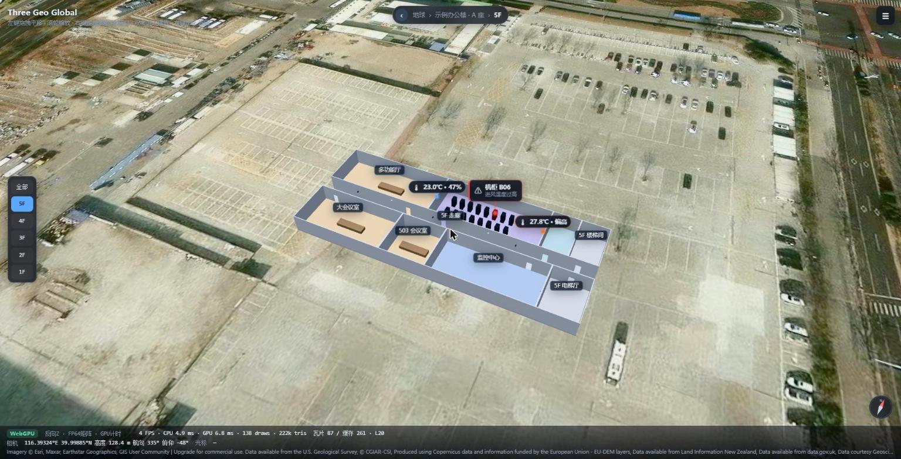
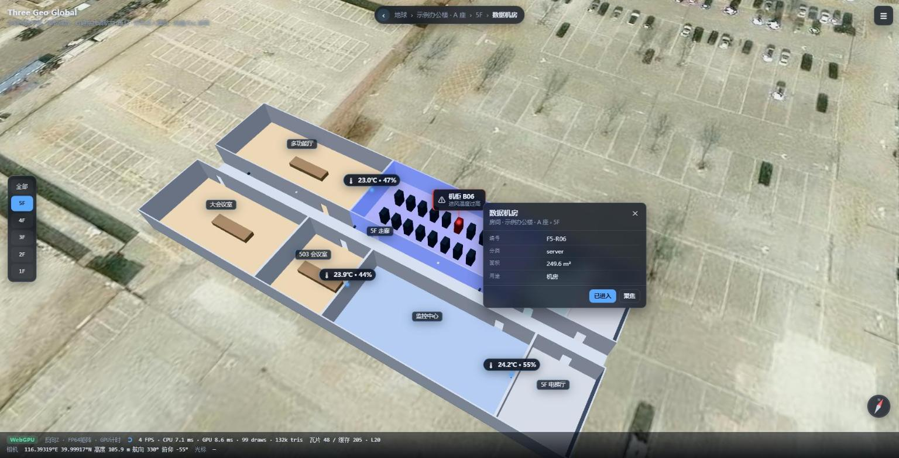
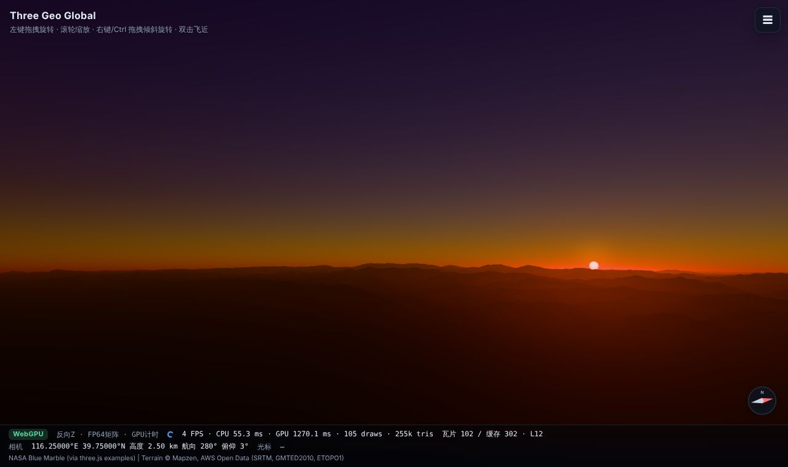
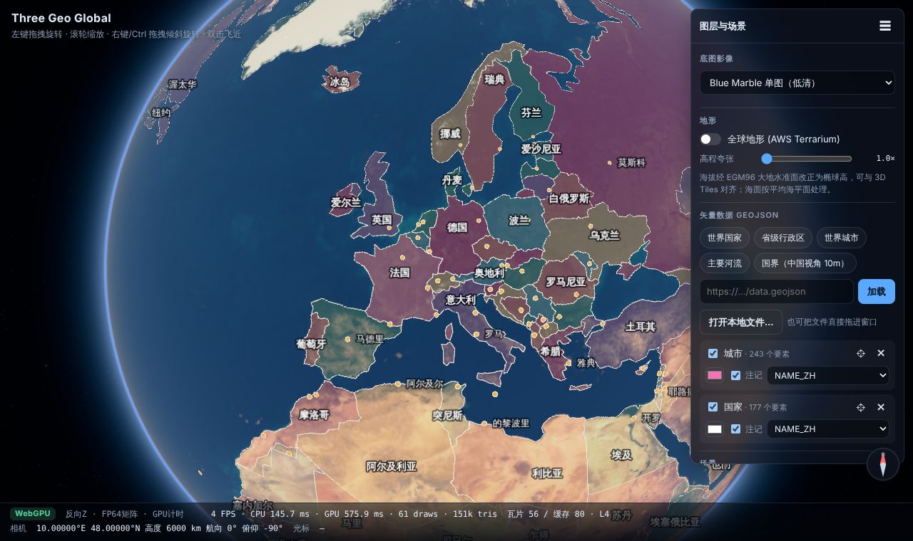

## At a glance

| Indoor floor and markers | Entering a room: highlight, properties and alerts |
| --- | --- |
|  |  |

| Sunset over the Western Hills, Beijing (terrain + atmosphere) | GeoJSON fill colors and label decluttering |
| --- | --- |
|  |  |

These screenshots predate the post-processing pipeline, shadows and volumetric clouds, so the current rendering looks different; for the latest, open the [live demo](https://yoy0o.github.io/TerraView/demo/).

## Three lines to get started

```bash
npm install terra-viewer three@0.187.0 3d-tiles-renderer@0.5.4
```

```ts
import 'terra-viewer/style.css';
import { AWS_TERRARIUM, findImageryPreset, GeoViewer } from 'terra-viewer';

const viewer = await GeoViewer.create({
  container: document.getElementById('map')!,
  imagery: findImageryPreset('esri-imagery')!.create(),
  terrain: AWS_TERRARIUM,
  initialView: { longitude: 116.391, latitude: 39.9, height: 2200, heading: 0, pitch: -38 },
});
```

Next, read [Quick start](/en/guide/getting-started), or pick one of the [examples](https://yoy0o.github.io/TerraView/examples/) and start modifying it.

The full [user manual](/guide/) and [API reference](/api) are currently in Chinese; English versions of the most-used pages are under /en/.

[Support the project](/en/sponsor).
