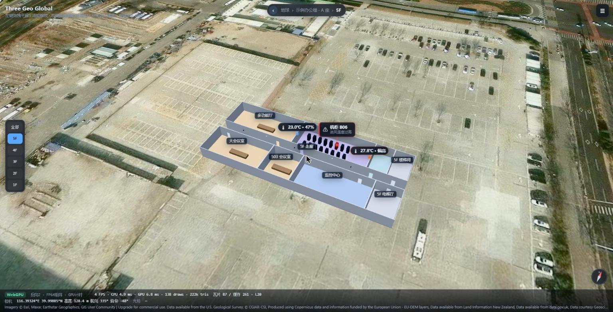
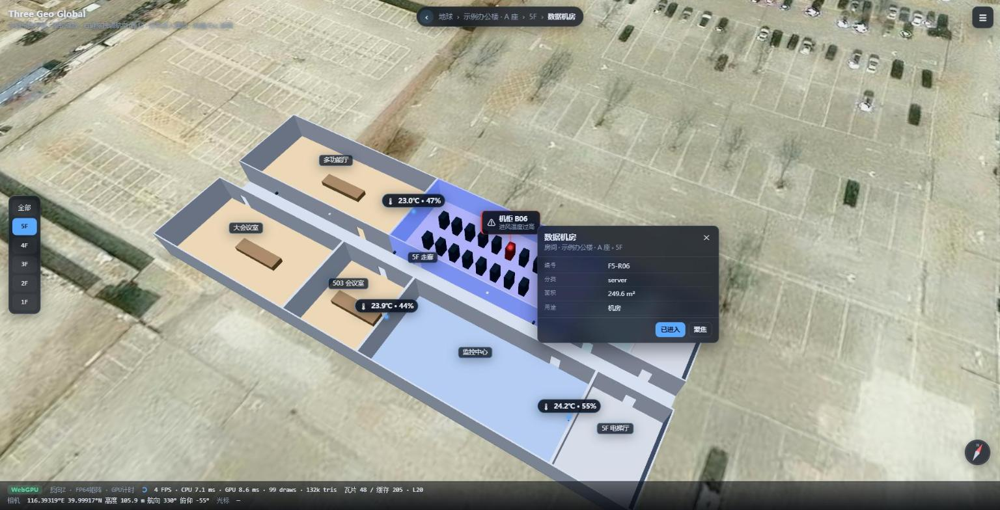
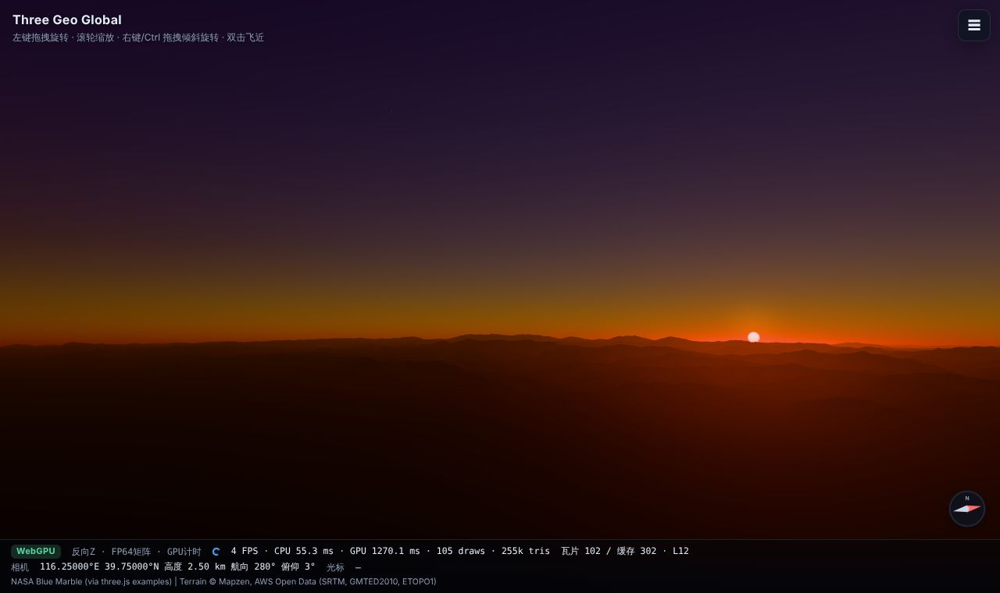
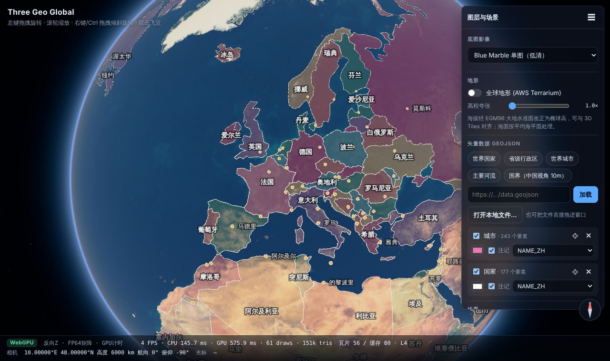

## 先看一眼

| 室内楼层与顶牌 | 进入房间：高亮、属性与告警 |
| --- | --- |
|  |  |

| 北京西山日落（地形 + 大气） | GeoJSON 分色与注记避让 |
| --- | --- |
|  |  |

截图早于后期管线、阴影和体积云，现在的画面会有差别；最新效果请直接打开[在线演示](https://yoy0o.github.io/TerraView/demo/)。

## 三行接入

```bash
npm install terra-viewer three@0.187.0 3d-tiles-renderer@0.5.4
```

```ts
import 'terra-viewer/style.css';
import { AWS_TERRARIUM, findImageryPreset, GeoViewer } from 'terra-viewer';

const viewer = await GeoViewer.create({
  container: document.getElementById('map')!,
  imagery: findImageryPreset('esri-imagery')!.create(),
  terrain: AWS_TERRARIUM,
  initialView: { longitude: 116.391, latitude: 39.9, height: 2200, heading: 0, pitch: -38 },
});
```

接下来读[快速开始](/guide/getting-started)，或者在[示例](https://yoy0o.github.io/TerraView/examples/)里挑一个改起来。

TerraView 免费开源，由个人维护者业余开发。觉得有用的话，欢迎[赞助支持](/sponsor)。English readers: see the [English pages](/en/).
